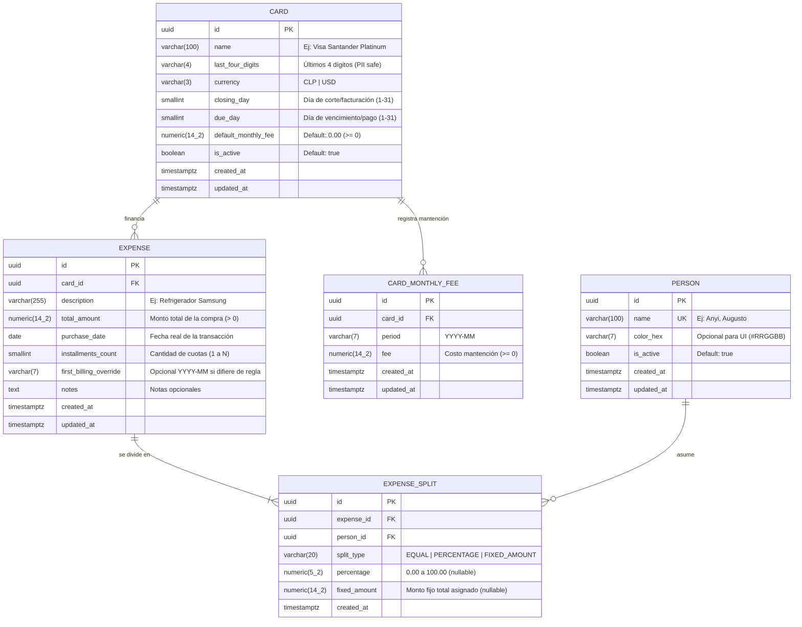

# Constitution — Credit Warrior Backend (System Design Document)

> **Estado:** Aprobado (v1.0)  
> **Proyecto:** `api-credit-warrior`  
> **Rol del Documento:** Fuente única de verdad (Single Source of Truth) para la arquitectura, el modelo de datos, los algoritmos financieros y los contratos de API del backend.

---

## 1. Project Overview

**Credit Warrior Backend** es una API RESTful diseñada para gestionar compras con tarjetas de crédito compartidas, automatizar el cálculo de ciclos de facturación (corte y vencimiento), proyectar tablas de amortización en cuotas **al vuelo (*on-the-fly*)** y dividir gastos (*splits*) entre múltiples personas sin fricción.

### Objetivos Clave del Sistema
1. **Cero redundancia de cuotas en Base de Datos:** Cada compra se almacena como un único **Registro Maestro (`Expense`)**. El backend calcula dinámicamente qué número de cuota ($k$ de $N$) corresponde pagar en cualquier mes consultado.
2. **Precisión Financiera Estricta:** Todos los cálculos monetarios utilizan aritmética de punto fijo (`decimal.Decimal`), eliminando errores de punto flotante (`float`) y resolviendo determinísticamente los residuos de redondeo en divisiones de cuotas y *splits* entre personas.
3. **Conciencia del Ciclo de Facturación:** Cada tarjeta define su día de corte/facturación (`closing_day`) y su día de vencimiento (`due_day`), permitiendo determinar automáticamente en qué estado de cuenta impacta una compra según su fecha de transacción (`purchase_date`).
4. **Enfoque en Proyección y Dashboard:** Proveer endpoints de agregación que respondan de forma inmediata *"¿Cuánto hay que pagar el próximo mes, a qué tarjeta y cuánto le corresponde a cada persona?"* discriminado por moneda (`CLP` y `USD`).

---

## 2. Tech Stack

| Capa / Propósito | Tecnología / Librería | Versión | Justificación Técnica |
| :--- | :--- | :--- | :--- |
| **Lenguaje** | Python | `3.12+` | Tipado moderno (`type` aliases, PEP 695), mejoras de rendimiento y soporte nativo de `Decimal` y `datetime`. |
| **Framework Web** | FastAPI + Uvicorn | `0.115+` | Alto rendimiento ASGI, inyección de dependencias declarativa y generación automática de OpenAPI 3.1. |
| **Base de Datos** | PostgreSQL | `16+` | Soporte robusto para tipos `NUMERIC(p, s)`, integridad referencial transaccional y restricciones `CHECK`. |
| **ORM** | SQLAlchemy | `2.0+` | Sintaxis declarativa tipada (`Mapped`, `mapped_column`), consultas parametrizadas seguras y soporte `async`/`sync`. |
| **Migraciones** | Alembic | `1.13+` | Control de versiones de esquema reproducible y autogeneración de migraciones desde modelos SQLAlchemy 2.0. |
| **Validación y Config** | Pydantic & Pydantic Settings | `2.x` | Validación en Rust (`pydantic-core`), serialización estricta de `Decimal` y carga tipada de variables de entorno. |
| **Driver DB** | `psycopg` (v3) / `asyncpg` | `3.2+` / `0.29+` | Conectores modernos de PostgreSQL compatibles con SQLAlchemy 2.0. |
| **Testing & Linting** | Pytest, HTTPX, Ruff, Mypy | Latest | Pruebas unitarias de algoritmos financieros, tests de integración de endpoints y verificación estática de tipos. |

---

## 3. Database Schema (ERD)

### 3.1 Diagrama Entidad-Relación



### 3.2 Especificación Detallada de Tablas y Modelos

#### Índices Compuestos Canónicos para Optimización (Spec 005)
Para garantizar latencias sub-milisegundo y optimizar los caminos de acceso críticos:
1. `ix_expenses_purchase_date_created_at`: `expenses (purchase_date DESC, created_at DESC)` — Ordenamiento cronológico de compras.
2. `ix_expenses_card_id_purchase_date`: `expenses (card_id, purchase_date)` — Filtrado de compras por tarjeta y ventana temporal.
3. `ix_card_monthly_fees_period_card_id`: `card_monthly_fees (period, card_id)` — Búsqueda agrupada de sobreescrituras de mantención por período.
4. `ix_expense_splits_person_id_expense_id`: `expense_splits (person_id, expense_id)` — Filtrado de particiones y deudas por persona.
5. `ix_cards_is_active_name`: `cards (is_active, name)` — Listado de tarjetas activas ordenadas por nombre.
6. `ix_persons_is_active_name`: `persons (is_active, name)` — Listado de personas activas ordenadas por nombre.

#### A. `cards` (Entidad `Card`)
Representa una tarjeta de crédito y sus reglas de ciclo de facturación.
- `id` (`UUID`, PK, default `uuid4`): Identificador único.
- `name` (`VARCHAR(100)`, `NOT NULL`): Nombre descriptivo (ej. `"CMR Falabella"`, `" Santander WorldMember"`).
- `last_four_digits` (`VARCHAR(4)`, `NULLABLE`): Solo los últimos 4 dígitos para identificación visual. **Nunca** se almacena el PAN completo (cumplimiento de enmascaramiento PII/PCI).
- `currency` (`Enum('CLP', 'USD')`, `NOT NULL`, default `'CLP'`): Moneda principal de facturación de la tarjeta.
- `closing_day` (`SMALLINT`, `NOT NULL`, `CHECK (closing_day BETWEEN 1 AND 31)`): Día del mes en que cierra la facturación (corte).
- `due_day` (`SMALLINT`, `NOT NULL`, `CHECK (due_day BETWEEN 1 AND 31)`): Día del mes en que vence el pago del estado de cuenta.
- `default_monthly_fee` (`NUMERIC(14, 2)`, `NOT NULL`, default `0.00`, `CHECK (default_monthly_fee >= 0)`): Cargo mensual por mantención por defecto de la tarjeta.
- `is_active` (`BOOLEAN`, `NOT NULL`, default `True`): Permite archivar tarjetas sin perder historial.
- `created_at` / `updated_at` (`TIMESTAMPTZ`, `NOT NULL`).

#### B. `persons` (Entidad `Person`)
Funciona como entidad maestra / etiqueta para asignar responsabilidad de pago (sin autenticación en esta etapa).
- `id` (`UUID`, PK, default `uuid4`).
- `name` (`VARCHAR(100)`, `NOT NULL`, `UNIQUE`): Nombre de la persona (ej. `"Anyi"`, `"Augusto"`).
- `color_hex` (`VARCHAR(7)`, `NULLABLE`): Color identificador opcional para el frontend.
- `is_active` (`BOOLEAN`, `NOT NULL`, default `True`).
- `created_at` / `updated_at` (`TIMESTAMPTZ`, `NOT NULL`).

#### C. `expenses` (Entidad `Expense` - Registro Maestro de Compra)
Almacena la compra original una única vez.
- `id` (`UUID`, PK, default `uuid4`).
- `card_id` (`UUID`, `ForeignKey('cards.id', ondelete='RESTRICT')`, `NOT NULL`, `INDEX`).
- `description` (`VARCHAR(255)`, `NOT NULL`): Concepto del gasto.
- `total_amount` (`NUMERIC(14, 2)`, `NOT NULL`, `CHECK (total_amount > 0)`): Monto total de la compra en la moneda de la tarjeta.
- `purchase_date` (`DATE`, `NOT NULL`, `INDEX`): Fecha en que se realizó la compra.
- `installments_count` (`SMALLINT`, `NOT NULL`, default `1`, `CHECK (installments_count >= 1 AND installments_count <= 120)`): Número total de cuotas ($N$).
- `first_billing_override` (`VARCHAR(7)`, `NULLABLE`, formato `'YYYY-MM'`): Permite forzar manualmente el mes de la primera cuota en casos excepcionales (ej. promociones bancarias "compre hoy y pague en 3 meses"). Si es `NULL`, se calcula automáticamente según `purchase_date` y `card.closing_day`.
- `notes` (`TEXT`, `NULLABLE`).
- `created_at` / `updated_at` (`TIMESTAMPTZ`, `NOT NULL`).

#### D. `expense_splits` (Entidad `ExpenseSplit` - Distribución del Gasto)
Define cómo se reparte el costo de un `Expense` entre una o más `Person`.
- `id` (`UUID`, PK, default `uuid4`).
- `expense_id` (`UUID`, `ForeignKey('expenses.id', ondelete='CASCADE')`, `NOT NULL`, `INDEX`).
- `person_id` (`UUID`, `ForeignKey('persons.id', ondelete='RESTRICT')`, `NOT NULL`, `INDEX`).
- `split_type` (`Enum('EQUAL', 'PERCENTAGE', 'FIXED_AMOUNT')`, `NOT NULL`, default `'EQUAL'`).
- `percentage` (`NUMERIC(5, 2)`, `NULLABLE`, `CHECK (percentage > 0 AND percentage <= 100)`): Porcentaje asignado a la persona (ej. `50.00`).
- `fixed_amount` (`NUMERIC(14, 2)`, `NULLABLE`, `CHECK (fixed_amount > 0)`): Monto fijo sobre el `total_amount` asignado a la persona.
- **Constraint Único Compuesto:** `UniqueConstraint('expense_id', 'person_id', name='uq_expense_person')` para evitar duplicar a la misma persona en el mismo gasto.

#### E. `card_monthly_fees` (Entidad `CardMonthlyFee` - Costos de Mantención Específicos por Período)
Almacena cobros de mantención mensuales específicos por período que sobrescriben el valor por defecto de la tarjeta.
- `id` (`UUID`, PK, default `uuid4`).
- `card_id` (`UUID`, `ForeignKey('cards.id', ondelete='CASCADE')`, `NOT NULL`, `INDEX`).
- `period` (`VARCHAR(7)`, `NOT NULL`, formato `'YYYY-MM'`): Mes de facturación al que aplica el costo.
- `fee` (`NUMERIC(14, 2)`, `NOT NULL`, `CHECK (fee >= 0)`): Monto de mantención para dicho período.
- `created_at` / `updated_at` (`TIMESTAMPTZ`, `NOT NULL`).
- **Constraint Único Compuesto:** `UniqueConstraint('card_id', 'period', name='uq_card_monthly_fees_card_period')`.

### 3.3 Referencia de Implementación en SQLAlchemy 2.0

```python
import enum
import uuid
from datetime import date, datetime
from decimal import Decimal
from sqlalchemy import (
    Boolean, CheckConstraint, Date, DateTime, Enum, ForeignKey,
    Numeric, SmallInteger, String, Text, UniqueConstraint, func
)
from sqlalchemy.dialects.postgresql import UUID
from sqlalchemy.orm import DeclarativeBase, Mapped, mapped_column, relationship


class Base(DeclarativeBase):
    pass


class CurrencyEnum(str, enum.Enum):
    CLP = "CLP"
    USD = "USD"


class SplitTypeEnum(str, enum.Enum):
    EQUAL = "EQUAL"
    PERCENTAGE = "PERCENTAGE"
    FIXED_AMOUNT = "FIXED_AMOUNT"


class FeeSourceEnum(str, enum.Enum):
    CARD_DEFAULT = "CARD_DEFAULT"
    OVERRIDE = "OVERRIDE"


class Card(Base):
    __tablename__ = "cards"
    __table_args__ = (
        CheckConstraint("closing_day BETWEEN 1 AND 31", name="ck_cards_closing_day"),
        CheckConstraint("due_day BETWEEN 1 AND 31", name="ck_cards_due_day"),
        CheckConstraint("default_monthly_fee >= 0", name="ck_cards_default_monthly_fee_non_negative"),
    )

    id: Mapped[uuid.UUID] = mapped_column(UUID(as_uuid=True), primary_key=True, default=uuid.uuid4)
    name: Mapped[str] = mapped_column(String(100), nullable=False)
    last_four_digits: Mapped[str | None] = mapped_column(String(4), nullable=True)
    currency: Mapped[CurrencyEnum] = mapped_column(Enum(CurrencyEnum), default=CurrencyEnum.CLP, nullable=False)
    closing_day: Mapped[int] = mapped_column(SmallInteger, nullable=False)
    due_day: Mapped[int] = mapped_column(SmallInteger, nullable=False)
    default_monthly_fee: Mapped[Decimal] = mapped_column(Numeric(14, 2), default=Decimal("0"), nullable=False)
    is_active: Mapped[bool] = mapped_column(Boolean, default=True, nullable=False)
    created_at: Mapped[datetime] = mapped_column(DateTime(timezone=True), server_default=func.now())
    updated_at: Mapped[datetime] = mapped_column(DateTime(timezone=True), server_default=func.now(), onupdate=func.now())

    expenses: Mapped[list["Expense"]] = relationship(back_populates="card")
    monthly_fees: Mapped[list["CardMonthlyFee"]] = relationship(back_populates="card", cascade="all, delete-orphan")


class CardMonthlyFee(Base):
    __tablename__ = "card_monthly_fees"
    __table_args__ = (
        UniqueConstraint("card_id", "period", name="uq_card_monthly_fees_card_period"),
        CheckConstraint("fee >= 0", name="ck_card_monthly_fees_fee_non_negative"),
    )

    id: Mapped[uuid.UUID] = mapped_column(UUID(as_uuid=True), primary_key=True, default=uuid.uuid4)
    card_id: Mapped[uuid.UUID] = mapped_column(UUID(as_uuid=True), ForeignKey("cards.id", ondelete="CASCADE"), nullable=False, index=True)
    period: Mapped[str] = mapped_column(String(7), nullable=False)
    fee: Mapped[Decimal] = mapped_column(Numeric(14, 2), nullable=False)
    created_at: Mapped[datetime] = mapped_column(DateTime(timezone=True), server_default=func.now())
    updated_at: Mapped[datetime] = mapped_column(DateTime(timezone=True), server_default=func.now(), onupdate=func.now())

    card: Mapped["Card"] = relationship(back_populates="monthly_fees")
```

---

## 4. Business Logic & Algorithms

Toda la lógica financiera debe residir en servicios de dominio puros (`app/services/billing_engine.py`), desacoplados de HTTP y fáciles de probar unitariamente recibiendo la fecha de referencia (`reference_date`) como parámetro explícito.

### 4.1 Algoritmo de Ciclo de Facturación y Período de Pago

En las tarjetas de crédito existen dos hitos mensuales:
1. **Fecha de Corte / Facturación (`closing_day`):** Día en que se cierra el estado de cuenta.
2. **Fecha de Vencimiento (`due_day`):** Día en que se debe pagar ese estado de cuenta.

#### Paso 1: Determinación del Mes de Facturación de la Cuota 1 (`first_statement_period`)
Dada una compra realizada en `purchase_date` sobre una tarjeta con `closing_day`:
- Para manejar meses con menos de 31 días (ej. febrero 28/29 o meses de 30 días), el día efectivo de corte de un mes $(Y, M)$ es:
  $$\text{effective\_closing\_day}(Y, M) = \min(\text{card.closing\_day}, \text{days\_in\_month}(Y, M))$$
- **Regla de Corte:**
  - Si `purchase_date.day <= effective_closing_day(purchase_date.year, purchase_date.month)`:
    La compra entra en el estado de cuenta que cierra en el **mismo mes** de la compra:
    $$P_{\text{corte}, 1} = (\text{purchase\_date.year}, \text{purchase\_date.month})$$
  - Si `purchase_date.day > effective_closing_day(purchase_date.year, purchase_date.month)`:
    La compra se realizó después del corte, por lo que su primera cuota entra en el estado de cuenta que cierra el **mes siguiente**:
    $$P_{\text{corte}, 1} = \text{add\_months}((\text{purchase\_date.year}, \text{purchase\_date.month}), +1)$$

#### Paso 2: Relación entre Estado de Cuenta (`statement_period`) y Mes de Pago (`payment_period`)
Un estado de cuenta que cierra en el mes $P_{\text{corte}} = (Y_c, M_c)$ se paga en la fecha de vencimiento (`due_day`):
- **Caso A (`card.due_day > card.closing_day`):** El pago vence dentro del **mismo mes calendario** en que cerró la facturación (ej. corta el día 5, vence el día 20 del mismo mes).
  $$P_{\text{pago}, 1} = P_{\text{corte}, 1}$$
- **Caso B (`card.due_day <= card.closing_day`):** El pago vence en el **mes calendario siguiente** al cierre (ej. corta el día 25 de octubre, vence el día 10 de noviembre).
  $$P_{\text{pago}, 1} = \text{add\_months}(P_{\text{corte}, 1}, +1)$$

> **Nota sobre `first_billing_override`:** Si el usuario define `first_billing_override = "YYYY-MM"`, dicho valor define directamente $P_{\text{pago}, 1}$, omitiendo el cálculo automático.

---

### 4.2 Cálculo de Cuotas "Al Vuelo" (*On-the-Fly Amortization*)

No se insertan registros por cada cuota en la base de datos. Para saber si un `Expense` tiene una cuota activa en un período de pago consultado $P_{\text{target}} = (Y_t, M_t)$:

1. **Cálculo del Índice de Cuota ($k$):**
   Sea $P_{\text{pago}, 1} = (Y_1, M_1)$ el período de pago de la primera cuota y $N = \text{installments\_count}$:
   $$k = (Y_t - Y_1) \times 12 + (M_t - M_1) + 1$$
2. **Condición de Vigencia:**
   - Si $k < 1$: La primera cuota aún no comienza a cobrarse en $P_{\text{target}}$ (compra futura o diferida).
   - Si $k > N$: La compra ya fue pagada en su totalidad antes de $P_{\text{target}}$.
   - Si $1 \le k \le N$: **La compra tiene activa la cuota $k$ de $N$ en el período $P_{\text{target}}$.**

3. **Cálculo Exacto del Monto de la Cuota $k$ (Manejo de Residuo por Redondeo):**
   - La unidad mínima de redondeo (`quantum`) depende de la moneda de la tarjeta:
     - `CLP`: `Decimal("1")` (sin centavos en facturación estándar chilena) o `Decimal("0.01")` según configuración. Por convención financiera local: `CLP -> Decimal("1")`, `USD -> Decimal("0.01")`.
   - Cuota base truncada/redondeada hacia abajo:
     $$\text{base\_installment} = \text{quantize\_floor}\left(\frac{\text{total\_amount}}{N}, \text{quantum}\right)$$
   - Residuo acumulado:
     $$\text{remainder} = \text{total\_amount} - (\text{base\_installment} \times N)$$
   - Asignación a la primera cuota ($k = 1$), igualando la práctica bancaria estándar:
     $$\text{installment\_amount}(k) = \begin{cases} \text{base\_installment} + \text{remainder} & \text{si } k = 1 \\ \text{base\_installment} & \text{si } 2 \le k \le N \end{cases}$$
   - **Invariante garantizada:** $\sum_{k=1}^{N} \text{installment\_amount}(k) \equiv \text{total\_amount}$.

---

### 4.3 Algoritmo de Distribución del Gasto (*Splits*)

Cada `Expense` tiene entre $1$ y $M$ registros en `ExpenseSplit`. Al momento de crear o editar un gasto:
- **Regla por defecto (50/50 o partes iguales):** Si se envían $M$ personas (por ejemplo, Anyi y Augusto) con `split_type = "EQUAL"`, cada una recibe una proporción de $1/M$ (50% y 50% para 2 personas).
- **Modo `PERCENTAGE`:** La suma de `percentage` de todos los splits del gasto debe ser exactamente `Decimal("100.00")`.
- **Modo `FIXED_AMOUNT`:** La suma de `fixed_amount` de todos los splits del gasto debe ser exactamente igual a `expense.total_amount`.

#### Prorrateo de la Cuota Mensual $\text{installment\_amount}(k)$ por Persona
Dado el monto de la cuota del mes $C_k = \text{installment\_amount}(k)$ y la lista ordenada de splits $[s_1, s_2, \dots, s_M]$:
1. Para cada split $s_i$, se determina su peso proporcional $w_i \in (0, 1]$:
   - `EQUAL`: $w_i = \frac{1}{M}$
   - `PERCENTAGE`: $w_i = \frac{s_i.\text{percentage}}{100}$
   - `FIXED_AMOUNT`: $w_i = \frac{s_i.\text{fixed\_amount}}{\text{expense.total\_amount}}$
2. Para $i = 1, \dots, M-1$:
   $$\text{share}_i = \text{quantize\_half\_up}(C_k \times w_i, \text{quantum})$$
3. Para el último participante $M$ (absorción del residuo de centavo/peso):
   $$\text{share}_M = C_k - \sum_{i=1}^{M-1} \text{share}_i$$
- **Invariante garantizada:** La suma de lo que pagan las personas en el mes $k$ cuadra al 100% con el valor de la cuota $C_k$ cobrada por la tarjeta.

---

### 4.4 Algoritmo de Costo de Mantención y Reparto Dinámico

Cada tarjeta de crédito puede incurrir en costos de mantención o administración mensual (`Card.default_monthly_fee` o tarifas específicas en `CardMonthlyFee`). El motor financiero aplica las siguientes reglas de negocio deterministas:

1. **Regla de Activación por Uso:**
   - La mantención mensual se aplica únicamente si la tarjeta está activa (`card.is_active is True`) **Y** posee al menos una cuota de compra activa en dicho período de pago ($k \in [1, N]$).
   - Si una tarjeta no posee compras vigentes en el mes (o `card.is_active is False`), su costo de mantención para dicho período es estrictamente `$0.00` (`Decimal("0")`).

2. **Resolución de Tarifa (`resolve_card_monthly_fee`):**
   - Si existe un registro específico en `card_monthly_fees` para el par `(card_id, period)`, se utiliza su valor (`source = "OVERRIDE"`).
   - Si no existe override para ese período, se utiliza `card.default_monthly_fee` (`source = "CARD_DEFAULT"`).

3. **Reparto Equitativo entre Participantes Activos (`prorate_maintenance_fee`):**
   - El costo total de mantención $M$ de la tarjeta se distribuye a partes iguales entre los $P$ participantes únicos que tienen al menos una cuota activa en esa tarjeta en ese período (incluyendo personas con `is_active = False` que tengan compromisos vigentes).
   - Para garantizar determinismo en el reparto monetario y absorción de residuo:
     1. Los participantes se ordenan de forma ascendente por su identificador UUID: $[p_1, p_2, \dots, p_P]$.
     2. Se calcula la cuota base truncada:
        $$\text{base\_share} = \text{quantize\_floor}\left(\frac{M}{P}, \text{quantum}\right)$$
     3. Para los primeros $P-1$ participantes ($i = 1, \dots, P-1$):
        $$\text{share}_i = \text{base\_share}$$
     4. El último participante $P$ absorbe el residuo:
        $$\text{share}_P = M - \sum_{i=1}^{P-1} \text{share}_i = M - (\text{base\_share} \times (P - 1))$$
     5. Siendo $M \ge 0$, se garantiza: $\text{share}_P \ge \text{base\_share} \ge 0$ y $\sum_{i=1}^{P} \text{share}_i \equiv M$.

4. **Proyecciones Financieras Multi-Mes:**
   - En `GET /api/v1/dashboard/projection`, cada mes proyectado aplica el costo de mantención resuelto mientras existan cuotas vigentes.
   - En el instante en que todas las compras de una tarjeta se amortizan completamente, la mantención proyectada pasa automáticamente a `$0.00`.

---

## 5. API Endpoints

Todos los endpoints siguen convenciones RESTful bajo el prefijo `/api/v1` y devuelven respuestas JSON estructuradas.

### 5.1 Tarjetas (`Cards`)
| Método | Endpoint | Descripción |
| :--- | :--- | :--- |
| `GET` | `/api/v1/cards` | Lista todas las tarjetas (filtrable por `is_active`, `currency`). |
| `POST` | `/api/v1/cards` | Crea una nueva tarjeta con su `closing_day`, `due_day`, `currency` y `default_monthly_fee`. |
| `GET` | `/api/v1/cards/{card_id}` | Obtiene el detalle de una tarjeta y su próximo ciclo de corte/vencimiento. |
| `PATCH` | `/api/v1/cards/{card_id}` | Actualiza nombre, días de ciclo, estado `is_active` o `default_monthly_fee`. |
| `DELETE` | `/api/v1/cards/{card_id}` | Baja lógica (`is_active=false`) o física si no posee compras asociadas. |

### 5.2 Mantención de Tarjetas (`Card Fees`)
| Método | Endpoint | Descripción |
| :--- | :--- | :--- |
| `GET` | `/api/v1/cards/{card_id}/fees` | Lista todos los overrides de mantención registrados para la tarjeta, ordenados ascendentemente por período (`YYYY-MM`). |
| `GET` | `/api/v1/cards/{card_id}/fees/{period}` | Obtiene el costo de mantención aplicable para el período especificado, indicando el origen (`source="OVERRIDE"` o `"CARD_DEFAULT"`). |
| `PUT` | `/api/v1/cards/{card_id}/fees/{period}` | Crea o actualiza de forma idempotente el costo de mantención (*override*) para el período (`YYYY-MM`). Retorna `200 OK`. |
| `DELETE` | `/api/v1/cards/{card_id}/fees/{period}` | Elimina el override de mantención para dicho período y restaura la tarifa por defecto de la tarjeta. Retorna `204 No Content` (o `404 Not Found` si no existía override). |

### 5.3 Personas (`Persons`)
| Método | Endpoint | Descripción |
| :--- | :--- | :--- |
| `GET` | `/api/v1/persons` | Lista las personas registradas (ej. Anyi, Augusto). |
| `POST` | `/api/v1/persons` | Registra una nueva persona/etiqueta. |
| `PATCH` | `/api/v1/persons/{person_id}` | Modifica nombre, color o estado activo de una persona. |
| `DELETE` | `/api/v1/persons/{person_id}` | Desactiva o elimina una persona sin deudas asociadas. |

### 5.4 Compras Maestras y Splits (`Expenses`)
| Método | Endpoint | Descripción |
| :--- | :--- | :--- |
| `GET` | `/api/v1/expenses` | Lista compras maestras (filtros: `card_id`, `person_id`, `date_from`, `date_to`, `active_in_period=YYYY-MM`). |
| `POST` | `/api/v1/expenses` | Crea un registro maestro de compra junto con sus `splits` en una única transacción atómica. |
| `GET` | `/api/v1/expenses/{expense_id}` | Obtiene el detalle de la compra, sus splits y el resumen de cuotas. |
| `PUT` | `/api/v1/expenses/{expense_id}` | Actualiza los datos de la compra y reemplaza/actualiza su distribución (`splits`). |
| `DELETE` | `/api/v1/expenses/{expense_id}` | Elimina el registro maestro de compra y sus splits en cascada. |
| `GET` | `/api/v1/expenses/{expense_id}/schedule` | **Tabla de Amortización al Vuelo:** Devuelve las $N$ cuotas proyectadas mes a mes con su desglose por persona. |

#### Ejemplo de Payload `POST /api/v1/expenses`
```json
{
  "card_id": "8f14e45f-ceea-467a-9a18-4b78c2d81e11",
  "description": "Aspiradora Robot",
  "total_amount": "300000",
  "purchase_date": "2026-10-16",
  "installments_count": 3,
  "splits": [
    {
      "person_id": "11111111-2222-3333-4444-555555555551",
      "split_type": "EQUAL"
    },
    {
      "person_id": "11111111-2222-3333-4444-555555555552",
      "split_type": "EQUAL"
    }
  ]
}
```

### 5.5 Dashboard y Proyecciones Financieras (`Dashboard`)
| Método | Endpoint | Descripción |
| :--- | :--- | :--- |
| `GET` | `/api/v1/dashboard/summary` | **Resumen de Pago Mensual:** Recibe `?period=YYYY-MM` (si se omite, calcula automáticamente el **próximo mes calendario**). Devuelve totales por moneda, por tarjeta (con `purchases_total`, `maintenance_fee`, `total_due`), por persona (con `purchases_amount`, `fee_share`, `amount_due`) y la lista de cuotas activas de compras de ese mes. |
| `GET` | `/api/v1/dashboard/projection` | **Proyección Multi-Mes:** Recibe `?start_period=YYYY-MM&months=6`. Proyecta la evolución del pago mensual durante los próximos $M$ meses agrupado por tarjeta y por persona, extinguiendo la mantención a `$0` al terminar las cuotas. |

#### Ejemplo de Respuesta `GET /api/v1/dashboard/summary?period=2026-11`
```json
{
  "period": "2026-11",
  "totals_by_currency": {
    "CLP": "450000",
    "USD": "35.50"
  },
  "by_card": [
    {
      "card_id": "8f14e45f-ceea-467a-9a18-4b78c2d81e11",
      "card_name": "Visa Santander",
      "currency": "CLP",
      "closing_date": "2026-10-25",
      "due_date": "2026-11-10",
      "purchases_total": "445000",
      "maintenance_fee": "5000",
      "total_due": "450000",
      "by_person": [
        { "person_id": "...551", "person_name": "Anyi", "purchases_amount": "220000", "fee_share": "2500", "amount_due": "222500" },
        { "person_id": "...552", "person_name": "Augusto", "purchases_amount": "225000", "fee_share": "2500", "amount_due": "227500" }
      ]
    }
  ],
  "by_person": [
    {
      "person_id": "...551",
      "person_name": "Anyi",
      "totals_by_currency": { "CLP": "222500", "USD": "17.75" }
    },
    {
      "person_id": "...552",
      "person_name": "Augusto",
      "totals_by_currency": { "CLP": "227500", "USD": "17.75" }
    }
  ],
  "active_installments": [
    {
      "expense_id": "9a8b7c6d-1234-5678-9abc-def012345678",
      "description": "Aspiradora Robot",
      "card_name": "Visa Santander",
      "currency": "CLP",
      "purchase_date": "2026-10-16",
      "installment_number": 1,
      "installments_count": 3,
      "installment_label": "1/3",
      "installment_amount": "100000",
      "person_shares": [
        { "person_name": "Anyi", "amount": "50000" },
        { "person_name": "Augusto", "amount": "50000" }
      ]
    }
  ]
}
```

---

## 6. Project Structure

El proyecto sigue una arquitectura limpia en capas (*Layered Clean Architecture*), separando las rutas HTTP (`api`), la validación de esquemas (`schemas`), la lógica financiera pura (`services`), el acceso a datos (`repositories`) y los modelos ORM (`models`).

```text
api-credit-warrior/
├── alembic/                        # Migraciones de base de datos
│   ├── versions/                   # Scripts de versión autogenerados y revisados
│   ├── env.py                      # Configuración de Alembic con SQLAlchemy 2.0
│   └── script.py.mako
├── app/
│   ├── __init__.py
│   ├── main.py                     # Punto de entrada FastAPI, middlewares, CORS y healthcheck
│   ├── core/
│   │   ├── __init__.py
│   │   ├── config.py               # Variables de entorno tipadas con Pydantic Settings
│   │   ├── database.py             # Engine de SQLAlchemy 2.0 y generador get_db (Session)
│   │   ├── exceptions.py           # Manejadores globales de errores (sin filtrar trazas SQL)
│   │   └── security.py             # Headers de seguridad HTTP, CORS estricto y TODO(security)
│   ├── models/                     # Modelos ORM SQLAlchemy 2.0
│   │   ├── __init__.py
│   │   ├── base.py
│   │   ├── card.py
│   │   ├── card_monthly_fee.py     # Entidad CardMonthlyFee y FeeSourceEnum
│   │   ├── person.py
│   │   └── expense.py              # Incluye Expense y ExpenseSplit
│   ├── schemas/                    # Esquemas Pydantic V2 (Request / Response DTOs)
│   │   ├── __init__.py
│   │   ├── card.py
│   │   ├── card_fee.py             # Esquemas CardMonthlyFeeCreateOrUpdate y Response
│   │   ├── person.py
│   │   ├── expense.py
│   │   └── dashboard.py
│   ├── repositories/               # Capa de persistencia (consultas SQLAlchemy parametrizadas)
│   │   ├── __init__.py
│   │   ├── card_repo.py
│   │   ├── card_fee_repo.py        # Repositorio de CardMonthlyFee
│   │   ├── person_repo.py
│   │   └── expense_repo.py
│   ├── services/                   # Lógica de negocio y algoritmos financieros puros
│   │   ├── __init__.py
│   │   ├── billing_engine.py       # Cálculo de ciclos, cuotas, splits y prorrateo de mantención
│   │   ├── card_fee_service.py     # Ciclo de vida y orquestación de tarifas de mantención
│   │   ├── expense_service.py      # Orquestación y validación de invariantes de negocio
│   │   └── dashboard_service.py    # Agregaciones por período, tarjeta, persona y mantención
│   └── api/
│       ├── __init__.py
│       ├── deps.py                 # Dependencias inyectables (DB session, servicios)
│       └── v1/
│           ├── __init__.py
│           ├── router.py           # Enrutador maestro v1
│           └── endpoints/
│               ├── cards.py
│               ├── card_fees.py    # Endpoints REST para costos de mantención
│               ├── persons.py
│               ├── expenses.py
│               └── dashboard.py
├── scripts/
│   └── dump_openapi.py             # Script de exportación automática de openapi.json
├── tests/                          # Suite de pruebas automatizadas (Pytest)
│   ├── conftest.py                 # Fixtures de DB aislada y TestClient (localhost)
│   ├── unit/
│   │   ├── test_billing_engine.py  # Tests exhaustivos de fechas de corte, bisiestos y redondeos
│   │   └── test_splits.py          # Tests de distribución 50/50, porcentajes y montos fijos
│   └── integration/
│       ├── test_expenses_api.py
│       └── test_dashboard_api.py
├── .env.example                    # Plantilla de variables de entorno (sin secretos reales)
├── alembic.ini                     # Configuración raíz de Alembic
├── pyproject.toml                  # Dependencias, configuración de Ruff, Pytest y Mypy
└── constitution.md                 # Este documento (System Design Document)
```

---

## 7. Security, Data Integrity & Verification Guidelines

Aunque el alcance inicial (MVP) prescinde de autenticación de usuarios, el diseño e implementación del backend **debe** cumplir estrictamente los siguientes lineamientos de seguridad y calidad:

1. **Prevención de SQL Injection (SQLi):**
   - **PROHIBIDO** concatenar strings para construir consultas SQL.
   - Todas las consultas deben ejecutarse mediante expresiones tipadas de SQLAlchemy 2.0 (`select()`, `where()`) con parámetros enlazados (*bound parameters*).
2. **Validación Estricta de Entrada (Pydantic V2):**
   - Validar rangos numéricos (`closing_day` y `due_day` entre 1 y 31, `installments_count` entre 1 y 120, `total_amount > 0`).
   - Rechazar campos desconocidos en los payloads (`model_config = ConfigDict(extra="forbid")`).
3. **Protección de Datos Sensibles (PII / PCI):**
   - Nunca almacenar ni solicitar números completos de tarjetas de crédito (PAN), códigos CVV ni fechas de expiración de plásticos. El campo `last_four_digits` está restringido por expresión regular a `^\d{4}$`.
4. **Manejo Seguro de Errores y Secretos:**
   - Las credenciales de base de datos (`DATABASE_URL`) se cargan exclusivamente desde variables de entorno vía `pydantic-settings`. Nunca hardcodear credenciales ni secretos en el código fuente.
   - Los manejadores de excepciones (`app/core/exceptions.py`) deben retornar mensajes de error genéricos y estructurados al cliente sin exponer trazas internas ni errores crudos de PostgreSQL/SQLAlchemy.
5. **Seguridad de Red, Cabeceras HTTP y Entorno de Pruebas:**
   - En desarrollo local y ejecución de tests automatizados, tanto el servidor Uvicorn como la base de datos de pruebas **deben** escuchar únicamente en `127.0.0.1` (`localhost`), nunca en `0.0.0.0`.
   - Configurar `CORSMiddleware` con una lista explícita de orígenes permitidos (`ALLOWED_ORIGINS`), prohibiendo el uso de `allow_origins=["*"]` en producción.
   - Incluir cabeceras de seguridad por defecto en las respuestas: `X-Content-Type-Options: nosniff`, `X-Frame-Options: DENY` y `Cache-Control: no-store`.
6. **Autenticación y Autorización Diferidas (`TODO(security)`):**
   - Por definición funcional del MVP, las entidades `Person` operan como etiquetas maestras sin login.
   - En `app/core/security.py` y `app/api/deps.py` se debe documentar explícitamente con comentarios `# TODO(security): Implementar autenticación OAuth2/JWT (o cookies __Host- HttpOnly + CSRF), MFA opcional y rate limiting por IP/usuario antes de exponer la API fuera de una red local de confianza.`

---

## 8. Performance, Resilience and Operational Contracts (Spec 005)

### 8.1 Cota Estricta de Consultas SQL en Proyecciones Multi-Mes ($\le 5$ Queries)
- **Problema N+1 Eliminado:** Para horizontes de proyección entre 1 y 24 meses (`/api/v1/dashboard/projection`), el sistema precarga el grafo completo de compras mediante `selectinload` (4 consultas SQL fijas) y las tarifas de mantención del rango de períodos (`WHERE period IN (...)`, 1 consulta SQL).
- **Cota Invariante:** La ejecución nunca excede **5 consultas SQL físicas**, garantizando complejidad $O(1)$ en accesos a base de datos independiente de $M$.

### 8.2 Gestión y Resiliencia del Pool de Conexiones
- **Parametrización con Fail-Fast:** `DB_POOL_SIZE >= 1` (default 10), `DB_MAX_OVERFLOW >= 0` (default 20), `DB_POOL_RECYCLE >= 1` (default 1800s), `DB_POOL_TIMEOUT >= 1` (default 30s) y `pool_pre_ping = True`.
- **Compatibilidad SQLite:** En desarrollo local o tests bajo SQLite, se omiten automáticamente los parámetros no soportados (`pool_size`, `max_overflow`).
- **Manejo de Saturación (503 Service Unavailable):** Si el pool se satura y se excede el timeout (`sqlalchemy.exc.TimeoutError`), el manejador global responde con HTTP 503 y `{"detail": "Database connection pool saturated. Service temporarily unavailable."}` sin filtrar trazas internas.

### 8.3 Compresión HTTP Adaptativa (GZip) y Negociación de Contenido
- **Middleware Global:** `ContentNegotiatedGZipMiddleware(minimum_size=1000)` registrado antes de middlewares de cabeceras para preservar la evaluación de tamaño.
- **Negociación RFC 9110:** Respuestas $\ge 1000$ bytes se comprimen con GZip si el cliente envía `Accept-Encoding: gzip` con $q > 0$. Si el cliente indica rechazo explícito (`gzip;q=0`), omite compresión o el cuerpo es $< 1000$ bytes, la respuesta se entrega en texto plano.

