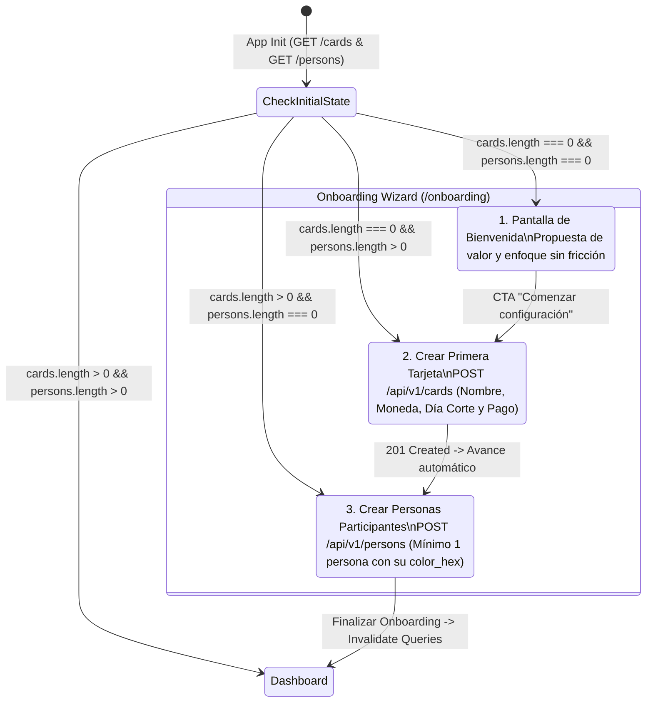
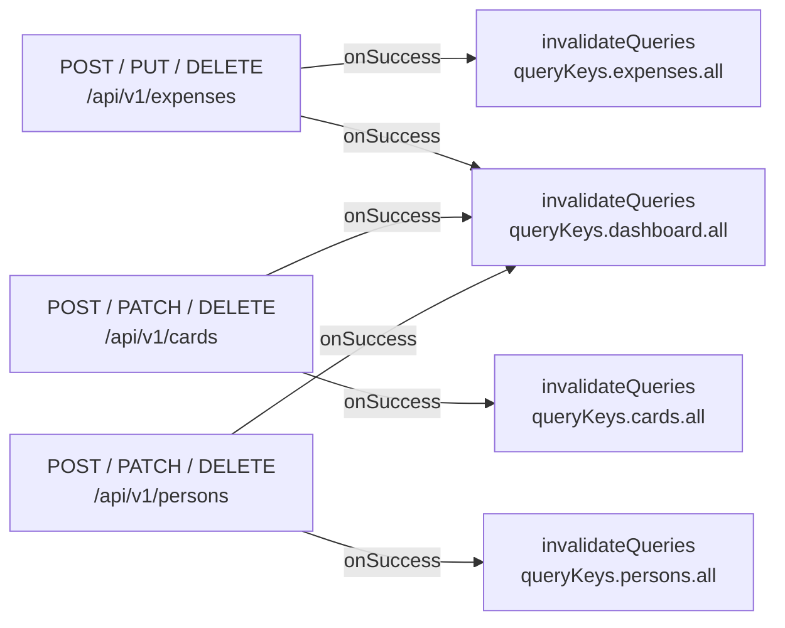

# Constitution — Credit Warrior Web (`web-credit-warrior`)
**System Design Document (SDD) & Architectural Blueprint**

---

## 1. Project Overview

**Credit Warrior Web** (`web-credit-warrior`) es la aplicación frontend para `api-credit-warrior`, diseñada para gestionar compras con tarjetas de crédito compartidas, visualizar cronogramas de amortización en cuotas y transparentar cuánto debe pagar cada participante mes a mes en múltiples monedas (`CLP` y `USD`).

### Principios Fundacionales

1. **Capa de Presentación Pura (Zero Financial Math on Client):**
   El frontend **jamás** calcula fechas de facturación, cortes, vencimientos, valores de cuota, ni absorción de residuos de redondeo. Toda la aritmética financiera y la tabla de amortización al vuelo (*on-the-fly*) provienen exclusivamente del backend (`api-credit-warrior`).
2. **Inmutabilidad y Precisión Monetaria Basada en Strings:**
   Para erradicar errores de coma flotante IEEE 754 en JavaScript (`0.1 + 0.2 !== 0.3`), todos los montos monetarios y porcentajes (`total_amount`, `installment_amount`, `amount_due`, `percentage`, `fixed_amount`) se almacenan, validan, transmiten y reciben estrictamente como `string` numéricos (`"100000"` para `CLP`, `"33.34"` para `USD`). El formateo visual (`Intl.NumberFormat`) ocurre únicamente en el último milisegundo del renderizado.
3. **Enfoque Mobile-First & Progressive Web App (PWA):**
   Registrar un gasto compartido suele ocurrir en el punto de venta o inmediatamente después de una compra desde el teléfono móvil. La aplicación se diseña con ergonomía táctil (*thumb-zone navigation*), soporte de instalación nativa en iOS/Android mediante Web App Manifest (`manifest.ts`) y Service Worker, apertura en modo `standalone` sin barra de direcciones y carga instantánea.
4. **Sin Autenticación en el MVP:**
   No existen pantallas de login ni cabeceras `Authorization` en esta fase. Los participantes del sistema son entidades maestras `Person` administradas directamente en la plataforma.

---

## 2. Tech Stack & Libraries

| Categoría | Tecnología / Librería | Justificación Arquitectónica |
| :--- | :--- | :--- |
| **Framework Core** | **Next.js 15 (App Router)** + React 19 + TypeScript 5 | Arquitectura híbrida con layouts anidados, soporte nativo para generación de `manifest.webmanifest`, optimización de fuentes (`next/font`) y tipado estricto extremo a extremo. |
| **Estilos & Sistema UI** | **Tailwind CSS v4 + shadcn/ui (Radix UI)** | Primitivas accesibles (WAI-ARIA), componibles y sin bloqueo de estilos. Permite construir una interfaz **Dark Mode First** de alta precisión visual sin sobrecarga de CSS en runtime. |
| **Data Fetching & Caché** | **TanStack Query v5 (`@tanstack/react-query`)** | Sincronización declarativa del estado del servidor, invalidación automática en cascada tras mutaciones (ej. actualizar Dashboard al crear un gasto), actualizaciones optimistas y deduplicación de requests. |
| **Formularios & Validación** | **React Hook Form + Zod (`@hookform/resolvers`)** | Renderizado de formularios sin re-renders innecesarios y validación de esquemas estrictos (`z.object().strict()`) que garantizan cumplimiento 100% con Pydantic V2 (`extra="forbid"`) antes de tocar la red. |
| **Visualización de Datos** | **Recharts** (vía `shadcn/ui charts`) | Gráficos responsivos basados en SVG para la proyección financiera a 6–24 meses, ligeros y personalizables mediante variables CSS del tema oscuro. |
| **Iconografía & Feedback** | **Lucide React + Sonner + Vaul** | Iconografía consistente de trazo limpio (`lucide-react`), notificaciones toast no bloqueantes (`sonner`) y drawers nativos con física táctil (`vaul`) ideales para dispositivos móviles. |
| **Capacidades PWA** | **`@serwist/next` + `app/manifest.ts`** | Evolución moderna de Workbox para Next.js 15 App Router. Gestiona el caché del App Shell estático y permite instalar la app en la pantalla de inicio con experiencia nativa. |

---

## 3. UX/UI & Navigation Flow

### 3.1 Dirección Estética & Sistema de Tokens (Dark Mode First)

El diseño evita los clichés genéricos de plantillas SaaS y adopta una estética inspirada en **banca privada contemporánea y terminales financieras de precisión**: superficies de obsidiana profunda, bordes de 1px con luminancia sutil, jerarquía tipográfica marcada y uso intencional del color únicamente para codificar divisas, estados de vencimiento e identidad de participantes.

#### Paleta de Colores Base (Tokens Semánticos)

| Token | Hex | Rol en la Interfaz |
| :--- | :--- | :--- |
| `--bg-canvas` | `#090A0F` | Fondo principal de la aplicación (Obsidian Ink). Evita el negro puro `#000000` para reducir fatiga visual OLED. |
| `--bg-surface` | `#12141C` | Superficie de tarjetas (Cards), contenedores de resumen y modales/drawers. |
| `--bg-elevated` | `#1A1D28` | Superficie interactiva (hover states, selectores activos, filas resaltadas, inputs). |
| `--border-subtle` | `#232736` | Líneas divisorias estructurales de 1px (`hairline rules`) que separan bloques de información sin sombras pesadas. |
| `--text-primary` | `#F3F5F8` | Texto principal y montos titulares (Alabaster White). |
| `--text-muted` | `#8A93A6` | Metadatos secundarios, etiquetas de fechas de corte/vencimiento y textos de apoyo. |
| `--accent-clp` | `#10B981` | **Emerald Mint** — Indicador semántico para montos y tarjetas en Pesos Chilenos (`CLP`). |
| `--accent-usd` | `#38BDF8` | **Cyan Sky** — Indicador semántico para montos y tarjetas en Dólares (`USD`). |
| `--accent-warning` | `#F59E0B` | **Amber Alert** — Fechas de vencimiento próximas o alertas de conflicto (`409 Conflict`). |
| `--accent-danger` | `#F43F5E` | **Crimson Rose** — Errores de validación (`422`) y acciones destructivas. |

> [!NOTE]
> Además de la paleta del sistema, cada entidad `Person` posee su propio `color_hex` (`^#[0-9A-Fa-f]{6}$`) devuelto por la API, el cual se utiliza en avatares, píldoras de participación (*split chips*) y series del gráfico de proyección.

#### Tipografía & Escala Tipográfica

Se emplean dos familias tipográficas complementarias cargadas mediante `next/font/google`:
1. **`Plus Jakarta Sans` (`--font-sans`)**: Para títulos, navegación, nombres de comercios/descripciones y etiquetas de interfaz. Legible y geométrica.
2. **`JetBrains Mono` (`--font-mono`, con `font-variant-numeric: tabular-nums`)**: Exclusiva para montos monetarios (`$100.000`, `US$33.34`), porcentajes (`70.00%`), etiquetas de cuotas (`1/3`), los últimos 4 dígitos de tarjetas (`•••• 1234`) y períodos (`2026-11`). Garantiza alineación vertical perfecta en tablas y listas financieras.

#### Reglas de Copywriting e Interfaz
- **Voz activa y directa**: Los botones indican la acción exacta (*"Registrar gasto"*, *"Crear tarjeta"*, *"Archivar tarjeta"* en lugar de *"Enviar"* o *"OK"*).
- **Estados vacíos accionables**: Ninguna pantalla vacía muestra mensajes pasivos; toda ausencia de datos explica el siguiente paso directo.
- **Cero diálogos nativos del navegador**: Prohibido el uso de `alert()`, `confirm()` o `prompt()`. Toda confirmación utiliza `AlertDialog` o `Drawer` de `shadcn/ui`.

---

### 3.2 Layout Concept & Wireframes ASCII

La interfaz prioriza alineación a la izquierda para textos descriptivos y **alineación a la derecha con números tabulares** para todas las cifras monetarias.

#### Vista Mobile (PWA First — `< 768px`) y Desktop (`>= 768px`)

```text
+-------------------------------------------------------------------+
| [Credit Warrior]                [Período: < Nov 2026 >]   [+Gasto]|
+-------------------------------------------------------------------+
| RESUMEN DEL PRÓXIMO PAGO (2026-11)                                |
| +-------------------------------+ +-----------------------------+ |
| | TOTAL A PAGAR CLP             | | TOTAL A PAGAR USD           | |
| | $150.000                  CLP | | US$45.50                USD | |
| +-------------------------------+ +-----------------------------+ |
|                                                                   |
| CUÁNTO PAGA CADA PERSONA               ESTADO POR TARJETA         |
| +-------------------------------+ +-----------------------------+ |
| | (*) Anyi                      | | Visa Santander   •••• 1234  | |
| |     CLP: $75.000 | USD: $25.50| | Corte: 25 Oct | Vence: 10 Nov| |
| | (*) Augusto                   | | Total tarjeta:     $150.000 | |
| |     CLP: $75.000 | USD: $20.00| |  - Anyi:            $75.000 | |
| +-------------------------------+ |  - Augusto:         $75.000 | |
|                                   +-----------------------------+ |
| PROYECCIÓN A 6 MESES (2026-11 -> 2027-04)    [Moneda: CLP | USD]  |
| +---------------------------------------------------------------+ |
| |  $150k |  ███                                                 | |
| |  $100k |  ███   ███   ███                                     | |
| |   $50k |  ███   ███   ███   ███   ███   ███                   | |
| |        +----------------------------------------------------- | |
| |          Nov   Dic   Ene   Feb   Mar   Abr                    | |
| +---------------------------------------------------------------+ |
| CUOTAS ACTIVAS DEL PERÍODO (4)                                    |
| +---------------------------------------------------------------+ |
| | Refrigerador              [1/3]   Visa Santander     $33.334  | |
| | 16 Oct 2026 · Anyi $16.667 / Augusto $16.667         [Ver >]  | |
| +---------------------------------------------------------------+ |
+-------------------------------------------------------------------+
| [Dashboard]        [Compras]       [( + ) Nuevo]        [Ajustes] | <-- Bottom Nav (Mobile)
+-------------------------------------------------------------------+
```

---

### 3.3 Flujo 1: Onboarding Inicial Paso a Paso (Zero-State Guard)

Al iniciar la aplicación, un guardia de estado consulta en paralelo `GET /api/v1/cards` y `GET /api/v1/persons`. Si `cards.length === 0` o `persons.length === 0`, el usuario es redirigido automáticamente a la experiencia guiada `/onboarding`:



1. **Paso 1 — Bienvenida**: Explica en 3 puntos clave que Credit Warrior organiza tus tarjetas compartidas y calcula automáticamente qué cuota entra en cada estado de cuenta.
2. **Paso 2 — Primera Tarjeta**: Formulario enfocado para registrar la primera tarjeta (`name`, `last_four_digits` opcional, `currency` `CLP`/`USD`, `closing_day` 1–31, `due_day` 1–31). Incluye una ayuda visual que explica la diferencia entre *Día de facturación/corte* y *Día de vencimiento/pago*.
3. **Paso 3 — Participantes**: Permite agregar de forma rápida a las personas que comparten gastos (ej. *"Anyi"*, *"Augusto"*) con un selector rápido de colores predefinidos (`color_hex`) y lista interactiva de los participantes creados antes de pasar al Dashboard.

---

### 3.4 Flujo 2: Registro Ultra-Rápido de Gastos (Quick Expense Entry)

Una vez completado el Onboarding, registrar un gasto es la acción principal y más accesible del sistema (disponible desde cualquier pantalla mediante el botón flotante central `+` en móvil o atajo superior en desktop, abriendo un `Sheet`/`Drawer` modal sin perder el contexto actual):

1. **Selección de Tarjeta Activa**: Píldoras horizontales táctiles (*selectable chips*) con las tarjetas activas (`GET /api/v1/cards?is_active=true`), mostrando de inmediato su moneda (`CLP` o `USD`) para adaptar el símbolo del input de monto.
2. **Datos Esenciales de Compra**:
   - `total_amount`: Input numérico formateado visualmente pero respaldado por un string puro (`"100000"` o `"33.34"`).
   - `description`: Nombre del comercio o producto (ej. `"Refrigerador"`).
   - `installments_count`: Selector rápido de cuotas (`1`, `3`, `6`, `12` o input manual `1..120`).
   - `purchase_date`: Por defecto la fecha actual en formato `YYYY-MM-DD`.
   - Opciones avanzadas colapsadas por defecto (*Acordeón "Opciones avanzadas"*): `first_billing_override` (`YYYY-MM`) y `notes`.
3. **Asignación de Participantes y Tipo de Split**:
   - Selector de participantes activos (`GET /api/v1/persons?is_active=true`). Por defecto selecciona todos los participantes habituales para ahorrar toques.
   - Selector segmentado (`Tabs`) para `split_type` (aplicado uniformemente a todos los elementos de `splits`):
     - **`EQUAL` (Partes Iguales)**: No solicita inputs adicionales; envía únicamente `{ person_id, split_type: "EQUAL" }`.
     - **`PERCENTAGE` (Porcentaje %)**: Muestra un input por participante seleccionado y una barra de progreso en vivo que exige que la suma sea exactamente `"100.00"`.
     - **`FIXED_AMOUNT` (Monto Fijo $)**: Muestra un input monetario por participante y un indicador de *"Restante por asignar"* que debe llegar exactamente a `0` respecto a `total_amount`.

---

### 3.5 Flujo 3: Dashboard Accionable y Jerarquía de Navegación

#### Jerarquía de Navegación
- **Mobile (`< 768px`)**: Barra de navegación inferior fija (`Bottom Navigation Bar`) con 4 destinos y botón central destacado:
  1. `Dashboard` (`/`) — Resumen mensual, desglose y proyección.
  2. `Compras` (`/expenses`) — Historial filtrable y tabla de amortización por compra (`GET /api/v1/expenses/{id}/schedule`).
  3. **`+ Registrar`** (Trigger global del Drawer de Nuevo Gasto).
  4. `Tarjetas` (`/cards`) — Administración de tarjetas de crédito.
  5. `Personas` (`/persons`) — Administración de participantes.
- **Desktop (`>= 768px`)**: Sidebar lateral izquierdo minimalista con acceso directo a las 4 rutas principales y botón primario `Registrar Gasto` en la cabecera.

#### Anatomía del Dashboard (`/`)
1. **Selector de Período (`period`)**: Navegador de mes (`< 2026-11 >`). Al cargar por primera vez se invoca `GET /api/v1/dashboard/summary` **sin parámetro `period`**, permitiendo que el backend determine y devuelva automáticamente el próximo mes calendario de pago, sincronizando el estado del selector con el `period` retornado.
2. **KPIs Globales por Moneda (`totals_by_currency`)**: Dos tarjetas principales que destacan el monto total del mes en `CLP` y en `USD`.
3. **Desglose por Persona (`by_person`) y por Tarjeta (`by_card`)**:
   - **Por Persona**: Muestra cuánto debe transferir o pagar cada participante en el período seleccionado, separado por `CLP` y `USD`.
   - **Por Tarjeta**: Muestra cada tarjeta con su fecha exacta de corte (`closing_date`), fecha de vencimiento (`due_date`), deuda total (`total_due`) y el sub-desglose por persona (`by_person`).
4. **Gráfico de Proyección a 6 Meses (`/api/v1/dashboard/projection`)**: Gráfico de barras apiladas por persona o tarjeta para los próximos 6 meses (`months=6`, con toggle para cambiar entre vista `CLP` y `USD`), permitiendo anticipar en qué mes se liberan cuotas grandes.
5. **Lista de Cuotas Activas (`active_installments`)**: Lista detallada de cada cuota que impacta el mes actual, con badge `installment_label` (ej. `"1/3"`), monto de la cuota (`installment_amount`) y participación individual (`person_shares`). Al hacer clic en cualquier ítem, se abre el Drawer con el cronograma completo de esa compra (`GET /api/v1/expenses/{expense_id}/schedule`).

---

## 4. State Management & Data Fetching

El estado de la aplicación se divide estrictamente en dos capas:
1. **Server State (TanStack Query v5)**: Único dueño de los datos provenientes de `api-credit-warrior`. Prohibido duplicar respuestas de la API en stores globales (`Zustand`/`Redux`).
2. **Ephemeral UI State (URL Search Params + React `useState`)**: Filtros de búsqueda (`period`, `card_id`, `person_id`, `currency`) sincronizados en los query params de la URL para que las vistas sean compartibles y resistentes a recargas, más estado local para apertura de modales/drawers.

### 4.1 Fábrica Centralizada de Query Keys (`src/lib/query-keys.ts`)

Para garantizar invalidaciones predecibles y tipadas en toda la aplicación, se utiliza el patrón *Query Key Factory*:

```typescript
export const queryKeys = {
  health: ['health'] as const,
  cards: {
    all: ['cards'] as const,
    list: (filters?: { is_active?: boolean; currency?: 'CLP' | 'USD' }) =>
      [...queryKeys.cards.all, 'list', filters ?? {}] as const,
    detail: (id: string) => [...queryKeys.cards.all, 'detail', id] as const,
  },
  persons: {
    all: ['persons'] as const,
    list: (filters?: { is_active?: boolean }) =>
      [...queryKeys.persons.all, 'list', filters ?? {}] as const,
    detail: (id: string) => [...queryKeys.persons.all, 'detail', id] as const,
  },
  expenses: {
    all: ['expenses'] as const,
    list: (filters?: {
      card_id?: string;
      person_id?: string;
      date_from?: string;
      date_to?: string;
      active_in_period?: string;
    }) => [...queryKeys.expenses.all, 'list', filters ?? {}] as const,
    detail: (id: string) => [...queryKeys.expenses.all, 'detail', id] as const,
    schedule: (id: string) => [...queryKeys.expenses.all, 'schedule', id] as const,
  },
  dashboard: {
    all: ['dashboard'] as const,
    summary: (period?: string) =>
      [...queryKeys.dashboard.all, 'summary', period ?? 'next'] as const,
    projection: (params?: { start_period?: string; months?: number }) =>
      [...queryKeys.dashboard.all, 'projection', params ?? { months: 6 }] as const,
  },
};
```

### 4.2 Estrategia de Invalidación en Cascada y Mutaciones Optimistas

Dado que el backend calcula las cuotas y los totales del dashboard *al vuelo*, cualquier mutación sobre compras, tarjetas o personas debe invalidar las vistas derivadas:



- **Al crear, editar o eliminar un Gasto (`expenses`)**:
  - Se invalidan automáticamente `queryKeys.dashboard.all` (actualizando tanto `summary` como `projection` en tiempo real) y `queryKeys.expenses.all`.
  - En `DELETE /api/v1/expenses/{expense_id}`, se aplica **Optimistic Update** removiendo la fila de la lista de gastos inmediatamente en `onMutate` y revirtiendo desde el `context` en `onError`.
- **Al activar/desactivar o editar Tarjetas (`cards`) o Personas (`persons`)**:
  - Se aplica actualización optimista sobre el toggle `is_active` en la lista de configuración y se invalida `queryKeys.dashboard.all` para reflejar cambios de nombres o estados.
- **Política de Caché (`staleTime`)**:
  - `cards` y `persons`: `staleTime: 5 * 60 * 1000` (5 minutos), ya que son catálogos maestros de baja frecuencia de cambio.
  - `dashboard` y `expenses`: `staleTime: 30 * 1000` (30 segundos) con `refetchOnWindowFocus: true` para mantener sincronización inmediata.

---

## 5. Form Handling & Validation

El backend utiliza **Pydantic V2 con `extra="forbid"` (`additionalProperties: false`)** en todos los esquemas de entrada (`CardCreate`, `CardUpdate`, `PersonCreate`, `PersonUpdate`, `ExpenseCreate`, `ExpenseUpdate`, `ExpenseSplitInput`). Cualquier propiedad no declarada o tipo incorrecto provoca un error `422 Unprocessable Entity`.

### 5.1 Reglas Estrictas de Validación con Zod

1. **Uso obligatorio de `.strict()`**: Todos los esquemas `z.object({...}).strict()` rechazan llaves adicionales antes de serializar el payload.
2. **Validación de Strings Numéricos Monetarios**:
   - Aunque el OpenAPI permite `number | string` en la entrada, por regla arquitectónica **el frontend valida y envía exclusivamente `string`**.
   - Para `CLP`: Enteros positivos como string (`^\d+$`, mayor a 0) o decimal válido según moneda de la tarjeta seleccionada.
   - Para `USD` y `percentage`: Strings decimales con hasta 2 decimales (`^\d+(\.\d{1,2})?$`, mayor a 0).
3. **Limpieza de Payload según `split_type`**:
   - Si `split_type === "EQUAL"`, el transformador de Zod omite o envía `null` en `percentage` y `fixed_amount`, evitando que residuos de inputs previos contaminen el payload.
   - Si `split_type === "PERCENTAGE"`, valida mediante `.superRefine()` que la suma exacta (multiplicando por 100 en enteros para validar sin error flotante) de todos los `percentage` sea `100.00` (`10000` centésimas).
   - Si `split_type === "FIXED_AMOUNT"`, valida mediante `.superRefine()` que la suma de todos los `fixed_amount` coincida exactamente con `total_amount`.

### 5.2 Esquemas Zod de Referencia (`src/schemas/expense.schema.ts`)

```typescript
import { z } from 'zod';

const decimalStringRegex = /^(?:0|[1-9]\d*)(?:\.\d{1,2})?$/;

export const splitTypeSchema = z.enum(['EQUAL', 'PERCENTAGE', 'FIXED_AMOUNT']);

export const expenseSplitInputSchema = z
  .object({
    person_id: z.string().uuid('Selecciona un participante válido'),
    split_type: splitTypeSchema,
    percentage: z
      .string()
      .regex(decimalStringRegex, 'Formato de porcentaje inválido (ej. 50 o 33.33)')
      .nullable()
      .optional(),
    fixed_amount: z
      .string()
      .regex(decimalStringRegex, 'Formato de monto fijo inválido')
      .nullable()
      .optional(),
  })
  .strict();

export const expenseCreateSchema = z
  .object({
    card_id: z.string().uuid('Debes seleccionar una tarjeta'),
    description: z
      .string()
      .trim()
      .min(1, 'Ingresa una descripción para la compra')
      .max(255, 'Máximo 255 caracteres'),
    total_amount: z
      .string()
      .regex(decimalStringRegex, 'Ingresa un monto válido (ej. 100000 o 33.34)')
      .refine((val) => Number(val) > 0, 'El monto debe ser mayor a 0'),
    purchase_date: z
      .string()
      .regex(/^\d{4}-\d{2}-\d{2}$/, 'Formato de fecha requerido: YYYY-MM-DD'),
    installments_count: z.coerce
      .number()
      .int('El número de cuotas debe ser entero')
      .min(1, 'Mínimo 1 cuota')
      .max(120, 'Máximo 120 cuotas')
      .default(1),
    first_billing_override: z
      .string()
      .regex(/^\d{4}-(0[1-9]|1[0-2])$/, 'Formato requerido: YYYY-MM')
      .nullable()
      .optional(),
    notes: z.string().max(2000, 'Máximo 2000 caracteres').nullable().optional(),
    splits: z
      .array(expenseSplitInputSchema)
      .min(1, 'Debes asignar al menos una persona al gasto'),
  })
  .strict()
  .superRefine((data, ctx) => {
    // 1. Verificar que no existan person_id duplicados
    const seenPersons = new Set<string>();
    for (const [index, split] of data.splits.entries()) {
      if (seenPersons.has(split.person_id)) {
        ctx.addIssue({
          code: z.ZodIssueCode.custom,
          path: ['splits', index, 'person_id'],
          message: 'Una persona no puede repetirse en el mismo gasto',
        });
      }
      seenPersons.add(split.person_id);
    }

    // 2. Verificar que todos los splits usen el mismo split_type
    const firstType = data.splits[0]?.split_type;
    if (!data.splits.every((s) => s.split_type === firstType)) {
      ctx.addIssue({
        code: z.ZodIssueCode.custom,
        path: ['splits'],
        message: 'Todas las divisiones deben usar el mismo método de reparto',
      });
      return;
    }

    // 3. Validación de suma exacta en unidades enteras (centavos/centésimas) para evitar float drift en UI
    const toCents = (val?: string | null) => {
      if (!val || !decimalStringRegex.test(val)) return 0;
      const [intPart = '0', decPart = ''] = val.split('.');
      return Number(intPart) * 100 + Number(decPart.padEnd(2, '0'));
    };

    if (firstType === 'PERCENTAGE') {
      const totalPctCents = data.splits.reduce((acc, s) => acc + toCents(s.percentage), 0);
      if (totalPctCents !== 10000) {
        ctx.addIssue({
          code: z.ZodIssueCode.custom,
          path: ['splits'],
          message: 'La suma de los porcentajes debe ser exactamente 100.00%',
        });
      }
    }

    if (firstType === 'FIXED_AMOUNT') {
      const sumFixedCents = data.splits.reduce((acc, s) => acc + toCents(s.fixed_amount), 0);
      const totalCents = toCents(data.total_amount);
      if (sumFixedCents !== totalCents) {
        ctx.addIssue({
          code: z.ZodIssueCode.custom,
          path: ['splits'],
          message: 'La suma de los montos fijos debe igualar exactamente el monto total',
        });
      }
    }
  });
```

---

## 6. Project Structure

Estructura modular basada en **Next.js 15 App Router** con directorio `src/`, separando claramente primitivas UI (`shadcn`), lógica de estado remoto (`hooks`), capa de red (`services`), esquemas (`schemas`) y vistas de dominio (`features`):

```text
web-credit-warrior/
├── docs/
│   ├── openapi.json                    # Contrato OpenAPI 3.1.0 del backend
│   └── resume.md                       # Reglas de negocio y resumen de endpoints
├── public/
│   ├── icons/                          # Iconos PWA (192x192, 512x512, maskable)
│   └── apple-touch-icon.png
├── src/
│   ├── app/                            # Next.js 15 App Router (Routing & Layouts)
│   │   ├── (main)/                     # Grupo de rutas protegidas por OnboardingGuard
│   │   │   ├── layout.tsx              # Shell principal (Sidebar en Desktop + BottomNav en Mobile)
│   │   │   ├── page.tsx                # Vista Dashboard (Resumen mensual + Proyección 6M)
│   │   │   ├── expenses/
│   │   │   │   └── page.tsx            # Historial de compras + Drawer de Amortización
│   │   │   ├── cards/
│   │   │   │   └── page.tsx            # Gestión de Tarjetas (ABM + Archivado 409)
│   │   │   └── persons/
│   │   │       └── page.tsx            # Gestión de Personas (ABM + Selector de color_hex)
│   │   ├── onboarding/
│   │   │   └── page.tsx                # Flujo guiado de 3 pasos (Bienvenida -> Tarjeta -> Personas)
│   │   ├── layout.tsx                  # Root Layout (Dark Mode, Fonts, QueryProvider, Toaster)
│   │   ├── manifest.ts                 # Configuración nativa de Web App Manifest (PWA)
│   │   ├── sw.ts                       # Service Worker (Serwist) para instalación PWA
│   │   └── globals.css                 # Tokens de color Tailwind v4 y variables Dark Mode
│   ├── components/
│   │   ├── ui/                         # Componentes atómicos de shadcn/ui (button, dialog, drawer, etc.)
│   │   ├── layout/                     # AppHeader, BottomNav, DesktopSidebar, OnboardingGuard
│   │   └── shared/                     # CurrencyBadge, MoneyDisplay, PersonChip, EmptyState
│   ├── features/                       # Vistas y componentes acoplados al dominio
│   │   ├── dashboard/
│   │   │   ├── components/             # PeriodSelector, CurrencyKpiCards, PersonSummaryList,
│   │   │   │                           # CardSummaryList, ProjectionStackedChart, ActiveInstallmentsTable
│   │   │   └── dashboard-view.tsx
│   │   ├── expenses/
│   │   │   ├── components/             # QuickExpenseDrawer, ExpenseSplitBuilder,
│   │   │   │                           # ExpenseList, ExpenseScheduleDrawer, ExpenseFilters
│   │   │   └── expenses-view.tsx
│   │   ├── cards/
│   │   │   ├── components/             # CardFormDialog, CreditCardItem, ArchiveCardAlertDialog
│   │   │   └── cards-view.tsx
│   │   ├── persons/
│   │   │   ├── components/             # PersonFormDialog, PersonItem, ArchivePersonAlertDialog
│   │   │   └── persons-view.tsx
│   │   └── onboarding/
│   │       ├── components/             # WelcomeStep, FirstCardStep, FirstPersonsStep
│   │       └── onboarding-wizard.tsx
│   ├── hooks/                          # Custom Hooks de TanStack Query y UI
│   │   ├── queries/
│   │   │   ├── use-cards.ts            # useCards, useCard, useCreateCard, useUpdateCard, useDeleteCard
│   │   │   ├── use-persons.ts          # usePersons, useCreatePerson, useUpdatePerson, useDeletePerson
│   │   │   ├── use-expenses.ts         # useExpenses, useExpenseSchedule, useCreateExpense, etc.
│   │   │   └── use-dashboard.ts        # useDashboardSummary, useDashboardProjection
│   │   └── use-onboarding-status.ts    # Evalúa si existen tarjetas y personas creadas
│   ├── schemas/                        # Esquemas estrictos de Zod (.strict())
│   │   ├── card.schema.ts
│   │   ├── person.schema.ts
│   │   └── expense.schema.ts
│   ├── services/                       # Capa de integración HTTP hacia api-credit-warrior
│   │   ├── api-client.ts               # Wrapper tipado sobre fetch con parseo de errores 400/404/409/422
│   │   ├── cards.service.ts
│   │   ├── persons.service.ts
│   │   ├── expenses.service.ts
│   │   └── dashboard.service.ts
│   ├── types/                          # Contratos TypeScript espejados de docs/openapi.json
│   │   └── api.types.ts
│   └── lib/                            # Utilidades puras de presentación
│       ├── formatters.ts               # Formateo visual de montos (CLP/USD), fechas y máscaras de tarjeta
│       ├── query-keys.ts               # Fábrica de claves de TanStack Query
│       └── utils.ts                    # Helper cn() de Tailwind
├── next.config.ts                      # Headers de seguridad (CSP, X-Frame-Options) y wrapper PWA
├── package.json
└── tsconfig.json
```

---

## 7. API Integration Strategy

### 7.1 Configuración de Red y Cliente HTTP (`src/services/api-client.ts`)

- **Variable de Entorno**: `NEXT_PUBLIC_API_URL` (por defecto `http://127.0.0.1:8000` en desarrollo local).
- **Prefijo de versión**: Todas las rutas de negocio se invocan bajo `${NEXT_PUBLIC_API_URL}/api/v1/...` (excepto `GET /health`).
- **Serialización limpia de Query Params**: Los filtros opcionales (`undefined` o `null` o `""`) se eliminan antes de construir `URLSearchParams` para evitar errores `422` en el backend.

### 7.2 Mapa Completo de Contratos (OpenAPI -> Frontend Services & Hooks)

| Dominio | Método & Endpoint | Query / Path Params | Request Schema | Response Schema | Hook de TanStack Query |
| :--- | :--- | :--- | :--- | :--- | :--- |
| **System** | `GET /health` | — | — | `Record<string, string>` | `useHealthCheck()` |
| **Cards** | `GET /api/v1/cards` | `is_active?: boolean`, `currency?: 'CLP' \| 'USD'` | — | `CardRead[]` | `useCards(filters)` |
| **Cards** | `POST /api/v1/cards` | — | `CardCreate` | `CardRead` (`201`) | `useCreateCard()` |
| **Cards** | `GET /api/v1/cards/{card_id}` | `card_id: UUID` | — | `CardRead` | `useCard(cardId)` |
| **Cards** | `PATCH /api/v1/cards/{card_id}` | `card_id: UUID` | `CardUpdate` | `CardRead` | `useUpdateCard()` |
| **Cards** | `DELETE /api/v1/cards/{card_id}` | `card_id: UUID` | — | `204 No Content` | `useDeleteCard()` |
| **Persons** | `GET /api/v1/persons` | `is_active?: boolean` | — | `PersonRead[]` | `usePersons(filters)` |
| **Persons** | `POST /api/v1/persons` | — | `PersonCreate` | `PersonRead` (`201`) | `useCreatePerson()` |
| **Persons** | `GET /api/v1/persons/{person_id}` | `person_id: UUID` | — | `PersonRead` | `usePerson(personId)` |
| **Persons** | `PATCH /api/v1/persons/{person_id}` | `person_id: UUID` | `PersonUpdate` | `PersonRead` | `useUpdatePerson()` |
| **Persons** | `DELETE /api/v1/persons/{person_id}` | `person_id: UUID` | — | `204 No Content` | `useDeletePerson()` |
| **Expenses** | `GET /api/v1/expenses` | `card_id?`, `person_id?`, `date_from?`, `date_to?`, `active_in_period?` | — | `ExpenseRead[]` | `useExpenses(filters)` |
| **Expenses** | `POST /api/v1/expenses` | — | `ExpenseCreate` | `ExpenseRead` (`201`) | `useCreateExpense()` |
| **Expenses** | `GET /api/v1/expenses/{expense_id}` | `expense_id: UUID` | — | `ExpenseRead` | `useExpense(expenseId)` |
| **Expenses** | `PUT /api/v1/expenses/{expense_id}` | `expense_id: UUID` | `ExpenseUpdate` | `ExpenseRead` | `useUpdateExpense()` |
| **Expenses** | `DELETE /api/v1/expenses/{expense_id}` | `expense_id: UUID` | — | `204 No Content` | `useDeleteExpense()` |
| **Expenses** | `GET /api/v1/expenses/{expense_id}/schedule` | `expense_id: UUID` | — | `ExpenseScheduleResponse` | `useExpenseSchedule(expenseId)` |
| **Dashboard** | `GET /api/v1/dashboard/summary` | `period?: YYYY-MM` | — | `DashboardSummaryResponse` | `useDashboardSummary(period)` |
| **Dashboard** | `GET /api/v1/dashboard/projection` | `start_period?: YYYY-MM`, `months?: 1..24` | — | `DashboardProjectionResponse` | `useDashboardProjection(params)` |

### 7.3 Estrategia de Manejo de Errores HTTP y Recuperación UX

El cliente HTTP transforma cualquier respuesta no exitosa en una instancia tipada `ApiError`:

```typescript
export interface ValidationErrorItem {
  loc: (string | number)[];
  msg: string;
  type: string;
}

export class ApiError extends Error {
  constructor(
    public status: number,
    public detail: string | ValidationErrorItem[],
  ) {
    super(typeof detail === 'string' ? detail : 'Error de validación en los datos enviados');
  }
}
```

1. **`409 Conflict` en `DELETE /api/v1/cards/{id}` o `DELETE /api/v1/persons/{id}` (Flujo de Archivado Inteligente)**:
   - Cuando el usuario intenta eliminar una tarjeta o persona que ya registra compras o participaciones asociadas, el backend devuelve `409 Conflict` con `{ "detail": "..." }`.
   - En lugar de mostrar únicamente un error bloqueante, la interfaz captura el código `409` y presenta un `AlertDialog` contextual:
     > *"Esta tarjeta tiene compras asociadas y no puede eliminarse para preservar tu historial. ¿Deseas archivarla para que no aparezca en nuevas compras?"*
   - Si el usuario confirma, se dispara inmediatamente `PATCH /api/v1/cards/{id}` (o `/persons/{id}`) con `{ "is_active": false }`.
2. **`409 Conflict` en `POST / PATCH /api/v1/persons` (Nombre duplicado)**:
   - Se asocia directamente al campo `name` del formulario mediante `form.setError('name', { message: apiError.detail })`.
3. **`422 Unprocessable Entity` (Errores de Validación de Pydantic V2)**:
   - El arreglo `detail` contiene objetos `{ loc: ["body", "campo", ...], msg: "...", type: "..." }`.
   - Un helper `mapPydanticErrorsToForm(error, form.setError)` elimina el prefijo `"body"` de `loc`, une la ruta con puntos (ej. `splits.0.percentage`) e inyecta el mensaje directamente en el input correspondiente de React Hook Form.
4. **`400 Bad Request` y `404 Not Found`**:
   - Se presentan mediante un toast descriptivo en `Sonner` mostrando el mensaje exacto de `detail` entregado por el backend.

---

## 8. Security Architecture & Verification Plan

Siguiendo los estándares de codificación web segura para aplicaciones financieras:

1. **Prevención Estricta de XSS y Manipulación Segura del DOM**:
   - **Auto-escaping nativo**: Todo dato proveniente de la API (`description`, `notes`, `person_name`, `card_name`) se renderiza exclusivamente mediante expresiones JSX de React (`{expense.description}`).
   - **Prohibición de inyección HTML**: Queda estrictamente prohibido el uso de `dangerouslySetInnerHTML`, `innerHTML`, `outerHTML` o `document.write`.
2. **Enmascaramiento de Datos de Tarjeta (PII Masking)**:
   - El sistema solo almacena y recibe `last_four_digits` (`^\d{4}$`). En toda etiqueta visual se formatea con máscara explícita (`•••• 1234`) mediante un helper dedicado `formatMaskedCard(lastFourDigits)`.
3. **Cabeceras de Seguridad HTTP (`next.config.ts`)**:
   - Configuración de `Content-Security-Policy` restringiendo `default-src 'self'`, `object-src 'none'`, `frame-ancestors 'none'` y limitando `connect-src` al origen del backend (`NEXT_PUBLIC_API_URL`).
   - Inclusión de `X-Content-Type-Options: nosniff`, `X-Frame-Options: DENY` y `Permissions-Policy: camera=(), microphone=(), geolocation=()`.
4. **Higiene de Logs e Interacciones UI**:
   - Prohibido imprimir objetos financieros o respuestas completas de usuario en consola (`console.log`) en producción.
   - Prohibido usar `alert()`, `confirm()` o `prompt()` nativos; todas las confirmaciones se gestionan con `AlertDialog` de `shadcn/ui`.
5. **Binding de Servidor en Desarrollo y Pruebas**:
   - El servidor de desarrollo y pruebas de Next.js debe ejecutarse escuchando en `127.0.0.1` / `localhost` (`next dev --hostname 127.0.0.1`), nunca expuesto en `0.0.0.0`.
6. **Evolución Post-MVP (Autenticación y Sesiones)**:
   - `TODO(security)`: El MVP opera sin autenticación por diseño del backend (`docs/resume.md` §1.2). Cuando se incorpore autenticación en fases futuras, se deberá implementar mediante cookies `HttpOnly`, `Secure`, `SameSite=Lax` (prefijo `__Host-`), protección CSRF para mutaciones (`POST`, `PUT`, `PATCH`, `DELETE`) y nunca almacenar tokens en `localStorage` o `sessionStorage`.
