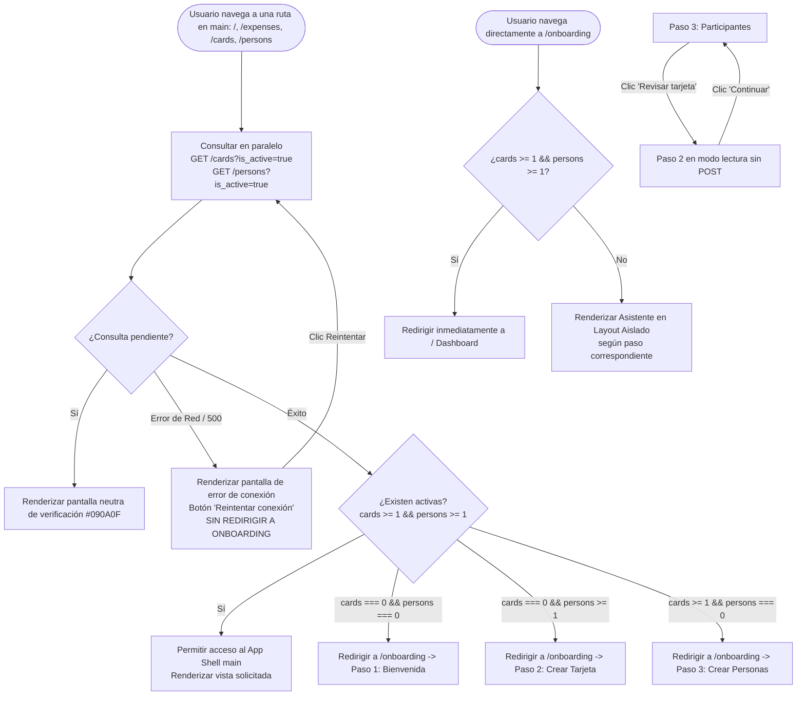

# Especificación 002 — Shell de Navegación Responsivo y Guardia de Onboarding Inicial (`002-onboarding-and-navigation-shell`)

- **Estado:** aprobado
- **Versión:** 1.1.0
- **Fecha:** 2026-10-20

---

## 1. Propósito y Contexto Funcional (QUÉ y POR QUÉ)

### 1.1 Qué se construye
Esta especificación define el marco estructural de navegación permanente (**App Shell**) para las rutas protegidas y la experiencia guiada de configuración inicial (**Onboarding Wizard**) protegida por un **Guardia de Estado Cero** (*Zero-State Guard*) para **Credit Warrior Web**.

El alcance comprende:
1. **Aislamiento Estructural de Rutas y Shell Responsivo**:
   - **Aislamiento Estricto de Layout**: El App Shell (`Bottom Navigation Bar` y `DesktopSidebar`) aplica **exclusivamente** al grupo de rutas principales de negocio `(main)` (`/`, `/expenses`, `/cards`, `/persons`). La ruta `/onboarding` cuenta con su propio layout limpio e independiente, libre de barras de navegación o accesos cruzados que distraigan del asistente.
   - **En dispositivos móviles (`< 768px`)**: Una barra de navegación inferior fija (*Bottom Navigation Bar*) con 4 destinos (`Dashboard`, `Compras`, `Tarjetas`, `Personas`), un disparador central destacado para compras, soporte nativo de áreas seguras (`pb-[env(safe-area-inset-bottom,0px)]`) y ergonomía táctil en la zona del pulgar (*thumb-zone*).
   - **Disparador `+` en Spec 002**: En esta especificación, presionar el botón `+` en móvil o en escritorio muestra una notificación toast informativa (*"El registro rápido de compras se habilitará en la siguiente fase de desarrollo"*), reservando la apertura del drawer para la Spec 004.
   - **En pantallas de escritorio (`>= 768px`)**: Un sidebar lateral fijo izquierdo (*Desktop Sidebar*) con accesos directos persistentes, botón de registro de gasto y cabecera superior (*AppHeader*) con título contextual y monitor de conexión.
2. **Guardia de Estado Inicial (Zero-State Guard)**:
   - Verificación de prerrequisitos de operación consultando entidades activas: `GET /api/v1/cards?is_active=true` y `GET /api/v1/persons?is_active=true`.
   - Intercepción de rutas en `(main)` y redirección automática hacia `/onboarding` cuando no exista al menos **1 tarjeta activa y al menos 1 persona activa**.
   - **Prevención de loops de redirección ante fallos de red**: Si las consultas del guardia fallan por caída de red o error de servidor, el sistema **no** redirige a `/onboarding`; presenta una pantalla de error de conexión con botón *"Reintentar conexión"*.
   - Protección contra reingreso al onboarding: redirección inmediata al Dashboard (`/`) si un usuario con catálogos ya configurados intenta navegar manualmente a `/onboarding`.
3. **Flujo Guiado de Onboarding Paso a Paso (`/onboarding`)**:
   - Gestión del paso activo en memoria de estado React (`step: 1 | 2 | 3`).
   - **Paso 1 — Bienvenida**: Presentación de la propuesta de valor (división automática en cuotas multimoneda `CLP`/`USD` y cero cálculos manuales).
   - **Paso 2 — Creación de la Primera Tarjeta**: Formulario guiado para dar de alta la tarjeta inaugural, con ayuda visual sobre la diferencia entre *día de corte/facturación* y *día de vencimiento/pago*.
   - **Paso 3 — Creación y Gestión de Participantes**: Registro ágil de personas que compartirán gastos, selector de color con opción neutra explícita (`color_hex: null`), bandeja de participantes con opción de eliminar errores (`DELETE /api/v1/persons/{id}`) y navegación de retroceso (*"Revisar tarjeta"*) para consultar la tarjeta creada sin duplicar envíos.
   - **Transición y Finalización**: Invalidación en cascada de catálogos y dashboard (`cards.all`, `persons.all`, `dashboard.all`) y redirección fluida a `/`.
4. **Ergonomía Móvil y Teclado Virtual**:
   - Contenedores con altura dinámica `100dvh` y scroll vertical automático para evitar que el teclado virtual tape los campos o los botones de acción en iOS y Android.

### 1.2 Por qué es necesario
Una aplicación de compras compartidas con tarjetas de crédito no puede operar sin tarjetas activas sobre las cuales registrar compras ni personas activas a las cuales asignar cuotas. El guardia de estado cero evita que un nuevo usuario aterrice en pantallas vacías sin guía, dirigiéndolo al asistente sin posibilidad de loops ante fallas de red. Asimismo, separar visualmente el layout del Onboarding del App Shell habitual mantiene el foco absoluto en la configuración inicial, mientras que la ergonomía táctil móvil y la compatibilidad con áreas seguras garantizan una experiencia PWA nativa desde el primer uso.

---

## 2. Reglas Innegociables del Dominio

1. **Capa de Presentación Pura (Zero Financial Math on Client)**:
   El Shell y el Onboarding solo gestionan navegación, captura de datos maestros y feedback visual. Toda lógica de facturación y amortización reside exclusivamente en el backend.
2. **Prerrequisito de Operación con Entidades Activas (Zero-State Rule)**:
   Para que el sistema sea operable en las rutas protegidas `(main)`, deben existir en el backend al menos **1 tarjeta de crédito activa** (`is_active: true`) y al menos **1 persona activa** (`is_active: true`). Si cualquiera de las dos condiciones no se cumple, las pantallas de negocio permanecen inaccesibles.
3. **Aislamiento de Layouts**:
   El App Shell (`BottomNav` y `DesktopSidebar`) existe únicamente en el grupo de rutas `(main)`. La ruta `/onboarding` utiliza un layout aislado sin barras de navegación para evitar distracciones o accesos prematuros a secciones no configuradas.
4. **Sin Autenticación en el MVP**:
   El Onboarding no es un proceso de registro de usuarios ni de autenticación. Es una configuración maestra del entorno de trabajo donde el usuario define sus entidades `Card` y `Person`. No se solicitan contraseñas, correos ni datos sensibles bancarios.
5. **Seguridad e Inmutabilidad de Identificadores**:
   Los últimos 4 dígitos de tarjeta (`last_four_digits`) son opcionales y se tratan estrictamente como texto plano con máscara visual `•••• 1234`. La aplicación prohíbe el uso de diálogos nativos del navegador (`alert`, `confirm`, `prompt`) y no expone datos en consola.
6. **Ergonomía Táctil, Safe Areas y Teclado Virtual en PWA**:
   La barra de navegación inferior debe aplicar `pb-[env(safe-area-inset-bottom,0px)]` para respetar los gestos del sistema operativo móvil, y las vistas de formulario deben estructurarse con `min-h-[100dvh]` y scroll adaptable para no quedar bloqueadas tras el teclado virtual.

---

## 3. Requisitos Funcionales (Formato EARS) y Criterios de Aceptación

### RF-01: Shell de Navegación Responsivo y Barra Inferior Móvil (Thumb-Zone)
**MIENTRAS** el usuario se encuentre en cualquiera de las rutas del grupo protegido `(main)` (`/`, `/expenses`, `/cards`, `/persons`) y el ancho del viewport sea menor a `768px`, **EL SISTEMA DEBERÁ** renderizar una barra de navegación inferior fija con las siguientes características:
1. Cuatro destinos de navegación organizados uniformemente:
   - **Dashboard** (`/`): Icono de gráfico o panel con etiqueta textual *"Dashboard"*.
   - **Compras** (`/expenses`): Icono de recibo con etiqueta textual *"Compras"*.
   - **Tarjetas** (`/cards`): Icono de tarjeta con etiqueta textual *"Tarjetas"*.
   - **Personas** (`/persons`): Icono de usuarios con etiqueta textual *"Personas"*.
2. Un botón central prominente de acción primaria (**Nuevo Gasto**):
   - Ubicado en el centro de la barra con elevación visual, fondo de acento de alta luminancia, icono de adición `+` y área táctil mínima accesible de `48x48px`.
   - **Comportamiento en Spec 002**: Al ser presionado, emite una notificación toast informativa no bloqueante: *"El registro rápido de compras se habilitará en la siguiente fase de desarrollo"*.
3. Distinción visual inequívoca del destino activo:
   - El destino que coincide con la ruta actual se resalta con color primario del tema (`#F3F5F8`), icono relleno o acentuado y un indicador sutil inferior, mientras que los destinos inactivos se muestran atenuados en `#8A93A6`.
4. Soporte para áreas seguras de pantalla y compensación de contenido:
   - El contenedor de la barra aplica padding inferior dinámico `pb-[env(safe-area-inset-bottom,0px)]`.
   - El contenedor principal de contenido aplica un padding inferior compensatorio equivalente para evitar que el contenido de las pantallas quede oculto detrás de la barra fija.
5. Adaptabilidad ante el teclado virtual:
   - El layout de página utiliza unidades de altura dinámica (`100dvh`) para evitar desbordamientos o deformaciones al abrirse el teclado virtual.

**Criterios de Aceptación:**
- [ ] En pantallas `< 768px` dentro de `(main)`, la barra de navegación inferior permanece fija al pie del viewport con fondo `#12141C` y borde superior divisorio de `1px` en `#232736`.
- [ ] La barra inferior NO se renderiza bajo ninguna circunstancia dentro de la ruta `/onboarding`.
- [ ] Al pulsar el botón central `+` en la barra inferior, se presenta un toast informativo indicando que el registro rápido se habilitará en la siguiente fase.
- [ ] La barra aplica `pb-[env(safe-area-inset-bottom,0px)]` evitando colisiones con la barra de inicio en dispositivos iOS/Android.
- [ ] El último elemento de la vista activa es visible y scrolleable por encima de la barra inferior gracias al padding compensatorio.

---

### RF-02: Shell de Navegación de Escritorio (Sidebar Lateral) y Cabecera Superior
**MIENTRAS** el usuario se encuentre en el grupo de rutas protegidas `(main)` y el ancho del viewport sea igual o mayor a `768px`, **EL SISTEMA DEBERÁ** ocultar la barra inferior móvil y renderizar:
1. **Sidebar Lateral Izquierdo Fijo**:
   - Ancho constante de `240px` a `280px` con fondo `#12141C` y borde derecho de `1px` en `#232736`.
   - Logotipo y nombre del sistema *"Credit Warrior"* en la zona superior.
   - Lista de enlaces verticales para: `Dashboard` (`/`), `Compras` (`/expenses`), `Tarjetas` (`/cards`) y `Personas` (`/persons`).
   - Botón primario prominente *"Registrar gasto"* con icono `+` que, al ser accionado en esta fase, emite el toast informativo de habilitación en siguiente fase.
   - Zona inferior con indicador de versión y estado de salud del sistema.
2. **Cabecera Superior (`AppHeader`)**:
   - Altura compacta fija, fondo `#090A0F` o `#12141C` translúcido con desenfoque de fondo (*backdrop blur*), y borde inferior divisorio en `#232736`.
   - Título claro y legible que describe la vista activa en curso (*"Dashboard"*, *"Historial de compras"*, *"Tarjetas de crédito"*, *"Participantes"*).
   - Indicador visual de estado de conexión con el backend (punto verde de servicio operativo o alerta amarilla/roja en desconexión).

**Criterios de Aceptación:**
- [ ] En pantallas `>= 768px` dentro de `(main)`, el sidebar lateral izquierdo permanece visible y la barra de navegación móvil desaparece completamente del DOM.
- [ ] Ni el sidebar ni el `AppHeader` se renderizan dentro de la ruta `/onboarding`.
- [ ] El enlace activo en el sidebar se distingue mediante fondo elevado `#1A1D28`, texto `#F3F5F8` y acento lateral.
- [ ] Al pulsar *"Registrar gasto"* en el sidebar, se despliega el toast informativo de la siguiente fase.

---

### RF-03: Guardia de Estado Inicial (Zero-State Guard) y Prevención de Loops
**CUANDO** el usuario intente ingresar a cualquier ruta del grupo `(main)` (`/`, `/expenses`, `/cards`, `/persons`), **EL SISTEMA DEBERÁ** evaluar el estado de los catálogos maestros consultando en paralelo `GET /api/v1/cards?is_active=true` y `GET /api/v1/persons?is_active=true`:
1. **SI** el total de tarjetas activas es `0` o el total de personas activas es `0`, **ENTONCES EL SISTEMA DEBERÁ** interceptar la navegación y redirigir al usuario hacia la ruta `/onboarding`.
2. **SI** la consulta de tarjetas o personas falla debido a caída de red, tiempo de espera agotado o error del servidor (`status: 0` o `>= 500`), **ENTONCES EL SISTEMA DEBERÁ**:
   - **NO** redirigir a `/onboarding` (previniendo loops infinitos de redirección).
   - Renderizar una pantalla de error de conexión con fondo `#090A0F`, icono de advertencia, explicación clara y botón *"Reintentar conexión"*.
3. **MIENTRAS** se resuelvan las consultas de verificación en el arranque, **EL SISTEMA DEBERÁ** presentar un estado de espera transitorio con fondo oscuro `#090A0F` y un indicador sutil de carga sin mostrar componentes rotos ni parpadeo de contenido desprotegido.
4. El guardia **DEBERÁ** inicializar el asistente en el paso que corresponda:
   - Si no existen tarjetas ni personas activas (`cards === 0 && persons === 0`), inicia en el **Paso 1 (Bienvenida)**.
   - Si existen personas activas pero faltan tarjetas (`cards === 0 && persons > 0`), inicia directamente en el **Paso 2 (Primera Tarjeta)**.
   - Si existen tarjetas activas pero faltan personas (`cards > 0 && persons === 0`), inicia directamente en el **Paso 3 (Participantes)**.

**Criterios de Aceptación:**
- [ ] El guardia consulta estrictamente con el filtro `?is_active=true` para tarjetas y personas.
- [ ] Al acceder a `/` sin tarjetas activas o sin personas activas, se redirige inmediatamente a `/onboarding`.
- [ ] Si el backend está apagado o hay un fallo de red, el sistema muestra la pantalla de error de conexión con botón de reintento y NO entra en loop de redirección hacia `/onboarding`.
- [ ] Durante la verificación inicial, no se produce parpadeo de la interfaz protegida antes de redirigir (*no flash of un-onboarded content*).

---

### RF-04: Redirección Inversa y Blindaje contra Reingreso a Onboarding
**CUANDO** un usuario que ya cuenta con al menos 1 tarjeta activa y al menos 1 persona activa intente navegar directa o manualmente a la ruta `/onboarding`, **EL SISTEMA DEBERÁ** interceptar la petición y redirigir inmediatamente al usuario hacia la vista principal del Dashboard (`/`).

**Criterios de Aceptación:**
- [ ] Si se ingresa la URL `/onboarding` en un navegador donde ya existen tarjetas y personas activas, la aplicación redirige de forma transparente al Dashboard (`/`).
- [ ] El usuario no puede reiniciar ni volver a ver la pantalla de bienvenida una vez completado el onboarding inicial, protegiendo la navegación habitual.

---

### RF-05: Onboarding — Paso 1: Bienvenida y Propuesta de Valor
**CUANDO** el usuario inicie el onboarding en el Paso 1 (`step === 1`), **EL SISTEMA DEBERÁ** presentar una vista centrada aislada en un contenedor con `min-h-[100dvh]` con la siguiente estructura:
1. Logotipo y nombre de Credit Warrior.
2. Titular contundente: *"Tus tarjetas compartidas, sin enredos de cuentas"*.
3. Tres bloques descriptivos breves con iconos representativos:
   - **Compras en cuotas transparentes**: Cada compra se divide automáticamente mes a mes en el estado de cuenta que corresponde.
   - **Soporte multimoneda nativo**: Control separado para gastos en Pesos Chilenos (`CLP`) y Dólares (`USD`).
   - **Cero cálculos manuales**: La plataforma calcula con precisión matemática cuánto debe transferir cada persona cada mes.
4. Botón de llamada a la acción primario con verbo en voz activa: *"Comenzar configuración"*, el cual avanza el estado interno a `step: 2` (**Paso 2: Primera Tarjeta**).
5. Indicador visual de progreso del asistente (ej. *"Paso 1 de 3: Bienvenida"*).

**Criterios de Aceptación:**
- [ ] El Paso 1 se renderiza dentro del layout aislado de onboarding sin barras de navegación.
- [ ] Al accionar *"Comenzar configuración"*, la vista cambia al Paso 2 mediante actualización del estado React sin recargar la página.
- [ ] El contenedor se adapta a la altura del viewport (`100dvh`) con scroll suave si la pantalla es reducida.

---

### RF-06: Onboarding — Paso 2: Creación de la Primera Tarjeta
**CUANDO** el usuario se encuentre en el Paso 2 (`step === 2`), **EL SISTEMA DEBERÁ** proveer un formulario para registrar la tarjeta de crédito inicial con los siguientes controles y validaciones:
1. **Nombre de la tarjeta (`name`)**: Campo de texto obligatorio (1 a 100 caracteres, ej. *"Visa Santander"*).
2. **Últimos 4 dígitos (`last_four_digits`)**: Campo de texto opcional; si se ingresa contenido, debe validar exactamente 4 números (`^\d{4}$`).
3. **Moneda de facturación (`currency`)**: Selector de dos opciones excluyentes (`CLP` o `USD`), preseleccionando `CLP` por defecto con sus insignias de color respectivas (`#10B981` para CLP y `#38BDF8` para USD).
4. **Día de facturación / corte (`closing_day`)**: Número entero obligatorio entre `1` y `31`.
5. **Día de vencimiento / pago (`due_day`)**: Número entero obligatorio entre `1` y `31`.
6. **Cápsula explicativa financiera**: Un bloque informativo sutil de apoyo que clarifica:
   - *Día de corte*: Día del mes en que el banco emite el estado de cuenta con las compras acumuladas.
   - *Día de pago*: Fecha límite mensual en que se debe pagar la tarjeta.
7. Botón de acción primaria: *"Guardar tarjeta y continuar"*, el cual realiza la petición `POST /api/v1/cards`.
8. **SI** la creación resulta exitosa (`201 Created`), **ENTONCES EL SISTEMA DEBERÁ** avanzar automáticamente a `step: 3` (**Paso 3: Participantes**) mostrando una notificación breve de éxito.
9. **Scroll automático y teclado virtual**: Al enfocar los campos de texto o numéricos en dispositivos móviles, la interfaz realiza un desplazamiento suave para que ni el campo ni el botón de guardado queden ocultos detrás del teclado virtual.

**Criterios de Aceptación:**
- [ ] Si se intenta enviar el formulario con campos vacíos o días fuera del rango 1..31, se muestran mensajes de validación específicos debajo de cada campo y se detiene el envío.
- [ ] La cápsula de ayuda sobre fechas de corte y vencimiento es visible de forma nativa en la pantalla.
- [ ] Tras la respuesta `201 Created` del backend, el asistente transiciona al Paso 3 sin intervención manual adicional.
- [ ] En pantallas móviles, al abrir el teclado virtual el formulario preserva visibilidad con scroll vertical.

---

### RF-07: Onboarding — Paso 3: Registro de Participantes, Selector de Color y Edición
**CUANDO** el usuario ingrese al Paso 3 (`step === 3`), **EL SISTEMA DEBERÁ** permitir gestionar las personas que comparten gastos con la tarjeta creada:
1. **Formulario rápido de participante**:
   - **Nombre de la persona (`name`)**: Campo de texto obligatorio (1 a 100 caracteres, ej. *"Anyi"*, *"Augusto"*).
   - **Selector visual de color identificador (`color_hex`)**: Paleta accesible de colores predefinidos (al menos 6 colores diferenciados sobre fondo oscuro) más una **opción de color neutro**:
     - **SI** se selecciona la opción neutra, **ENTONCES** el payload enviado a `POST /api/v1/persons` incluye `"color_hex": null`, y la UI renderiza el fallback `#8A93A6`.
   - Botón *"Agregar participante"* que realiza la petición `POST /api/v1/persons`.
2. **Bandeja de participantes añadidos y eliminación**:
   - Lista visual de personas creadas exitosamente para este onboarding, mostrando para cada una su píldora identificadora (`PersonChip`).
   - Cada píldora en la bandeja incluye un botón de eliminación contextual (`X` o papelera) que invoca `DELETE /api/v1/persons/{person_id}` para descartar participantes creados por error.
3. **Navegación de retroceso para revisión de tarjeta**:
   - Se incluye un botón de enlace secundario *"Revisar tarjeta creada"*: al accionarlo, regresa temporalmente al Paso 2 mostrando los datos de la tarjeta recién creada en modo consulta/lectura sin reenviar peticiones `POST`, permitiendo volver al Paso 3 con el botón *"Continuar a participantes"*.
4. **Condición de activación del botón de finalización**:
   - El botón de finalización del onboarding (*"Finalizar y ver Dashboard"*) permanece deshabilitado **MIENTRAS** la cantidad de participantes activos añadidos en la bandeja sea menor a **1**.
   - **CUANDO** exista al menos una persona añadida en la lista, el botón se habilita de forma destacada.

**Criterios de Aceptación:**
- [ ] Se puede crear una persona con color personalizado o seleccionando la opción neutra (enviando `color_hex: null`).
- [ ] Cada persona creada se agrega a la bandeja inferior con opción de ser eliminada (`DELETE`), actualizando la lista de inmediato.
- [ ] Si se eliminan todos los participantes de la bandeja, el botón de finalización se deshabilita automáticamente.
- [ ] El botón de retroceso permite consultar los datos de la tarjeta creada en el Paso 2 sin disparar llamadas `POST` duplicadas.

---

### RF-08: Finalización del Onboarding e Invalidación en Cascada
**CUANDO** el usuario accione el botón *"Finalizar y ver Dashboard"* en el Paso 3, **EL SISTEMA DEBERÁ**:
1. Invalidar en cascada las siguientes colecciones de caché en TanStack Query:
   - `queryKeys.cards.all` (para refrescar catálogos de tarjetas).
   - `queryKeys.persons.all` (para refrescar catálogos de participantes).
   - `queryKeys.dashboard.all` (tanto `summary` como `projection`, para garantizar que el dashboard nazca sincronizado).
2. Redirigir de manera suave hacia la ruta raíz del Dashboard (`/`).
3. Presentar una notificación toast confirmatoria: *"¡Configuración inicial completada con éxito!"*.
4. Desactivar el guardia de Onboarding para permitir el libre acceso a todas las secciones del App Shell `(main)`.

**Criterios de Aceptación:**
- [ ] Al finalizar el Paso 3, se invalidan `cards.all`, `persons.all` y `dashboard.all`.
- [ ] El usuario es redirigido a `/` y visualiza el App Shell con sus datos de tarjeta y participantes ya sincronizados.
- [ ] Se muestra la notificación de éxito toast no bloqueante.
- [ ] Cualquier intento posterior de retroceder en el historial del navegador hacia `/onboarding` es interceptado y redirigido a `/`.

---

### RF-09: Manejo de Errores, Conflictos de Nombre (`409 Conflict`) y Resiliencia
**SI** durante el registro de una persona en el Paso 3 el backend responde con un error `409 Conflict` (debido a que el nombre ya existe en el sistema):
1. **EL SISTEMA DEBERÁ** asociar el error directamente al campo de texto del nombre, mostrando un mensaje inline: *"Ya existe una persona registrada con este nombre"*.
2. **EL SISTEMA DEBERÁ** mantener intactos los demás controles del formulario (incluyendo el color seleccionado) sin borrar lo escrito por el usuario.
3. **SI** ocurre un fallo de conexión o un error `500` durante la creación de tarjeta o persona, **ENTONCES EL SISTEMA DEBERÁ** mostrar una alerta toast destructiva con mensaje comprensible y mantener los datos del formulario intactos para permitir reintentar sin reescribir.
4. **SI** la consulta del guardia de estado falla al entrar a la app, **EL SISTEMA DEBERÁ** mostrar la pantalla de reconexión sin iniciar loops de navegación hacia `/onboarding`.

**Criterios de Aceptación:**
- [ ] Un error `409 Conflict` por nombre duplicado resalta el borde del campo `name` en color de error (`#F43F5E`) con su mensaje inline.
- [ ] Una pérdida transitoria de red mantiene lo ingresado en los formularios y permite reintentar tras restablecer la conexión.
- [ ] Una falla de red en el guardia presenta pantalla de reintento de conexión y no redirige a `/onboarding`.

---

### RF-10: Accesibilidad, Navegación por Teclado y Safe Areas
**EL SISTEMA DEBERÁ** garantizar que todos los elementos interactivos del App Shell y del Onboarding:
1. Sean completamente navegables mediante teclado utilizando la tecla `Tab` y activables con `Enter` o `Espacio`.
2. Presenten un anillo o borde de foco visible de alto contraste (`focus-visible`) que destaque claramente sobre superficies oscuras `#090A0F` y `#12141C`.
3. Contengan etiquetas accesibles para lectores de pantalla (`aria-label` o texto visible) en todos los iconos de navegación y botones de acción (especialmente en el botón central `+` y botones de eliminación en la bandeja).
4. Respeten estrictamente las áreas seguras de pantalla mediante clases utilitarias de safe-areas (`pb-[env(safe-area-inset-bottom,0px)]`).

**Criterios de Aceptación:**
- [ ] Se puede navegar a lo largo de toda la barra inferior móvil o del sidebar exclusivamente con el teclado, con anillos de foco visibles en todo momento.
- [ ] El botón central `+` incluye una etiqueta accesible clara (`aria-label="Registrar nueva compra compartida"`).
- [ ] Los botones de eliminación de persona en la bandeja del Paso 3 cuentan con etiqueta accesible (ej. `aria-label="Eliminar participante [Nombre]"`).

---

## 4. Flujos de Experiencia de Usuario (UX) y Estados de Interfaz

### 4.1 Flujo Lógico de Verificación y Guardia de Onboarding



---

### 4.2 Matriz de Estados de Interfaz

| Estado | Comportamiento en App Shell `(main)` | Comportamiento en Onboarding Wizard `/onboarding` |
| :--- | :--- | :--- |
| **Carga (`Loading`)** | Transición silenciosa en `#090A0F` sin parpadeos mientras el guardia verifica el estado. En vistas hijas, skeletons de 1px sobre `#12141C`. | Botón de envío muestra estado de carga con spinner y texto *"Guardando..."*, deshabilitando clics repetidos. |
| **Vacío (`Empty`)** | Bloqueado por diseño: ningún usuario puede ver el App Shell vacío gracias al `OnboardingGuard`. | En el Paso 3, la bandeja de participantes muestra una guía invitando a añadir al menos una persona. |
| **Éxito (`Success`)** | Cambio inmediato de ruta, resaltado del destino activo. Clic en `+` muestra toast de próxima fase. | Avance automático entre pasos y toast celebratorio al completar el Paso 3. |
| **Error `400` / `404`** | Notificación toast en rojo `#F43F5E` indicando el mensaje del servidor sin cerrar la sesión ni perder contexto. | Toast descriptivo manteniendo los valores ingresados en el formulario. |
| **Error `409 Conflict`** | N/A en navegación de Shell. | Mensaje de error debajo del campo `name` indicando duplicidad de participante sin perder el color seleccionado. |
| **Error `422 Validation`** | N/A en navegación de Shell. | Mensajes de error específicos debajo de los inputs de días (1..31) o formato de últimos 4 dígitos. |
| **Desconexión de Red** | Pantalla dedicada de error de conexión con botón *"Reintentar conexión"* en el guardia (evita loop). | Alerta toast informativa con botón de reintento directo preservando los campos. |

---

### 4.3 Wireframes ASCII de Referencia

#### A. Barra Inferior Móvil (`< 768px`) en `(main)`
```text
+-------------------------------------------------------------------+
|  [VISTA DE PÁGINA PROTEGIDA: DASHBOARD / COMPRAS / TARJETAS]      |
|                                                                   |
|                                                                   |
+-------------------------------------------------------------------+
|   [icon]         [icon]          ( + )          [icon]     [icon] |
| Dashboard       Compras        Registrar       Tarjetas   Personas|
|    ====                                                           |
+-------------------------------------------------------------------+
| < - - - - - - pb-[env(safe-area-inset-bottom,0px)] - - - - - - - >|
+-------------------------------------------------------------------+
```

#### B. Sidebar Lateral de Escritorio (`>= 768px`) en `(main)`
```text
+----------------------+--------------------------------------------+
| [CW] Credit Warrior  | [AppHeader] Dashboard           (•) Online |
+----------------------+--------------------------------------------+
|                      |                                            |
| [>] Dashboard (Activo|  [CONTENIDO PRINCIPAL DE LA VISTA ACTIVA]  |
| [ ] Compras          |                                            |
| [ ] Tarjetas         |                                            |
| [ ] Personas         |                                            |
|                      |                                            |
| +------------------+ |                                            |
| | [+ Registrar]    | |                                            |
| +------------------+ |                                            |
|                      |                                            |
| v0.1.0 · Conectado   |                                            |
+----------------------+--------------------------------------------+
```

#### C. Asistente de Onboarding Paso a Paso en Layout Aislado (`/onboarding`)
```text
+-------------------------------------------------------------------+
|                      [ Credit Warrior Logo ]                      |
|                     Paso 3 de 3: Participantes                    |
|                 [=====================================>]          |
+-------------------------------------------------------------------+
|                                                                   |
|  ¿Quiénes comparten gastos con esta tarjeta?                      |
|  Agrega al menos una persona para dividir las compras.            |
|                                                                   |
|  Nombre del participante:                                         |
|  [ Anyi                                                         ] |
|                                                                   |
|  Color identificador:                                             |
|  (•) Neutro   [#10B981]   [#38BDF8]   [#8B5CF6]   [#F59E0B]       |
|                                                                   |
|  +-------------------------------------------------------------+  |
|  |                 [ + Agregar participante ]                  |  |
|  +-------------------------------------------------------------+  |
|                                                                   |
|  Participantes añadidos (1):                                      |
|  +-------------------------------------------------------------+  |
|  |  (*) Anyi                                             [ x ] |  |
|  +-------------------------------------------------------------+  |
|                                                                   |
|  [< Revisar tarjeta creada]       [ Finalizar y ver Dashboard -> ]|
+-------------------------------------------------------------------+
```

---

## 5. Casos Límite (Edge Cases)

1. **Catálogos Parcialmente Completados (Abandono a Medio Camino)**:
   - Si un usuario registra su primera tarjeta en el Paso 2 pero cierra la pestaña antes de registrar participantes en el Paso 3: al volver a abrir la aplicación, el guardia detecta `cards.length === 1` y `persons.length === 0`, dirigiéndolo directamente al Paso 3 para que no tenga que volver a ingresar la tarjeta ya creada.
   - De manera análoga, si existieran personas registradas pero cero tarjetas activas, el guardia salta directamente al Paso 2 de tarjeta.
2. **Revisión de Tarjeta Creada desde el Paso 3**:
   - Si en el Paso 3 el usuario pulsa *"Revisar tarjeta creada"*, el asistente retrocede a `step: 2` mostrando los campos deshabilitados en modo lectura o un resumen de la tarjeta para verificar nombre, moneda y fechas de corte/pago sin volver a disparar `POST /api/v1/cards`. Un botón *"Continuar a participantes"* lo regresa a `step: 3`.
3. **Eliminación Total de Participantes en el Paso 3**:
   - Si el usuario agrega un participante y luego lo elimina mediante el botón `[ x ]` (`DELETE /api/v1/persons/{id}`), la lista de participantes vuelve a `0`. El botón *"Finalizar y ver Dashboard"* se deshabilita de inmediato, impidiendo avanzar hasta que exista al menos 1 participante activo.
4. **Caída de Red en el Guardia de Estado (Anti-Loop Guard)**:
   - Si al iniciar la aplicación no hay conexión con `http://127.0.0.1:8000`, la llamada falla con error de red. El guardia detecta el estado de error y despliega una pantalla de desconexión sin alterar la URL ni redirigir a `/onboarding`. Al pulsar *"Reintentar conexión"*, se disparan de nuevo las consultas en segundo plano.
5. **Apertura del Teclado Virtual en Móviles con Formularios de Tarjeta o Participantes**:
   - Al desplegarse el teclado táctil en iOS o Android, la altura visible se reduce drásticamente. El contenedor aplica `min-h-[100dvh]` con scroll vertical automático, asegurando que el input en foco y el botón de acción permanezcan accesibles sin solaparse con la barra de herramientas del teclado.
6. **Dispositivos Móviles PWA con Barra Inferior de Navegación del Sistema**:
   - En dispositivos iOS con barra de inicio táctil o Android con barra de gestos, el contenedor de la barra inferior aplica `pb-[env(safe-area-inset-bottom,0px)]` para mantener al menos `12px` de margen libre sobre el borde físico de la pantalla, evitando toques accidentales con el sistema operativo.
7. **Intentos de Doble Clic Rápido en Botones de Guardado**:
   - Al pulsar *"Guardar tarjeta"* o *"Agregar participante"*, el botón entra inmediatamente en estado deshabilitado con spinner de carga para imposibilitar el envío de peticiones duplicadas en ráfaga al backend.
8. **Nombre de Participante Duplicado en Onboarding (`409 Conflict`)**:
   - Si se intenta agregar dos veces a *"Anyi"* dentro del Paso 3, el backend devolverá `409 Conflict`. El sistema asocia el error al campo de texto del nombre, indica que el nombre ya está en uso y preserva el color seleccionado sin reiniciar la lista de participantes ya creados.
