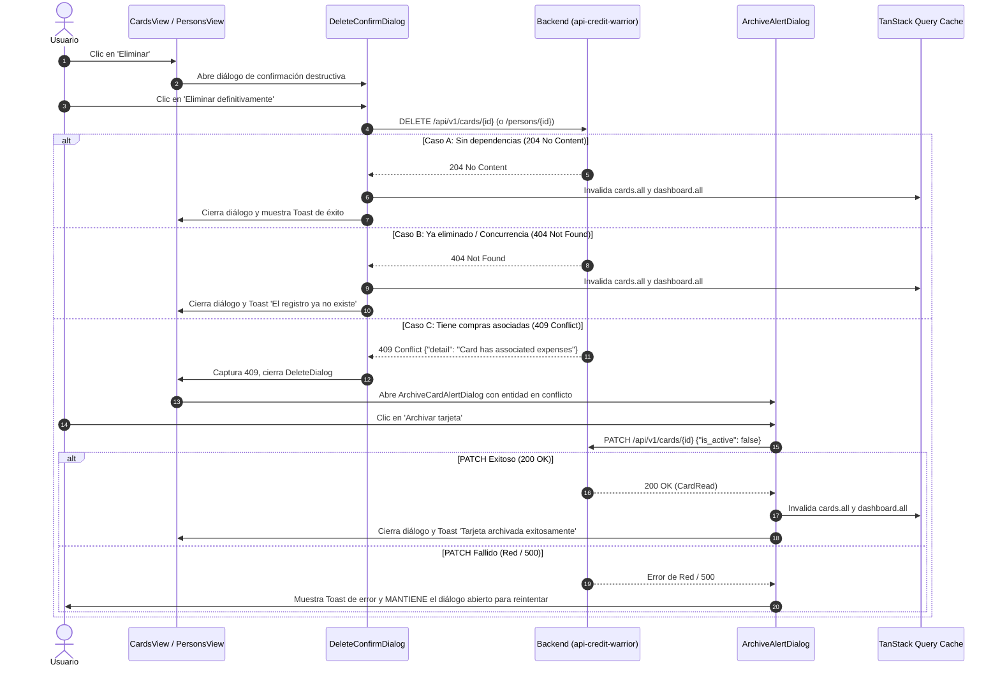

# Plan Técnico 003 — Gestión de Tarjetas y Personas: Catálogos Maestros y Archivado Inteligente (`003-cards-and-persons-management`)

- **Estado:** borrador
- **Versión:** 1.0.0
- **Fecha:** 2026-10-20
- **Especificación Relacionada:** [`specs/003-cards-and-persons-management/spec.md`](file:///home/glup/src/learning/credit-warrior/web-credit-warrior/specs/003-cards-and-persons-management/spec.md) (v1.1.0)
- **Documentos de Referencia:** [`docs/constitution.md`](file:///home/glup/src/learning/credit-warrior/web-credit-warrior/docs/constitution.md) (§3.5, §4.2, §7.2, §7.3), [`docs/openapi.json`](file:///home/glup/src/learning/credit-warrior/web-credit-warrior/docs/openapi.json), [`docs/resume.md`](file:///home/glup/src/learning/credit-warrior/web-credit-warrior/docs/resume.md), [`AGENTS.md`](file:///home/glup/src/learning/credit-warrior/web-credit-warrior/AGENTS.md), [`MEMORY.md`](file:///home/glup/src/learning/credit-warrior/web-credit-warrior/MEMORY.md)

---

## 1. Arquitectura y Estructura Exhaustiva de Archivos

La arquitectura para la Spec 003 organiza la gestión de catálogos maestros bajo el directorio modular `src/features/`, separando claramente la lógica de presentación, formularios adaptativos, modales de confirmación destructiva y el flujo de archivado inteligente ante conflictos `409`.

```text
web-credit-warrior/
├── src/
│   ├── app/
│   │   └── (main)/
│   │       ├── cards/
│   │       │   └── page.tsx                    # Vista principal /cards (Suspense + CardsView)
│   │       └── persons/
│   │           └── page.tsx                    # Vista principal /persons (Suspense + PersonsView)
│   ├── components/
│   │   └── ui/
│   │       ├── alert-dialog.tsx                # Primitiva Radix UI AlertDialog (confirmaciones destructivas y archivado)
│   │       ├── dialog.tsx                      # Primitiva Radix UI Dialog (modales de formulario en escritorio)
│   │       ├── drawer.tsx                      # Primitiva Vaul Drawer (formularios y diálogos en móvil)
│   │       ├── dropdown-menu.tsx               # Primitiva Radix UI DropdownMenu (menú de acciones contextuales)
│   │       ├── switch.tsx                      # Primitiva Radix UI Switch (toggle is_active accesible)
│   │       └── tabs.tsx                        # Primitiva Radix UI Tabs (pestañas de segmentación de catálogo)
│   ├── features/
│   │   ├── cards/
│   │   │   ├── components/
│   │   │   │   ├── archive-card-alert-dialog.tsx # Diálogo de Archivado Inteligente ante 409 Conflict
│   │   │   │   ├── card-form-dialog.tsx        # Formulario adaptativo (Dialog/Drawer) Alta y Edición
│   │   │   │   ├── card-item.tsx               # Ficha de tarjeta con metadatos, moneda y menú de acciones
│   │   │   │   ├── card-list.tsx               # Pestañas sincronizadas en URL (?status=), contadores y lista
│   │   │   │   └── delete-card-confirm-dialog.tsx # Confirmación previa de eliminación física
│   │   │   └── cards-view.tsx                  # Coordinador de vista /cards y gestión de modales
│   │   └── persons/
│   │       ├── components/
│   │       │   ├── archive-person-alert-dialog.tsx # Diálogo de Archivado Inteligente ante 409 Conflict
│   │       │   ├── color-picker.tsx            # Selector de 8 colores + botón neutro explícito (null)
│   │       │   ├── delete-person-confirm-dialog.tsx # Confirmación previa de eliminación física
│   │       │   ├── person-form-dialog.tsx      # Formulario adaptativo (Dialog/Drawer) Alta y Edición
│   │       │   ├── person-item.tsx             # Ficha de participante con avatar de color y menú de acciones
│   │       │   └── person-list.tsx             # Pestañas sincronizadas en URL (?status=), contadores y lista
│   │       └── persons-view.tsx                # Coordinador de vista /persons y gestión de modales
│   ├── hooks/
│   │   └── queries/                            # Hooks existentes (Spec 001) con invalidación en cascada
│   │       ├── use-cards.ts                    # useCards, useCreateCard, useUpdateCard, useDeleteCard
│   │       └── use-persons.ts                  # usePersons, useCreatePerson, useUpdatePerson, useDeletePerson
│   └── schemas/                                # Esquemas existentes (Spec 001)
│       ├── card.schema.ts                      # cardCreateSchema, cardUpdateSchema
│       └── person.schema.ts                    # personCreateSchema, personUpdateSchema
```

---

## 2. Contratos de Datos y Sincronización de Caché (TanStack Query v5)

### 2.1 Hooks y Endpoints Consumidos
El módulo consume la capa de servicios y hooks implementada en la Spec 001:

| Catálogo | Operación | Endpoint | Request Payload | Hook Consumido | Invalidaciones Disparadas |
| :--- | :--- | :--- | :--- | :--- | :--- |
| **Cards** | Listar | `GET /api/v1/cards` | `{ is_active?: boolean }` | `useCards(filters)` | — |
| **Cards** | Crear | `POST /api/v1/cards` | `CardCreate` | `useCreateCard()` | `cards.all` y `dashboard.all` |
| **Cards** | Editar / Archivar | `PATCH /api/v1/cards/{id}` | `CardUpdate` | `useUpdateCard()` | `cards.all` y `dashboard.all` |
| **Cards** | Eliminar | `DELETE /api/v1/cards/{id}` | — | `useDeleteCard()` | `cards.all` y `dashboard.all` |
| **Persons** | Listar | `GET /api/v1/persons` | `{ is_active?: boolean }` | `usePersons(filters)` | — |
| **Persons** | Crear | `POST /api/v1/persons` | `PersonCreate` | `useCreatePerson()` | `persons.all` y `dashboard.all` |
| **Persons** | Editar / Archivar | `PATCH /api/v1/persons/{id}` | `PersonUpdate` | `useUpdatePerson()` | `persons.all` y `dashboard.all` |
| **Persons** | Eliminar | `DELETE /api/v1/persons/{id}` | — | `useDeletePerson()` | `persons.all` y `dashboard.all` |

### 2.2 Sincronización en URL Search Params
Las vistas `/cards` y `/persons` enlazan las pestañas con la URL para mantener el estado compartible y resiliente a recargas:
- Parámetro: `?status=active|archived|all` (predeterminado: `active` si el parámetro está ausente).
- Lectura: `searchParams.get('status') || 'active'`.
- Escritura: `router.replace(`${pathname}?status=${newStatus}`)` con `{ scroll: false }`.
- **Cálculo de Contadores en Memoria**:
  Para evitar múltiples peticiones concurrentes a la API (`is_active=true` e `is_active=false`), se invoca `useCards()` (o `usePersons()`) sin filtro para traer el listado completo en caché:
  ```typescript
  const activeCount = allItems.filter((item) => item.is_active).length;
  const archivedCount = allItems.filter((item) => !item.is_active).length;
  const totalCount = allItems.length;
  ```
  La pestaña visual activa filtra la colección en memoria instantáneamente.

---

## 3. Validación de Formularios, Normalización y Manejo de Errores

### 3.1 Normalización de `last_four_digits` en Edición de Tarjetas
En `cardUpdateSchema` (`src/schemas/card.schema.ts`), `last_four_digits` es `.regex(/^\d{4}$/).nullable().optional()`.
Si en el formulario de edición el usuario borra los dígitos dejando cadena vacía `""`, la función de envío normaliza el dato antes de la mutación:
```typescript
const payload: CardUpdate = {
  ...values,
  name: values.name.trim(),
  last_four_digits: values.last_four_digits?.trim() === '' ? null : values.last_four_digits,
};
await updateCard.mutateAsync({ id: cardId, data: payload });
```
Esto previene que el backend rechace la actualización con error `422 Unprocessable Entity` por no cumplir con la expresión regular `^\d{4}$`.

### 3.2 Mapeo de Errores de Validación `422 Unprocessable Entity`
Si el backend responde con error `422`:
- Se invoca `mapPydanticErrorsToForm(error, form.setError)`.
- El helper remueve el prefijo `"body"` del arreglo `loc` y asocia el mensaje de error `msg` al campo correspondiente (`name`, `closing_day`, etc.).
- El input se resalta visualmente en rojo `#F43F5E` y se muestra el mensaje de error debajo del control sin cerrar el diálogo ni perder lo escrito.

### 3.3 Mapeo de Conflicto de Nombre Duplicado `409 Conflict` en Personas
Si `useCreatePerson` o `useUpdatePerson` falla con `ApiError` de estado `409`:
```typescript
if (error instanceof ApiError && error.status === 409) {
  form.setError('name', {
    type: 'server',
    message: 'Ya existe una persona registrada con este nombre',
  });
}
```
El campo `name` se resalta en `#F43F5E` con el mensaje inline explicativo, preservando el color seleccionado en el `ColorPicker`.

---

## 4. Flujo de Eliminación y Archivado Inteligente ante `409 Conflict`

El flujo de eliminación física y recuperación inteligente ante dependencias históricas se gestiona mediante dos componentes complementarios:



### 4.1 Comportamiento Detallado del Diálogo de Archivado Inteligente
- **Estado de Carga (`isPending`)**: Al pulsar *"Archivar tarjeta"* o *"Archivar persona"*, el botón muestra un spinner de carga y desactiva las acciones del diálogo para evitar pulsaciones duplicadas.
- **Resiliencia ante Fallos**: Si la petición `PATCH` falla, el diálogo no se cierra y permite al usuario reintentar la operación con un solo toque.
- **Cancelación Segura**: Si el usuario pulsa *"Cancelar"*, el diálogo se cierra sin realizar modificaciones.

---

## 5. Diseño UI/UX, Componentes y Paleta Visual

### 5.1 Adaptabilidad Responsiva (Desktop Dialog vs Mobile Drawer)
Para optimizar la ergonomía táctil en dispositivos móviles sin duplicar lógica de negocio, los formularios de alta/edición y los diálogos de confirmación utilizan un wrapper responsivo:
- **En pantallas `>= 768px`**: Renderiza primitivas `Dialog` / `AlertDialog` de Radix UI con ancho `max-w-md` y centrado en pantalla.
- **En pantallas `< 768px`**: Renderiza primitivas `Drawer` de Vaul con tirador superior táctil (*drag handle*), deslizamiento hacia abajo para cerrar y ajuste a `100dvh` para respetar el teclado virtual.

### 5.2 Selector de Color (`ColorPicker`)
Renderiza una cuadrícula táctil con 8 colores vibrantes y una opción neutra explícita:
- Colores predefinidos:
  1. Verde Esmeralda (`#10B981`)
  2. Azul Cielo (`#38BDF8`)
  3. Violeta Real (`#8B5CF6`)
  4. Ámbar Cálido (`#F59E0B`)
  5. Rosa Carmín (`#F43F5E`)
  6. Aguamarina (`#14B8A6`)
  7. Naranja Fuego (`#FB923C`)
  8. Azul Índigo (`#6366F1`)
- **Opción Neutra**: Botón con estilo gris `#8A93A6`, icono `Slash` o texto *"Neutro"*, que establece el valor del formulario en `null`.
- Cada botón circular posee un tamaño accesible de `40x40px` (con target táctil expandido a `44x44px`), borde de `2px` cuando está seleccionado y un check interior `Check` (`lucide-react`).

### 5.3 Tolerancia a Cero Entidades Activas en la Vista
Si el usuario archiva o elimina su última tarjeta activa desde `/cards`, o su última persona activa desde `/persons`:
- La página **no** dispara redirección hacia `/onboarding`.
- Permanece en la pantalla actual renderizando el componente `EmptyState`:
  - En `/cards`: *"No tienes tarjetas activas"* con CTA primario *"Crear primera tarjeta"* y enlace secundario para ir a la pestaña de archivadas.
  - En `/persons`: *"No tienes participantes activos"* con CTA primario *"Agregar persona"*.
- El `OnboardingGuard` solo evaluará la condición de redirección si el usuario navega posteriormente hacia `/` o `/expenses`.

---

## 6. Decisiones Técnicas y Alternativas Descartadas

| Decisión Técnica | Alternativa Elegida | Alternativa Descartada | Justificación Arquitectónica |
| :--- | :--- | :--- | :--- |
| **Segmentación de Catálogo** | Pestañas sincronizadas en URL (`?status=active\|archived\|all`) con filtrado en memoria del catálogo completo. | Consultas separadas a la API por cada pestaña (`GET /cards?is_active=true` y `false`). | Filtrar en memoria el resultado de `useCards()` reduce las peticiones de red a la mitad, permite calcular los contadores exactos de todas las pestañas instantáneamente y agiliza la navegación sin parpadeos de carga. |
| **Manejo de Conflicto 409** | Captura automática de `409` en `onError` de eliminación y apertura inmediata del `ArchiveAlertDialog`. | Error bloqueante genérico o toast de fallo sin acción posterior. | Ofrece una vía de recuperación funcional inmediata: el usuario entiende por qué no puede eliminar y puede resolver el conflicto archivando la tarjeta/persona en un solo paso. |
| **Normalización de `last_four_digits`** | Transformación en cliente de `""` a `null` antes de `PATCH`. | Enviar `""` al backend o requerir que el usuario no toque el campo. | El contrato OpenAPI valida `last_four_digits` con `^\d{4}$`. La cadena vacía `""` es rechazada con `422`. Normalizar a `null` permite remover dígitos de tarjeta válidamente en el backend. |
| **Componentes de Formulario** | Primitivas adaptativas (`Dialog` en desktop, `Drawer` en mobile con Vaul). | Modales flotantes únicos en todas las resoluciones. | Los modales centrados en teléfonos móviles sufren con el teclado virtual y carecen de ergonomía táctil en el pulgar. Los Drawers inferiores ofrecen una experiencia nativa PWA de primer nivel. |
| **Selector de Color** | Paleta fija de 8 colores contrastados + botón neutro explícito (`null`). | Input nativo `<input type="color">`. | El selector nativo del sistema operativo no garantiza contraste sobre fondo oscuro `#090A0F`, ni permite seleccionar `null` de forma intuitiva. |

---

## 7. Estrategia de Tests y Verificación (TDD)

Cada componente y flujo contará con su suite de pruebas unitarias e integración en Vitest + React Testing Library:

1. **`src/components/ui/` (Primitivas UI)**:
   - `src/components/ui/tabs.test.tsx`: Renderizado accesible, cambio de pestaña y eventos.
   - `src/components/ui/dialog.test.tsx` y `drawer.test.tsx`: Apertura, cierre con Escape y foco accesible.
2. **`src/features/cards/` (Tarjetas)**:
   - `src/features/cards/components/card-item.test.tsx`: Renderizado de datos de tarjeta, formato `•••• 1234`, badge de moneda y menú de acciones.
   - `src/features/cards/components/card-form-dialog.test.tsx`: Validaciones de días 1..31, selector CLP/USD, normalización de `""` a `null` en `last_four_digits`, nota de corte en mes corto, e inyección de error `422`.
   - `src/features/cards/components/archive-card-alert-dialog.test.tsx`: Renderizado tras 409, estado `isPending` en botón archivar, mutación `PATCH { is_active: false }`, reintento ante falla de red.
   - `src/features/cards/cards-view.test.tsx`: Flujo completo de navegación por pestañas (`?status=`), contadores en memoria, apertura de formularios, confirmación de eliminación y permanencia en `EmptyState` si quedan 0 activas.
3. **`src/features/persons/` (Personas)**:
   - `src/features/persons/components/color-picker.test.tsx`: Selección de colores, opción neutra enviando `null`, anillo de selección visible y accesibilidad por teclado.
   - `src/features/persons/components/person-item.test.tsx`: Renderizado de avatar con color hex y fallback `#8A93A6`, menú de acciones.
   - `src/features/persons/components/person-form-dialog.test.tsx`: Alta y edición, captura de `409 Conflict` inyectando error en campo `name`, preservación del color seleccionado y errores `422`.
   - `src/features/persons/components/archive-person-alert-dialog.test.tsx`: Renderizado tras 409 en eliminación, mutación `PATCH { is_active: false }`, reintento ante fallo de red.
   - `src/features/persons/persons-view.test.tsx`: Navegación por pestañas, contadores en memoria, permanencia en `EmptyState` ante 0 activas y apertura de formularios.
4. **Verificación Estática y de Calidad**:
   - `npx tsc --noEmit` con 0 errores de tipos.
   - `npm run lint` con 0 advertencias.
   - `npm test` con 100% de suites en verde.
