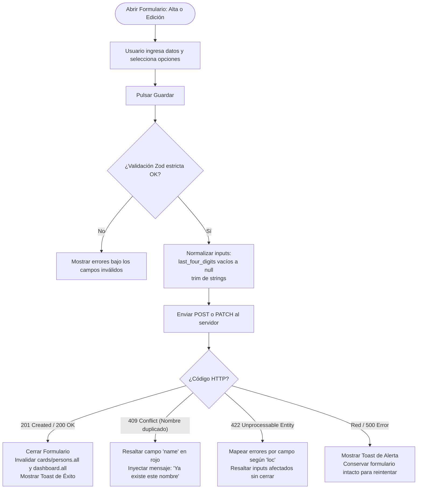

# Especificación 003 — Gestión de Tarjetas y Personas: Catálogos Maestros y Archivado Inteligente (`003-cards-and-persons-management`)

- **Estado:** aprobado
- **Versión:** 1.1.0
- **Fecha:** 2026-10-20

---

## 1. Propósito y Contexto Funcional (QUÉ y POR QUÉ)

### 1.1 Qué se construye
Esta especificación define la funcionalidad de administración completa (**Altas, Bajas, Modificaciones y Archivado — ABM/CRUD**) para los dos catálogos maestros esenciales de **Credit Warrior Web**:
1. **Catálogo de Tarjetas de Crédito (`/cards`)**: Registro, edición de parámetros de facturación (`closing_day`, `due_day`, `currency`), activación/desactivación rápida y eliminación con flujo de archivado inteligente ante dependencias históricas.
2. **Catálogo de Personas / Participantes (`/persons`)**: Alta, edición de identidad visual (`color_hex`), control de estado activo/archivado y eliminación protegida ante participaciones previas en compras compartidas.

Su alcance funcional comprende:
- **Gestión Visual Responsiva con Sincronización en URL**: Listados estructurados con separación nítida entre registros **Activos**, **Archivados** y **Todos**, sincronizados bidireccionalmente con parámetros de búsqueda (`?status=active|archived|all`), estados vacíos accionables y formularios adaptativos (diálogos modales centrados en escritorio y paneles deslizantes inferiores o *drawers* en pantallas móviles).
- **Flujo de Archivado Inteligente ante Integridad Histórica (`409 Conflict`)**: Mecanismo guiado que, cuando el servidor rechaza la eliminación de una tarjeta o persona porque existen compras o cronogramas de pago asociados, ofrece archivar la entidad (`is_active: false`) de forma transparente y sin pérdida de datos históricos, con reintento ante fallos de red.
- **Normalización de Datos y Manejo de Errores de Validación (`422 Unprocessable Entity`)**: Conversión automática de campos de texto vacíos a `null` para evitar errores de validación por expresiones regulares en ediciones parciales, e inyección inline de mensajes de error de Pydantic directamente en los campos afectados.
- **Detección y Mapeo Inline de Nombres Duplicados (`409 Conflict`)**: Retroalimentación inmediata en el formulario cuando se intenta registrar una persona con un nombre ya existente, asociando el error directamente al campo de texto.
- **Identidad Cromática y Opción Neutra**: Selector visual de colores de alto contraste para personas, con una opción neutra explícita que asigna un valor nulo (`color_hex: null`) preservando la estética oscura sin forzar personalizaciones arbitrarias.
- **Invalidación en Cascada hacia Dashboard**: Sincronización automática de todas las mutaciones exitosas hacia el catálogo respectivo y hacia las vistas del dashboard (`dashboard.all`), garantizando coherencia financiera global.

### 1.2 Por qué es necesario
Las tarjetas de crédito y las personas participantes constituyen la base estructural sobre la cual se registran todas las compras compartidas y se calculan las amortizaciones mensuales. En la vida real, las tarjetas cambian de fecha de facturación, se reemplazan por renovación o se dejan de usar, y los grupos de personas que comparten gastos pueden incorporar nuevos integrantes o desvincular a otros.
Sin una administración completa y resiliente de estos catálogos:
1. El usuario no podría corregir un día de corte o vencimiento mal configurado durante el onboarding.
2. Intentar eliminar una tarjeta antigua con compras históricas resultaría en un error técnico confuso si no se le ofrece una alternativa clara de archivado.
3. El listado de tarjetas y personas para nuevas compras se saturaría de elementos obsoletos, dificultando la velocidad de registro en movilidad.
4. Si el usuario archiva temporalmente su última entidad mientras opera en la pantalla de administración, una expulsión abrupta a la pantalla de bienvenida frustraría la experiencia de usuario.

---

## 2. Reglas Innegociables del Dominio

1. **Capa de Presentación Pura (Zero Financial Math on Client)**:
   El frontend gestiona la captura y presentación de los catálogos maestros sin calcular fechas de corte efectivas, vencimientos futuros ni totales de cuotas por tarjeta. Todo cálculo financiero continúa residiendo exclusivamente en el backend.
2. **Integridad Histórica y Archivado Inteligente ante `409 Conflict`**:
   Las tarjetas o personas que registran compras activas o históricas **no pueden ser eliminadas físicamente** de la base de datos para no corromper la trazabilidad financiera ni los resúmenes mensuales previos. Ante un intento de eliminación que retorne conflicto, la interfaz debe ofrecer siempre la opción de **Archivar** (`is_active: false`), retirando la entidad de los selectores de nuevas compras sin destruir su historial en el Dashboard.
3. **Sin Autenticación en el MVP**:
   La administración de tarjetas y personas opera de forma directa en el entorno local del usuario sin pantallas de login, roles ni permisos jerárquicos.
4. **Enmascaramiento y Seguridad de Datos de Tarjeta**:
   Por estándares de seguridad, jamás se solicita el número completo de tarjeta de crédito, código de seguridad ni fecha de expiración bancaria. Solo se permite registrar opcionalmente los últimos 4 dígitos (`last_four_digits`), los cuales se presentan visualmente siempre enmascarados como `•••• 1234`.
5. **Ergonomía Táctil y Prohibición de Diálogos Nativos**:
   Queda estrictamente prohibido el uso de `alert()`, `confirm()` o `prompt()`. Toda confirmación destructiva o de archivado debe gestionarse mediante diálogos modales o drawers accesibles con áreas táctiles mínimas de `44x44px` sobre la paleta oscura Obsidian Ink.
6. **Sincronización en Cascada hacia Dashboard**:
   Toda creación, actualización parcial, archivado o eliminación de tarjetas o personas debe invalidar automáticamente las consultas del Dashboard (`summary` y `projection`) para reflejar los cambios de inmediato en los paneles financieros.

---

## 3. Requisitos Funcionales (Formato EARS) y Criterios de Aceptación

### RF-01: Catálogo Maestro de Tarjetas (`/cards`), Sincronización en URL y Tolerancia a Cero Activas
**MIENTRAS** el usuario se encuentre en la vista de tarjetas (`/cards`), **EL SISTEMA DEBERÁ** presentar el listado completo de tarjetas de crédito registradas, organizadas o filtrables según su estado de vigencia:
1. **Control de Segmentación de Vista Sincronizado en URL**:
   - Pestañas visuales accesibles:
     - **Activas** (predeterminado): Tarjetas disponibles para asociar a nuevas compras (`is_active: true`).
     - **Archivadas**: Tarjetas inactivas que conservan historial financiero previo (`is_active: false`).
     - **Todas**: Totalidad de tarjetas registradas sin distinción de estado.
   - La selección de pestaña se sincroniza bidireccionalmente con el parámetro de búsqueda en la URL (`?status=active|archived|all`). Si el parámetro está ausente, se asume `active`.
   - Los contadores numéricos de cada pestaña (ej. *"Activas (2)"*, *"Archivadas (1)"*, *"Todas (3)"*) se calculan en memoria a partir del catálogo completo para optimizar el rendimiento sin peticiones redundantes.
2. **Ficha de Tarjeta de Crédito**:
   - Cada tarjeta se presenta dentro de un contenedor visual con superficie `#12141C`, borde de `1px` en `#232736` y los siguientes datos:
     - Nombre de la tarjeta (ej. *"Visa Santander"*).
     - Últimos 4 dígitos enmascarados (`•••• 1234`), u omitidos limpiamente si no fueron registrados.
     - Distintivo de moneda de facturación (`CLP` en `#10B981` o `USD` en `#38BDF8`).
     - Metadatos de facturación: Día de corte (`closing_day`) y día de vencimiento (`due_day`).
     - Insignia de estado (*"Activa"* en verde o *"Archivada"* en tono atenuado `#8A93A6`).
     - Menú de acciones contextuales: *"Editar"*, *"Archivar/Activar"* y *"Eliminar"*.
3. **Acceso a Alta Rápida**:
   - Botón primario visible en la cabecera: *"Nueva tarjeta"* con icono de adición `+`.
4. **Tolerancia ante Cero Tarjetas Activas en `/cards`**:
   - **SI** el usuario archiva o elimina su última tarjeta activa mientras se encuentra en `/cards`, **ENTONCES EL SISTEMA DEBERÁ** permanecer en la vista `/cards` mostrando el componente de estado vacío (*EmptyState*) con botón para crear una nueva tarjeta o navegar a las archivadas para reactivar una, **sin expulsar ni redirigir abruptamente al usuario hacia `/onboarding`**.

**Criterios de Aceptación:**
- [ ] La vista `/cards` carga inicialmente en la pestaña "Activas" reflejando `?status=active` (o sin parámetro en URL).
- [ ] Cambiar la pestaña a "Archivadas" actualiza la URL a `?status=archived` y filtra la lista instantáneamente sin recargar la página.
- [ ] Los contadores de las pestañas coinciden con el desglose real de tarjetas en memoria.
- [ ] Las tarjetas sin últimos 4 dígitos no muestran máscaras incompletas ni textos nulos (`•••• null`).
- [ ] Si se archiva la última tarjeta activa en `/cards`, la vista no redirige a `/onboarding`; muestra el estado vacío en pantalla con botón para crear o reactivar.

---

### RF-02: Creación, Edición y Normalización de Tarjetas de Crédito
**CUANDO** el usuario accione *"Nueva tarjeta"* o seleccione *"Editar"* en una tarjeta existente, **EL SISTEMA DEBERÁ** abrir un formulario adaptativo (diálogo en escritorio, panel inferior deslizante en móvil) con los siguientes campos y validaciones:
1. **Nombre de la tarjeta (`name`)**:
   - Cadena obligatoria entre `1` y `100` caracteres (con limpieza automática de espacios en extremos).
2. **Últimos 4 dígitos (`last_four_digits`) y Normalización**:
   - Campo opcional; si se ingresa texto, debe contener exactamente `4` números (`^\d{4}$`).
   - **Normalización en edición**: Si el usuario borra el campo en el formulario de edición (dejando cadena vacía `""`), el valor se normaliza automáticamente a `null` antes de enviarse en la petición `PATCH` (o se omite si el campo no fue alterado), evitando rechazos `422` por la expresión regular `^\d{4}$`.
3. **Moneda de facturación (`currency`)**:
   - Selector excluyente `CLP` o `USD` (predeterminado en `CLP` en altas).
4. **Día de facturación / corte (`closing_day`)**:
   - Número entero obligatorio entre `1` y `31` inclusive.
   - **Nota de ayuda contextual**: Explicación de que si se selecciona el día `31` (o días 29-30), el backend ajusta automáticamente la fecha de corte al último día de meses cortos (ej. 28 o 29 de febrero, 30 de abril).
5. **Día de vencimiento / pago (`due_day`)**:
   - Número entero obligatorio entre `1` y `31` inclusive.
6. **Estado de actividad (`is_active`)**:
   - Casilla o interruptor (por defecto `true` en creación; editable en modificación).
7. **Procesamiento de Errores de Validación (`422 Unprocessable Entity`)**:
   - Si el backend rechaza la petición con código `422`, el sistema extrae los errores por campo (`loc`) e inyecta el mensaje `msg` directamente debajo del input correspondiente, resaltando el control en `#F43F5E` sin cerrar el formulario ni descartar los datos.
8. **Acción de Guardado e Invalidación en Cascada**:
   - Botón *"Crear tarjeta"* o *"Guardar cambios"*, deshabilitado durante la petición con indicador de carga.
   - Tras respuesta exitosa (`201 Created` o `200 OK`), cierra el formulario, invalida en cascada las consultas de tarjetas (`cards.all`) y del dashboard (`dashboard.all`), y muestra un toast confirmatorio.

**Criterios de Aceptación:**
- [ ] Si en edición se borra el contenido de `last_four_digits`, la petición `PATCH` transmite `"last_four_digits": null` y el backend la acepta con éxito.
- [ ] La nota sobre ajuste de corte en meses cortos para el día 31 es visible junto al campo de día de corte.
- [ ] Un error `422` inyecta el mensaje directamente debajo del input correspondiente sin cerrar el diálogo.
- [ ] Al guardar una tarjeta creada o editada, se invalidan tanto `cards.all` como `dashboard.all`.

---

### RF-03: Activación y Desactivación Rápida de Tarjetas
**CUANDO** el usuario accione el control rápido de estado (toggle o menú de acción *"Archivar"* / *"Activar"*) en una tarjeta:
1. **SI** la tarjeta está activa (`is_active: true`), **ENTONCES EL SISTEMA DEBERÁ** enviar una actualización parcial desactivando la tarjeta (`PATCH { "is_active": false }`), trasladándola a la pestaña de archivadas, invalidando en cascada `cards.all` y `dashboard.all`, y mostrando un toast: *"Tarjeta archivada exitosamente"*.
2. **SI** la tarjeta está archivada (`is_active: false`), **ENTONCES EL SISTEMA DEBERÁ** enviar una actualización parcial activando la tarjeta (`PATCH { "is_active": true }`), reincorporándola a la lista de activas, invalidando en cascada `cards.all` y `dashboard.all`, y mostrando un toast: *"Tarjeta reactivada exitosamente"*.
3. La interfaz **DEBERÁ** reflejar el cambio de estado de forma inmediata mediante actualización optimista o refresco reactivo instantáneo.

**Criterios de Aceptación:**
- [ ] Archivar una tarjeta actualiza su estado de inmediato e invalida las consultas de tarjetas y del dashboard.
- [ ] Reactivar una tarjeta archivada la regresa a la pestaña de activas y sincroniza el dashboard.

---

### RF-04: Eliminación de Tarjetas, Manejo de `404` y Archivado Inteligente ante `409 Conflict`
**CUANDO** el usuario solicite eliminar una tarjeta de crédito:
1. **EL SISTEMA DEBERÁ** presentar un diálogo de confirmación destructiva alertando sobre la eliminación permanente.
2. **SI** el usuario confirma la eliminación y la tarjeta **no registra compras asociadas**, **ENTONCES EL SISTEMA DEBERÁ** eliminar el registro (`204 No Content`), removerlo de la interfaz, invalidar en cascada `cards.all` y `dashboard.all`, y notificar con un toast: *"Tarjeta eliminada definitivamente"*.
3. **SI** la petición de eliminación devuelve `404 Not Found` (debido a eliminación concurrente previa):
   - **EL SISTEMA DEBERÁ** cerrar el diálogo de confirmación, desplegar un toast informativo (*"La tarjeta ya no existe en el servidor"*) e invalidar `cards.all` y `dashboard.all` para refrescar el catálogo.
4. **SI** la tarjeta posee compras asociadas y el backend responde con un error `409 Conflict`:
   - **EL SISTEMA DEBERÁ NO** mostrar una alerta técnica cruda ni bloquear al usuario con un error sin salida.
   - **EL SISTEMA DEBERÁ** abrir el diálogo explicativo de **Archivado Inteligente** (*ArchiveCardAlertDialog*) con el siguiente mensaje y controles:
     - **Título**: *"Esta tarjeta tiene compras asociadas"*.
     - **Explicación**: *"Para preservar la integridad de tu historial financiero y los cálculos de cuotas pasadas, esta tarjeta no puede eliminarse de forma permanente. Sin embargo, puedes archivarla para que no aparezca al registrar nuevas compras."*.
     - **Botón Primario**: *"Archivar tarjeta"*.
       - Al ser presionado, muestra un estado de carga activo (`isPending`) deshabilitando los botones del diálogo.
       - Envía `PATCH { "is_active": false }`.
       - Si la petición es exitosa, cierra el diálogo, mueve la tarjeta a archivadas, invalida en cascada `cards.all` y `dashboard.all`, y notifica: *"Tarjeta archivada exitosamente"*.
       - **SI** la petición falla por error de red o servidor (`status: 0` o `>= 500`), el diálogo **NO** se cierra, se notifica el fallo mediante toast y se permite al usuario reintentar la acción.
     - **Botón Secundario**: *"Cancelar"* (cierra el diálogo sin aplicar cambios).

**Criterios de Aceptación:**
- [ ] Una tarjeta sin compras se elimina limpiamente tras confirmar, invalidando `cards.all` y `dashboard.all`.
- [ ] Una respuesta `404 Not Found` en eliminación cierra el diálogo, muestra toast explicativo y refresca la lista.
- [ ] Una tarjeta con compras activa el diálogo de Archivado Inteligente ante `409 Conflict`.
- [ ] Si falla la red al archivar desde el diálogo, el diálogo permanece abierto y permite reintentar sin perder contexto.

---

### RF-05: Catálogo Maestro de Personas (`/persons`), Sincronización en URL y Tolerancia a Cero Activas
**MIENTRAS** el usuario se encuentre en la vista de personas (`/persons`), **EL SISTEMA DEBERÁ** presentar el listado de participantes que comparten gastos, organizados o filtrables según su estado de vigencia:
1. **Control de Segmentación de Vista Sincronizado en URL**:
   - Pestañas visuales: **Activas** (predeterminado), **Archivadas** y **Todas**.
   - Sincronización bidireccional con el parámetro de búsqueda en la URL (`?status=active|archived|all`), asumiendo `active` si no se incluye parámetro.
   - Contadores numéricos calculados en memoria a partir del listado completo.
2. **Ficha de Persona Participante**:
   - Cada participante se presenta dentro de un contenedor visual con superficie `#12141C`, borde de `1px` en `#232736` y los siguientes datos:
     - Avatar circular o indicador con su color identificador (`color_hex`) o el color neutro `#8A93A6` si no posee color personalizado.
     - Nombre del participante (ej. *"Anyi"*).
     - Insignia de estado (*"Activo"* o *"Archivado"*).
     - Menú de acciones contextuales: *"Editar"*, *"Archivar/Activar"* y *"Eliminar"*.
3. **Acceso a Alta Rápida**:
   - Botón primario en la cabecera: *"Nueva persona"* con icono `+`.
4. **Tolerancia ante Cero Personas Activas en `/persons`**:
   - **SI** el usuario archiva o elimina su última persona activa mientras se encuentra en `/persons`, **ENTONCES EL SISTEMA DEBERÁ** permanecer en la vista `/persons` mostrando el componente de estado vacío (*EmptyState*) con botón para crear una nueva persona o reactivar una archivada, **sin expulsar ni redirigir abruptamente al usuario hacia `/onboarding`**.

**Criterios de Aceptación:**
- [ ] La vista `/persons` carga en la pestaña "Activas" reflejando la URL correspondiente.
- [ ] La alternancia de pestañas actualiza el parámetro `?status=` y filtra la lista en tiempo real.
- [ ] Cada participante refleja su color en su avatar o el fallback `#8A93A6` si es neutro.
- [ ] Si se archiva a la última persona activa en `/persons`, la vista permanece en la pantalla actual con su estado vacío sin forzar redirección a `/onboarding`.

---

### RF-06: Creación, Edición y Validación de Personas Participantes
**CUANDO** el usuario accione *"Nueva persona"* o seleccione *"Editar"* en un participante existente, **EL SISTEMA DEBERÁ** abrir un formulario adaptativo (diálogo en escritorio, panel inferior deslizante en móvil) con los siguientes campos y validaciones:
1. **Nombre de la persona (`name`)**:
   - Cadena obligatoria entre `1` y `100` caracteres (con limpieza automática de espacios en extremos).
2. **Selector de color identificador (`color_hex`)**:
   - Selector visual con paleta de 8 colores y opción neutra explícita conforme a **RF-07**.
3. **Estado de actividad (`is_active`)**:
   - Casilla o interruptor (por defecto `true` en creación; editable en modificación).
4. **Procesamiento de Errores de Validación (`422 Unprocessable Entity`)**:
   - Si el backend devuelve un error `422`, se inyecta el mensaje directamente debajo del campo `name`, resaltando el borde en `#F43F5E` sin descartar los datos del formulario.
5. **Acción de Guardado e Invalidación en Cascada**:
   - Botón *"Crear persona"* o *"Guardar cambios"*, deshabilitado durante la petición con indicador de carga.
   - En edición, el envío es parcial transmitiendo únicamente los campos modificados.
   - Tras respuesta exitosa (`201 Created` o `200 OK`), cierra el formulario, invalida en cascada las consultas de personas (`persons.all`) y del dashboard (`dashboard.all`), y muestra un toast confirmatorio.

**Criterios de Aceptación:**
- [ ] Se puede crear o editar una persona informando su nombre y seleccionando su color visual.
- [ ] Errores de validación `422` se muestran inline sin cerrar el diálogo.
- [ ] El guardado exitoso invalida `persons.all` y `dashboard.all` de forma inmediata.

---

### RF-07: Selector Cromático Accesible y Opción Neutra (`color_hex: null`)
**CUANDO** el usuario seleccione el color identificador de un participante en el formulario de alta o edición, **EL SISTEMA DEBERÁ** proveer una paleta visual compuesta por:
1. **Ocho colores contrastados de alta visibilidad sobre fondo oscuro**:
   - Verde Esmeralda (`#10B981`)
   - Azul Cielo (`#38BDF8`)
   - Violeta Real (`#8B5CF6`)
   - Ámbar Cálido (`#F59E0B`)
   - Rosa Carmín (`#F43F5E`)
   - Aguamarina (`#14B8A6`)
   - Naranja Fuego (`#FB923C`)
   - Azul Índigo (`#6366F1`)
2. **Opción Neutra Explícita**:
   - Un botón o círculo con tono gris pizarra que representa la ausencia de personalización cromática.
   - **SI** se elige la opción neutra, **ENTONCES EL SISTEMA DEBERÁ** enviar `"color_hex": null` en la petición al backend, y la interfaz deberá renderizar el color neutro de apoyo `#8A93A6` en avatares y píldoras.
3. **Indicador de Selección**:
   - El color actualmente seleccionado exhibe un anillo de foco destacado de `2px` con contraste accesible y un icono de verificación `✓` en su interior.

**Criterios de Aceptación:**
- [ ] Seleccionar un color asigna su código hexadecimal de 6 caracteres (`^#[0-9A-Fa-f]{6}$`).
- [ ] Seleccionar la opción neutra transmite `"color_hex": null` en la petición al backend.
- [ ] El participante con `color_hex: null` se visualiza con el color `#8A93A6` en avatares y píldoras.

---

### RF-08: Manejo de Conflicto por Nombre Duplicado en Personas (`409 Conflict`)
**SI** durante la creación o edición de una persona el backend responde con un error `409 Conflict` (debido a que ya existe otra persona con el mismo nombre, evaluado de forma no sensible a mayúsculas/minúsculas):
1. **EL SISTEMA DEBERÁ NO** cerrar el formulario ni resetear los campos ingresados.
2. **EL SISTEMA DEBERÁ** asociar el error directamente al campo de texto `name`, resaltando su borde en color de error (`#F43F5E`) y desplegando el mensaje descriptivo debajo del input: *"Ya existe una persona registrada con este nombre"*.
3. **EL SISTEMA DEBERÁ** preservar el color seleccionado y el estado de actividad para que el usuario solo deba corregir el nombre sin reconfigurar el resto del formulario.

**Criterios de Aceptación:**
- [ ] Intentar guardar a "Anyi" cuando ya existe "anyi" produce un error `409` que se inyecta directamente bajo el campo de texto del nombre.
- [ ] El formulario permanece abierto y el color seleccionado no se pierde.

---

### RF-09: Eliminación de Personas, Manejo de `404` y Archivado Inteligente ante `409 Conflict`
**CUANDO** el usuario solicite eliminar a un participante:
1. **EL SISTEMA DEBERÁ** presentar un diálogo de confirmación destructiva.
2. **SI** el participante **no tiene compras ni participaciones en gastos**, **ENTONCES EL SISTEMA DEBERÁ** eliminar el registro de forma definitiva (`204 No Content`), retirarlo de la interfaz, invalidar en cascada `persons.all` y `dashboard.all`, y notificar con un toast: *"Persona eliminada definitivamente"*.
3. **SI** la petición de eliminación devuelve `404 Not Found` (debido a eliminación concurrente previa):
   - **EL SISTEMA DEBERÁ** cerrar el diálogo de confirmación, desplegar un toast informativo (*"La persona ya no existe en el servidor"*) e invalidar `persons.all` y `dashboard.all` para refrescar el catálogo.
4. **SI** el participante posee compras o participaciones asociadas y el backend responde `409 Conflict`:
   - **EL SISTEMA DEBERÁ** abrir el diálogo de **Archivado Inteligente** (*ArchivePersonAlertDialog*) con el siguiente mensaje y controles:
     - **Título**: *"Esta persona tiene gastos asociados"*.
     - **Explicación**: *"Para no alterar los repartos de compras históricas ni los saldos acumulados de períodos anteriores, esta persona no puede eliminarse permanentemente. Puedes archivarla para que no aparezca disponible al registrar nuevas compras."*.
     - **Botón Primario**: *"Archivar persona"*.
       - Al ser presionado, muestra un estado de carga activo (`isPending`) deshabilitando los botones del diálogo.
       - Envía `PATCH { "is_active": false }`.
       - Si la petición es exitosa, cierra el diálogo, mueve a la persona a archivadas, invalida en cascada `persons.all` y `dashboard.all`, y notifica: *"Persona archivada exitosamente"*.
       - **SI** la petición falla por error de red o servidor (`status: 0` o `>= 500`), el diálogo **NO** se cierra, se notifica el fallo mediante toast y se permite al usuario reintentar la acción.
     - **Botón Secundario**: *"Cancelar"*.

**Criterios de Aceptación:**
- [ ] Una persona sin gastos asociados se elimina definitivamente tras la confirmación, invalidando `persons.all` y `dashboard.all`.
- [ ] Una respuesta `404 Not Found` en eliminación cierra el diálogo, muestra toast explicativo y refresca la lista.
- [ ] Una persona con gastos asociados activa el diálogo de Archivado Inteligente ante la respuesta `409 Conflict`.
- [ ] Si falla la red al archivar desde el diálogo, el diálogo permanece abierto y permite reintentar sin perder contexto.

---

### RF-10: Ergonomía Modal Adaptativa y Accesibilidad Universal
**EL SISTEMA DEBERÁ** garantizar una experiencia ergonómica adaptada a las características del dispositivo para todos los formularios y diálogos de tarjetas y personas:
1. **Adaptación según Viewport**:
   - En pantallas móviles (`< 768px`): Los formularios y confirmaciones se abren como paneles inferiores deslizables (*Drawers*) con tirador táctil (*drag handle*), cierre por deslizamiento hacia abajo y soporte para teclado virtual (`100dvh`).
   - En pantallas de escritorio (`>= 768px`): Se abren como diálogos modales centrados (*Dialogs*) con ancho restringido (`max-w-md`), overlay con backdrop-blur y botón de cierre superior derecho.
2. **Navegación por Teclado y Foco Accesible**:
   - El foco inicial se sitúa automáticamente en el primer campo de texto al abrirse el formulario.
   - Atrapamiento de foco (*focus trap*) dentro del modal o drawer mientras permanezca abierto.
   - Posibilidad de cerrar con la tecla `Escape`.
   - Anillos de foco visibles de alto contraste (`focus-visible`) en todos los controles interactivos con dimensiones mínimas de toque de `44x44px`.

**Criterios de Aceptación:**
- [ ] En un teléfono móvil, al pulsar "Nueva tarjeta" se despliega un drawer desde la base de la pantalla.
- [ ] En un navegador de escritorio, el mismo botón abre un diálogo modal centrado.
- [ ] La tecla `Escape` cierra cualquier diálogo o drawer abierto sin guardar cambios.
- [ ] Todos los botones de acción poseen etiquetas semánticas audibles por lectores de pantalla y targets táctiles `>= 44px`.

---

## 4. Flujos de Experiencia de Usuario (UX) y Estados de Interfaz

### 4.1 Flujo de Eliminación vs Archivado Inteligente ante `409 Conflict`

```mermaid
flowchart TD
    UserAction([Usuario solicita eliminar Tarjeta o Persona]) --> ConfirmDialog[Mostrar Diálogo de Confirmación Destructiva]
    ConfirmDialog -->|Cancelar| EndCancel([Cerrar diálogo sin cambios])
    ConfirmDialog -->|Confirmar Eliminación| SendDelete[Enviar DELETE /api/v1/.../{id}]
    
    SendDelete --> ResponseCheck{¿Código de Respuesta?}
    
    ResponseCheck -- 204 No Content --> DeleteSuccess[Remover elemento del catálogo\nInvalidar cards/persons.all y dashboard.all\nMostrar Toast 'Eliminado definitivamente']
    ResponseCheck -- 404 Not Found --> DeleteNotFound[Cerrar Diálogo\nMostrar Toast 'El registro ya no existe'\nInvalidar cards/persons.all y dashboard.all]
    ResponseCheck -- 409 Conflict --> OpenSmartArchive[Intercepción 409 Conflict:\nAbrir Diálogo de Archivado Inteligente]
    
    OpenSmartArchive --> ArchiveDialog[Explicar integridad histórica:\n¿Deseas archivar en vez de eliminar?]
    ArchiveDialog -->|Cancelar| EndCancel
    ArchiveDialog -->|Confirmar Archivado| SendPatch[Enviar PATCH /api/v1/.../{id}\n{ is_active: false }\nBotón en estado isPending]
    
    SendPatch --> PatchStatus{¿Respuesta PATCH?}
    PatchStatus -- 200 OK --> ArchiveSuccess[Cerrar Diálogo\nMover a sección Archivadas\nInvalidar cards/persons.all y dashboard.all\nMostrar Toast 'Archivado exitosamente']
    PatchStatus -- Red / 500 Error --> ArchiveFail[Mantener diálogo abierto\nMostrar Toast de error de red\nPermitir reintentar]
    ArchiveFail -->|Clic Reintentar| SendPatch
```

---

### 4.2 Flujo de Creación y Edición con Manejo de Errores



---

### 4.3 Matriz de Estados de Interfaz

| Estado | Comportamiento en Catálogo de Tarjetas (`/cards`) | Comportamiento en Catálogo de Personas (`/persons`) |
| :--- | :--- | :--- |
| **Carga (`Loading`)** | Grilla de tarjetas con skeletons oscuros `#12141C` simulando nombre, badge de moneda y fechas. | Lista de filas con skeletons simulando avatar circular, nombre y badge de estado. |
| **Vacío Activas (`Empty`)** | Componente de estado vacío con icono de tarjeta: *"No tienes tarjetas activas"* y botón primario *"Crear primera tarjeta"*. Permanece en `/cards` sin expulsar al usuario. | Componente de estado vacío con icono de grupo: *"No tienes personas activas"* y botón *"Agregar persona"*. Permanece en `/persons` sin expulsar al usuario. |
| **Vacío Archivadas (`Empty`)** | Mensaje informativo: *"No hay tarjetas archivadas en tu historial"*. | Mensaje informativo: *"No hay personas archivadas en tu historial"*. |
| **Éxito (`Success`)** | Notificación toast en verde al crear, editar, archivar o reactivar una tarjeta. Invalida `cards.all` y `dashboard.all`. | Notificación toast en verde al crear, editar, archivar o reactivar una persona. Invalida `persons.all` y `dashboard.all`. |
| **Error `404 Not Found` (Eliminación)** | Cierra el diálogo destructivo, muestra toast informativo y refresca el catálogo. | Cierra el diálogo destructivo, muestra toast informativo y refresca el catálogo. |
| **Error `409 Conflict` (Eliminación)** | Intercepción inmediata abriendo el diálogo de **Archivado Inteligente** para tarjetas con reintento ante falla de red. | Intercepción inmediata abriendo el diálogo de **Archivado Inteligente** para personas con reintento ante falla de red. |
| **Error `409 Conflict` (Formulario)** | N/A (el backend no restringe nombres duplicados en tarjetas). | Inyección de error inline en el campo `name`: *"Ya existe una persona registrada con este nombre"*. |
| **Error `422 Validation`** | Resaltado de inputs en rojo `#F43F5E` (días 1..31 o últimos 4 dígitos no numéricos) sin cerrar el formulario. | Resaltado de input en rojo si el nombre supera los 100 caracteres sin cerrar el formulario. |
| **Desconexión de Red** | Alerta toast no bloqueante con opción de reintentar sin perder los datos del formulario. | Alerta toast no bloqueante con opción de reintentar sin perder los datos del formulario. |

---

### 4.4 Wireframes ASCII de Referencia

#### A. Catálogo de Tarjetas de Crédito (`/cards`)
```text
+-------------------------------------------------------------------+
| Tarjetas de Crédito                           [ + Nueva tarjeta ] |
| Administra tus plásticos, fechas de corte y monedas asociadas.    |
+-------------------------------------------------------------------+
|  [ Activas (2) ]     [ Archivadas (1) ]     [ Todas (3) ]         |
|  (URL: /cards?status=active)                                      |
+-------------------------------------------------------------------+
|                                                                   |
| +---------------------------------------------------------------+ |
| | Visa Santander                       •••• 1234      [ CLP ]   | |
| | Corte: día 25 | Pago: día 10                         (Activa) | |
| |                                                               | |
| | [ Editar ]          [ Archivar ]                 [ Eliminar ] | |
| +---------------------------------------------------------------+ |
|                                                                   |
| +---------------------------------------------------------------+ |
| | Mastercard Black                      •••• 9876      [ USD ]  | |
| | Corte: día 20 | Pago: día 05                         (Activa) | |
| |                                                               | |
| | [ Editar ]          [ Archivar ]                 [ Eliminar ] | |
| +---------------------------------------------------------------+ |
+-------------------------------------------------------------------+
```

#### B. Diálogo / Drawer de Tarjeta de Crédito (Desktop / Mobile)
```text
+-------------------------------------------------------------------+
|                      [ Nueva Tarjeta de Crédito ]             [X] |
+-------------------------------------------------------------------+
|  Nombre de la tarjeta:                                            |
|  [ Visa Santander                                               ] |
|                                                                   |
|  Últimos 4 dígitos (opcional):           Moneda:                  |
|  [ 1234 ] (dejar vacío para null)        (•) CLP       ( ) USD    |
|                                                                   |
|  Día de corte (facturación):             Día de pago (vencimiento):|
|  [ 25 ] (1-31)                           [ 10 ] (1-31)            |
|                                                                   |
|  (?) Día de corte: Emisión del estado de cuenta mensual.          |
|      Si seleccionas día 31, se ajusta al último día en meses cortos|
|      Día de pago: Fecha límite para pagar el estado de cuenta.    |
|                                                                   |
|  [x] Tarjeta activa (disponible para nuevas compras)             |
|                                                                   |
|  [ Cancelar ]                                 [ Guardar tarjeta ] |
+-------------------------------------------------------------------+
```

#### C. Catálogo de Personas (`/persons`) y Selector de Color
```text
+-------------------------------------------------------------------+
| Personas y Participantes                       [ + Nueva persona ]|
| Gestiona a los integrantes que comparten gastos en tus compras.  |
+-------------------------------------------------------------------+
|  [ Activas (3) ]     [ Archivadas (0) ]     [ Todas (3) ]         |
|  (URL: /persons?status=active)                                    |
+-------------------------------------------------------------------+
|                                                                   |
| +---------------------------------------------------------------+ |
| | (*) Anyi                                             (Activa) | |
| |     Color: [#10B981] Verde Esmeralda                          | |
| |     [ Editar ]          [ Archivar ]             [ Eliminar ] | |
| +---------------------------------------------------------------+ |
|                                                                   |
| +---------------------------------------------------------------+ |
| | (*) Augusto                                          (Activa) | |
| |     Color: [#38BDF8] Azul Cielo                               | |
| |     [ Editar ]          [ Archivar ]             [ Eliminar ] | |
| +---------------------------------------------------------------+ |
+-------------------------------------------------------------------+
```

#### D. Diálogo de Archivado Inteligente ante `409 Conflict`
```text
+-------------------------------------------------------------------+
| ( ! ) Esta tarjeta tiene compras asociadas                    [X] |
+-------------------------------------------------------------------+
|                                                                   |
|  Para preservar la integridad de tu historial financiero y los    |
|  cálculos de cuotas pasadas, "Visa Santander" no puede            |
|  eliminarse de forma permanente.                                  |
|                                                                   |
|  Sin embargo, puedes archivarla para que no aparezca disponible   |
|  al registrar nuevas compras compartidas.                         |
|                                                                   |
|  [ Cancelar ]                     [ Archivar tarjeta (isPending) ]|
+-------------------------------------------------------------------+
```

---

## 5. Casos Límite (Edge Cases)

1. **Tarjeta Archivada con Compras Activas en Amortización**:
   - Una tarjeta puede ser archivada (`is_active: false`) mientras aún tenga cuotas pendientes de pago en meses futuros. La interfaz debe permitir archivarla sin problemas: el backend continuará generando sus cuotas correspondientes en el Dashboard y cronogramas, pero la tarjeta desaparecerá del selector de compras al crear nuevos gastos.
2. **Persona Archivada con Cuotas Futuras Asignadas**:
   - De manera análoga, un participante archivado continúa figurando en los totales por persona del Dashboard para aquellas compras donde ya participaba, pero no se lista como participante seleccionable para compras nuevas.
3. **Cero Entidades Activas en `/cards` o `/persons` sin Expulsión Abrupta**:
   - Si un usuario archiva o elimina la única tarjeta o persona activa que tenía mientras se encuentra navegando dentro de `/cards` o `/persons`, el sistema actualiza el contador de entidades activas pero **permanece en la pantalla actual** mostrando el estado vacío (*EmptyState*). Esto permite al usuario crear una nueva entidad o reactivar una archivada de forma fluida. El guardia de estado cero (`OnboardingGuard`) solo evaluará la redirección si el usuario navega posteriormente hacia `/` o `/expenses`.
4. **Unicidad de Nombre en Personas No Sensible a Mayúsculas/Minúsculas (*Case-Insensitive*)**:
   - Si en el sistema ya existe *"Anyi"*, un intento de crear *"anyi"* o *"ANYI"* provocará un error `409 Conflict` en el backend. El formulario captura este error y muestra el mensaje inline sobre el campo de texto sin distinguir mayúsculas.
5. **Edición con Limpieza de los Últimos 4 Dígitos**:
   - Si una tarjeta tenía `"last_four_digits": "1234"` y el usuario borra el campo en edición dejándolo vacío `""`, la capa de cliente normaliza el valor a `null` antes del envío `PATCH`. Esto evita que el backend responda `422 Unprocessable Entity` por la expresión regular `^\d{4}$`.
6. **Eliminación Concurrente (`404 Not Found`)**:
   - Si dos sesiones intentan eliminar la misma tarjeta o persona simultáneamente, la segunda petición devuelve `404 Not Found`. La interfaz captura el error, cierra el diálogo de confirmación, despliega un toast informativo (*"El registro ya no existe en el servidor"*) e invalida las consultas para actualizar la lista.
7. **Fallo de Red durante el Archivado Inteligente**:
   - Si al presionar *"Archivar tarjeta"* en el diálogo de conflicto ocurre una caída de red o error de servidor, el diálogo no se cierra, el botón se rehabilita y se notifica el fallo mediante toast para permitir reintentar la operación inmediatamente.
8. **Reactivación de Tarjetas o Personas Archivadas**:
   - En la pestaña de archivadas, el usuario puede reactivar cualquier entidad en cualquier momento mediante un solo clic en *"Activar"*, devolviéndola inmediatamente al selector de compras sin requerir reingresar sus datos.
9. **Nombres Extensos y Truncamiento Visual**:
   - Nombres de tarjeta o personas de hasta `100` caracteres no deben romper la cuadrícula de fichas ni desbordar la pantalla móvil; deben aplicar truncamiento elíptico limpio (`...`) conservando la visibilidad de los botones de acción y badges de estado.
