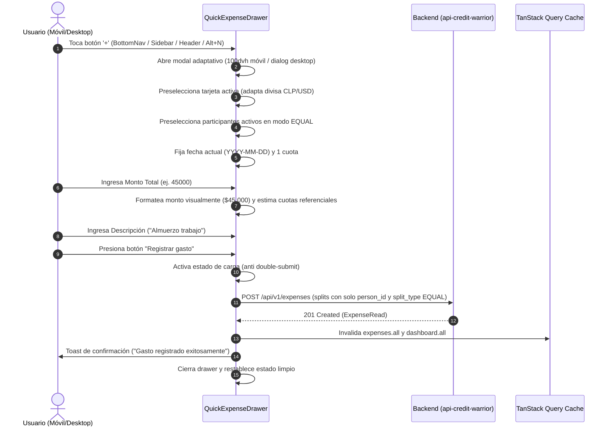
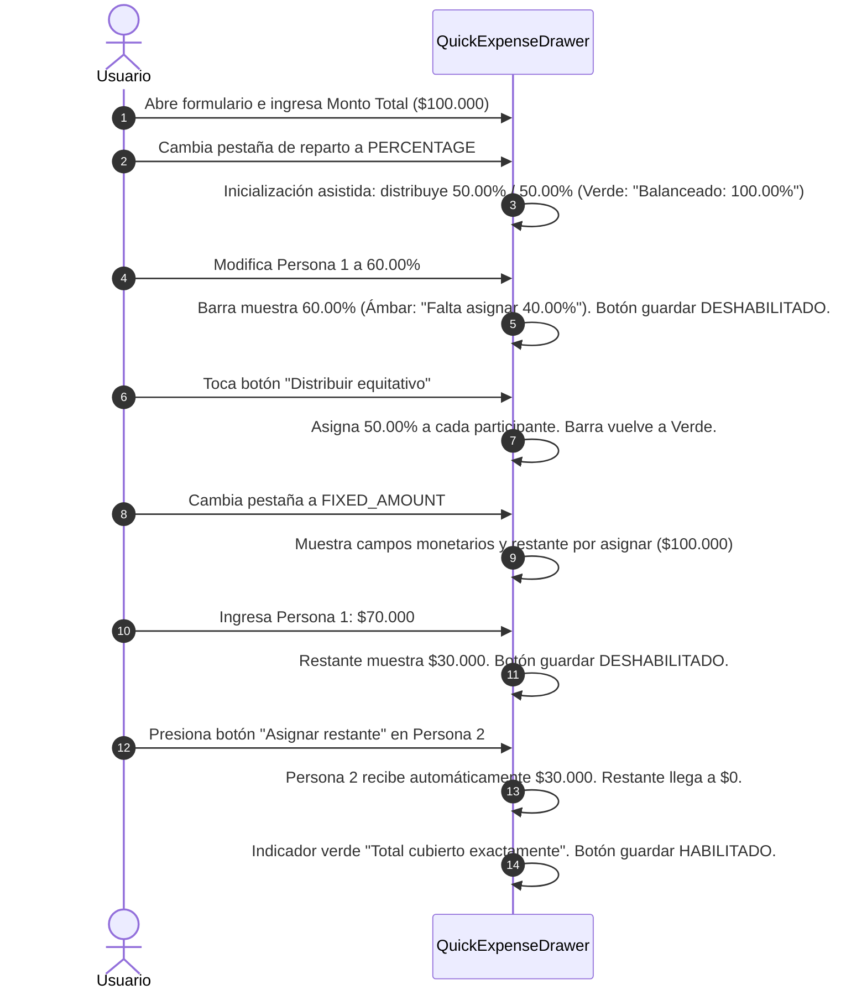

# Especificación 004 — Registro Ultra-Rápido de Gastos: Drawer Global, Adaptación de Moneda y Constructor de Repartos (`004-quick-expense-entry`)

- **Estado:** aprobado
- **Versión:** 1.1.0
- **Fecha:** 2026-10-20

---

## 1. Propósito y Contexto Funcional (QUÉ y POR QUÉ)

### 1.1 Qué se construye
Esta especificación define la experiencia de **captura y registro ultra-rápido de gastos compartidos** en **Credit Warrior Web**. Corresponde al flujo de interacción más crítico y frecuente de toda la plataforma, permitiendo a los usuarios asentar compras en tarjeta de crédito en segundos, tanto desde un teléfono móvil en el punto de venta físico como desde un navegador de escritorio.

El alcance funcional abarca:
1. **Punto de Entrada Global y Modal Adaptativo**:
   - Acceso universal e instantáneo desde cualquier pantalla de la aplicación a través de un botón destacado en la barra de navegación móvil (`BottomNav`), en la barra lateral de escritorio (`DesktopSidebar`), en la cabecera superior (`AppHeader`) o mediante atajo de teclado accesible (`Alt+N` o `N`), sin perder la vista ni el contexto de trabajo actual.
   - Presentación ergonómica mediante un panel inferior deslizable (*Drawer*) adaptado a gestos táctiles y teclado virtual en pantallas móviles con protección contra cierre accidental, y un modal centrado o panel lateral en pantallas de escritorio.
2. **Selección Inteligente de Tarjeta y Adaptación Dinámica de Moneda**:
   - Filtrado estricto que expone únicamente tarjetas de crédito activas (`is_active: true`).
   - Cambio reactivo e inmediato de la divisa del formulario (`CLP` o `USD`), adaptando símbolos monetarios, formatos de miles/decimales y validaciones de los montos al seleccionar la tarjeta.
   - Reseteo preventivo de cifras monetarias si el usuario cambia de tarjeta entre monedas distintas para evitar discrepancias de escala.
3. **Captura Ergonómica de Parámetros de Compra**:
   - Monto total con formateo monetario contextual en tiempo real.
   - Descripción obligatoria del comercio o concepto.
   - Selector de fecha con atajos rápidos táctiles (*"Hoy"* y *"Ayer"*), predeterminado en la fecha local del dispositivo.
   - Selector táctil de cuotas con atajos rápidos para plazos estándar (1, 3, 6, 12 cuotas) y selector numérico extendido (hasta 120 cuotas).
   - Acordeón de opciones avanzadas para diferimiento explícito del primer mes de facturación (`YYYY-MM`) y notas adicionales, con normalización rigurosa de cadenas vacías a `null`.
4. **Constructor Dinámico de Repartos (*ExpenseSplitBuilder*)**:
   - Selección unificada del método de división entre participantes:
     - **Equitativo (`EQUAL`)**: Selección rápida de participantes activos con cálculo de cuotas gestionado íntegramente por el servidor y visualización estimativa referencial.
     - **Porcentual (`PERCENTAGE`)**: Asignación de porcentajes individuales con inicialización asistida al 100% y barra interactiva de balance que exige un total estricto de `100.00%`, con botón de utilidad para distribución equitativa asistida.
     - **Monto Fijo (`FIXED_AMOUNT`)**: Asignación de cifras exactas por participante con indicador interactivo de saldo restante que debe llegar estrictamente a `$0`, respaldado por el botón *"Asignar restante"*.
   - Tratamiento de estado vacío orientativo ante ausencia de participantes activos registrados.
5. **Resiliencia, Mapeo de Errores e Invalidación en Cascada**:
   - Prevención activa de envíos duplicados durante el procesamiento (*anti double-submit*).
   - Sincronización en cascada tras el guardado exitoso hacia el catálogo de gastos y los resúmenes financieros mensuales y de proyección.
   - Mapeo directo y contextual de errores de validación de backend directamente sobre los campos o filas de participantes afectados.
   - Preservación integral de todos los datos ingresados ante fallos de conexión o caídas de servidor, permitiendo reintentar la acción sin pérdida de información.

### 1.2 Por qué es necesario
El registro de un gasto compartido ocurre comúnmente en situaciones de movilidad inmediata: al pagar la cuenta en un restaurante, al finalizar una compra en un supermercado o al recibir la notificación bancaria en el teléfono. Si el proceso de registro presenta fricción, requiere demasiados pasos o impone recálculos manuales:
- Los usuarios postergan el registro de la compra, lo que ocasiona olvidos y descuadra los estados de cuenta mensuales.
- Intentar forzar la misma moneda cuando la tarjeta factura en otra divisa genera confusiones cambiarias irreparables (ej. registrar un monto de $100.000 pesos chilenos bajo una tarjeta en dólares provocaría una deuda astronómica de cien mil dólares).
- Un reparto de gastos inflexible obliga a las personas a calcular mentalmente porcentajes o centavos, propiciando errores humanos.
- Si una compra falla por una desconexión momentánea del teléfono o un toque involuntario fuera del panel cierra el formulario perdiendo lo ingresado, la frustración del usuario degrada severamente la confianza en la herramienta.

---

## 2. Reglas Innegociables del Dominio

1. **Capa de Presentación Pura (Zero Financial Math on Client)**:
   - El frontend **no calcula** cronogramas de amortización, fechas efectivas de vencimiento, valores de cuota futuros ni la absorción de residuos de redondeo (la cual resuelve el backend asignando las diferencias de centavos a la cuota #1 y al último participante de la lista).
   - Las indicaciones de división en la interfaz (como la estimación referencial en reparto equitativo) son exclusivamente informativas. Toda cifra financiera definitiva proviene de las respuestas oficiales del servidor.
2. **Inmutabilidad y Precisión Monetaria Basada en `string`**:
   - Todos los montos monetarios (`total_amount`, `fixed_amount`) y porcentajes (`percentage`) se gestionan, validan y transmiten estrictamente como **cadenas de texto numéricas** (`"150000"`, `"45.50"`, `"50.00"`).
   - Queda prohibido el almacenamiento o manipulación de estos valores como números flotantes (`number`) en el estado del formulario o en las comunicaciones de red.
   - Las validaciones de balanceo en cliente (suma del 100.00% y suma de montos fijos igual al monto total) deben efectuarse operando sobre **unidades enteras** (centésimas y centavos) para garantizar exactitud aritmética absoluta.
3. **Restricciones Contractuales de Repartos (`splits`)**:
   - Cada gasto debe registrar al menos un participante (`minItems: 1`).
   - Todos los participantes asignados a un gasto deben compartir obligatoriamente el mismo método de reparto (`split_type`: `EQUAL`, `PERCENTAGE` o `FIXED_AMOUNT`).
   - Ningún participante (`person_id`) puede repetirse dentro de la lista de repartos de una misma compra.
   - En el modo equitativo (`EQUAL`), los atributos `percentage` y `fixed_amount` no deben enviarse (o deben enviarse como `null`) para cumplir estrictamente con el contrato del servidor y evitar rechazos por campos indebidos.
4. **Adaptación Automática de Moneda por Tarjeta y Protección ante Discrepancia**:
   - La divisa de la compra está rígidamente condicionada por la moneda de facturación de la tarjeta seleccionada (`CLP` o `USD`).
   - Si el usuario cambia entre tarjetas de monedas distintas mientras ya existían montos ingresados, el sistema borra de forma segura dichos montos y alerta al usuario para evitar errores de magnitud.
5. **Resiliencia de Datos y Ergonomía Libre de Diálogos Nativos**:
   - Si la petición de guardado falla por error de red o error de servidor, el formulario **no debe cerrarse bajo ninguna circunstancia**, conservando intactos todos los campos, selecciones y montos ingresados para permitir el reintento inmediato.
   - Si el usuario ha comenzado a ingresar datos (formulario "sucio"), el panel móvil deshabilita el cierre accidental por toque en el fondo para proteger el esfuerzo del usuario.
   - Queda prohibido el uso de ventanas nativas del navegador (`alert`, `confirm`, `prompt`). Todas las alertas y confirmaciones se gestionan mediante componentes accesibles integrados en el tema oscuro de la plataforma.
6. **Sin Autenticación en el MVP**:
   - El registro de compras opera directamente en el entorno local del usuario sin pantallas de acceso ni encabezados de autorización.

---

## 3. Requisitos Funcionales (Formato EARS) y Criterios de Aceptación

### RF-01: Activador Global, Disparadores en Desktop/Móvil y Modal Adaptativo
**MIENTRAS** el usuario se encuentre en cualquier vista de la aplicación (Dashboard, Compras, Tarjetas, Personas), **EL SISTEMA DEBERÁ** proporcionar acceso continuo e inmediato al formulario de registro rápido de gastos:
1. **Disparadores Globales Segregados por Dispositivo**:
   - **En pantallas móviles (`< 768px`)**: Un botón central destacado con el símbolo `+` en la barra inferior de navegación fija (`BottomNav`), con un área táctil mínima de `48x48px` y elevación visual distinguible.
   - **En pantallas de escritorio (`>= 768px`)**:
     - **Disparador Primario**: Botón destacado con icono `+` y texto *"Registrar gasto"* ubicado en la barra lateral fija de navegación (`DesktopSidebar`).
     - **Disparador Secundario**: Botón de acceso rápido en la cabecera superior (`AppHeader`).
     - **Atajo de Teclado Accesible**: Activación global mediante la combinación `Alt+N` (o pulsación simple de la tecla `N` en vista general).
     - **Regla Estricta de Exclusión de Foco**: El atajo de teclado **no debe dispararse** cuando el foco del usuario resida dentro de elementos editables interactivos (`input`, `textarea`, `select` o elementos con atributo `contenteditable`), evitando activaciones no deseadas mientras se redacta texto.
2. **Presentación Adaptativa de Interfaz**:
   - **En pantallas móviles (`< 768px`)**: Se abre un panel inferior deslizable (*Drawer*) con manija de arrastre (*drag handle*), adaptable a la altura disponible (`100dvh`), que reposiciona suavemente su contenido al desplegarse el teclado virtual para mantener el campo activo en la zona visible.
   - **Prevención de Cierre Accidental por Formulario Sucio**:
     - **SI** el formulario contiene datos ingresados (monto total mayor a cero o texto en la descripción), **ENTONCES EL SISTEMA DEBERÁ** deshabilitar el cierre accidental por toque involuntario fuera del panel (desactivando el despido al presionar el backdrop o deslizar suavemente). Para descartar el formulario en dicho estado, el usuario debe pulsar explícitamente el botón *"Cancelar"*, garantizando la protección de los datos en pantallas táctiles.
   - **En pantallas de escritorio (`>= 768px`)**: Se abre un diálogo modal centrado o panel lateral con ancho confortable y desenfoque de fondo (*backdrop blur*).
3. **Conservación del Contexto**:
   - Abrir o cerrar el formulario de registro rápido no altera la ruta ni los filtros de la pantalla que el usuario tenía activa.

**Criterios de Aceptación:**
- [ ] El botón `+` en móvil abre el panel deslizable con animación fluida sin recargar la página.
- [ ] En escritorio, tanto el botón en la barra lateral (`DesktopSidebar`) como en la cabecera (`AppHeader`) abren el modal centrado con foco accesible automático.
- [ ] Presionar `Alt+N` (o `N`) en escritorio abre el modal si el foco está en el documento; si el foco está en un input o textarea, el atajo no se dispara y se escribe la letra correspondiente.
- [ ] En móvil, al enfocar un campo de texto, el teclado virtual no oculta el campo ni bloquea el scroll del formulario.
- [ ] Si el usuario ingresó monto o descripción en móvil, presionar el backdrop exterior no cierra el panel; se requiere pulsar *"Cancelar"*.
- [ ] Cerrar el modal mediante botón de cancelar o tecla Escape devuelve al usuario exactamente a la vista donde se encontraba.

---

### RF-02: Selección de Tarjeta de Crédito Activa y Adaptación de Moneda
**CUANDO** se abra el formulario de registro rápido, **EL SISTEMA DEBERÁ** cargar y presentar las tarjetas de crédito disponibles:
1. **Filtro Exclusivo de Tarjetas Activas**:
   - Solo se despliegan aquellas tarjetas que registran estado activo (`is_active: true`). Las tarjetas archivadas no se muestran en este selector.
2. **Presentación de Opciones**:
   - Cada tarjeta muestra su nombre identificador, sus últimos 4 dígitos enmascarados (`•••• 1234`) si existen, y su distintivo de moneda (`CLP` o `USD`).
3. **Comportamiento de Preselección**:
   - Si existe una única tarjeta activa registrada, el sistema la preselecciona automáticamente.
   - Si existen múltiples tarjetas activas, el selector permanece en espera de elección o recuerda la última tarjeta empleada en la sesión.
   - **SI** no existen tarjetas activas registradas (por archivado previo o anomalía de estado), **ENTONCES EL SISTEMA DEBERÁ** desplegar un mensaje orientativo con un botón directo para registrar o reactivar una tarjeta.
4. **Adaptación Reactiva de Moneda**:
   - **CUANDO** el usuario seleccione una tarjeta de crédito, **EL SISTEMA DEBERÁ** sincronizar instantáneamente la divisa del formulario con la de la tarjeta:
     - Si la tarjeta es `CLP`: el símbolo monetario cambia a `$`, los inputs formatean sin decimales (separación de miles por punto) y la divisa se fija en `CLP`.
     - Si la tarjeta es `USD`: el símbolo monetario cambia a `US$`, los inputs aceptan y muestran hasta dos decimales (separador decimal) y la divisa se fija en `USD`.
   - La divisa seleccionada se propaga de forma inmediata a todos los indicadores de reparto y resúmenes del formulario.
5. **Reseteo Preventivo de Cifras ante Cambio de Moneda**:
   - **SI** el usuario ya había introducido un monto en `total_amount` o cifras en `fixed_amount` y procede a seleccionar una tarjeta con divisa diferente (ej. de `CLP` a `USD` o viceversa), **ENTONCES EL SISTEMA DEBERÁ** limpiar los campos monetarios (restableciéndolos a cadena vacía `""`), notificar de inmediato mediante un aviso visual o toast sutil (*"Moneda cambiada a [USD/CLP]: se restablecieron los montos para evitar discrepancias de escala"*) y recalcular los estados de balance, evitando que cifras de gran magnitud en pesos chilenos se interpreten erróneamente como dólares (ej. 100.000 CLP vs 100.000 USD).

**Criterios de Aceptación:**
- [ ] Solo se muestran tarjetas con `is_active: true`.
- [ ] Si hay una sola tarjeta activa, aparece seleccionada por defecto al abrir el formulario.
- [ ] Cambiar de una tarjeta en CLP a una en USD actualiza de inmediato el símbolo y las reglas de formato de todos los campos monetarios.
- [ ] Si el usuario ingresó "$50.000" en CLP y cambia a una tarjeta USD, el campo de monto se vacía y se notifica el restablecimiento.
- [ ] Si no hay tarjetas activas disponibles, el formulario no permite el ingreso de montos y muestra un enlace directo hacia la gestión de tarjetas.

---

### RF-03: Captura de Datos Esenciales de Compra y Atajos de Fecha
**MIENTRAS** el usuario complete los campos del gasto, **EL SISTEMA DEBERÁ** validar y procesar los siguientes datos obligatorios:
1. **Descripción (`description`)**:
   - Texto obligatorio de `1` a `255` caracteres.
   - Los espacios en blanco al inicio y al final se limpian automáticamente (*trim*).
   - Se muestra texto de marcador (*placeholder*) ilustrativo (ej. *"Supermercado Líder"*, *"Cena amigos"*, *"Pasajes aéreos"*).
2. **Monto Total (`total_amount`)**:
   - Valor monetario obligatorio, estrictamente numérico y mayor a cero (`> 0`).
   - Se introduce mediante un teclado numérico optimizado en dispositivos móviles.
   - Formateo visual dinámico según la moneda activa:
     - `CLP`: Formato entero sin decimales (ej. `$150.000`).
     - `USD`: Formato con hasta 2 decimales (ej. `US$45.50`).
   - El valor interno persistido y transmitido es siempre una cadena numérica limpia (ej. `"150000"`, `"45.50"`).
3. **Fecha de Compra (`purchase_date`) y Atajos Rápidos**:
   - Campo obligatorio en formato de fecha estándar `YYYY-MM-DD`.
   - Se inicializa de forma predeterminada con la fecha local actual del dispositivo.
   - **Atajos de Fecha Rápida**: Junto al control de fecha se disponen píldoras táctiles de un solo toque:
     - *"Hoy"*: Asigna la fecha local actual.
     - *"Ayer"*: Asigna la fecha correspondiente al día anterior.
   - Selector de calendario accesible para fechas previas o futuras específicas.
4. **Cantidad de Cuotas (`installments_count`)**:
   - Número entero obligatorio comprendido entre `1` y `120` inclusive (predeterminado en `1`).
   - Dispone de botones táctiles de acceso rápido para los valores más comunes: `1` (Al contado), `3`, `6`, `12`.
   - Dispone de un control de entrada manual para ingresar cualquier número entero dentro del rango permitido (`1`..`120`).

**Criterios de Aceptación:**
- [ ] El campo de monto solo permite ingresar números válidos y aplica el formato de moneda de la tarjeta en tiempo real.
- [ ] La fecha de compra se inicializa en el día actual del dispositivo del usuario.
- [ ] Tocar el botón *"Ayer"* actualiza inmediatamente el campo de fecha al día inmediatamente anterior.
- [ ] Seleccionar el botón rápido de `3` cuotas actualiza el valor de cuotas a 3 de inmediato.
- [ ] Si se intenta ingresar un monto menor o igual a cero o una cantidad de cuotas superior a 120, la validación visual alerta sobre el error antes del envío.

---

### RF-04: Opciones Avanzadas de Facturación (Diferimiento, Notas y Normalización)
**EL SISTEMA DEBERÁ** incluir una sección colapsable denominada *"Opciones avanzadas"*, cerrada por defecto para optimizar la velocidad del registro rápido:
1. **Primer Mes de Facturación Forzado (`first_billing_override`) y Normalización**:
   - Campo opcional en formato de período `YYYY-MM` (ej. `2026-12`).
   - Cuenta con una explicación contextual: permite forzar o postergar el inicio del cobro de cuotas (para compras con meses de gracia o promociones tipo *"compre en octubre y pague en diciembre"*).
   - **Normalización Estricta a Nulo**: Si el campo permanece vacío o el usuario borra su contenido (dejando cadena vacía `""`), el valor se normaliza obligatoriamente a `null` (o se omite) antes de despachar el payload, impidiendo que el backend rechace la petición con error `422 Unprocessable Entity` por la expresión regular `^\d{4}-(0[1-9]|1[0-2])$`.
2. **Notas Adicionales (`notes`) y Normalización**:
   - Campo de texto multilínea opcional con capacidad de hasta `2000` caracteres.
   - Permite registrar aclaraciones, números de comprobante o acuerdos específicos del gasto.
   - **Normalización Estricta a Nulo**: Si el campo contiene solo espacios o cadena vacía `""`, se normaliza obligatoriamente a `null` (o se omite) antes del envío.

**Criterios de Aceptación:**
- [ ] La sección de opciones avanzadas se encuentra colapsada al abrir el formulario.
- [ ] Al expandir la sección, el campo de primer mes de facturación solo admite entradas en formato de año y mes válido.
- [ ] Si el usuario no ingresa notas ni diferimiento, la petición transmite `null` (o los omite) y nunca cadenas vacías `""`.
- [ ] Si el usuario escribe y luego borra el campo de diferimiento, el payload transmite `null` sin disparar error `422`.

---

### RF-05: Constructor de Repartos — Selección de Participantes, Estado Vacío y Reglas Globales
**MIENTRAS** el usuario configure la distribución del gasto, **EL SISTEMA DEBERÁ** proveer un selector unificado de estrategia de división (*split_type*):
1. **Métodos Disponibles**:
   - **`EQUAL`** (*Partes iguales*): División equitativa entre todos los participantes seleccionados.
   - **`PERCENTAGE`** (*Porcentaje*): Asignación porcentual explícita a cada participante.
   - **`FIXED_AMOUNT`** (*Monto fijo*): Asignación de una cifra monetaria exacta a cada participante.
2. **Participantes Disponibles**:
   - Solo se listan personas registradas con estado activo (`is_active: true`).
   - Cada participante se representa mediante su distintivo visual con nombre y color asignado.
3. **Comportamiento Inicial Predeterminado**:
   - El formulario se inicializa en modo `EQUAL`.
   - Por defecto, se preseleccionan automáticamente todos los participantes activos disponibles, reduciendo el proceso a un único toque de confirmación para gastos compartidos habituales.
4. **Comportamiento ante Cero Participantes Activos**:
   - **SI** no existen personas activas registradas (`activePersonsCount === 0`) (por haber sido archivadas o no haberse creado ninguna), **ENTONCES EL SISTEMA DEBERÁ** desplegar en el bloque de repartos un mensaje orientativo (*"No tienes participantes activos para dividir compras"*) acompañado de un botón directo de acción (*"Crear participante"*) que enlace hacia `/persons`, manteniendo deshabilitado el botón de guardado para evitar violar la restricción del servidor de requerir al menos un participante (`splits.minItems: 1`).
5. **Validaciones Estructurales**:
   - La lista debe contar con al menos un participante seleccionado (`minItems: 1`).
   - No puede incluirse dos veces a la misma persona dentro del reparto.
   - Todos los integrantes deben regirse bajo el mismo método de reparto activo.

**Criterios de Aceptación:**
- [ ] Al abrir el formulario, todos los participantes activos aparecen preseleccionados en modo partes iguales.
- [ ] Si no existen participantes activos, se muestra el estado vacío informativo con botón a `/persons` y el botón de guardado permanece deshabilitado.
- [ ] Deseleccionar a un participante lo excluye del cálculo y de la petición enviada.
- [ ] Si se deseleccionan todos los participantes, se muestra una alerta que exige al menos un responsable del gasto.
- [ ] Cambiar el método de reparto actualiza uniformemente la vista para todos los participantes seleccionados.

---

### RF-06: Reparto Equitativo (Modo `EQUAL`)
**CUANDO** el modo de reparto activo sea `EQUAL`:
1. **Selección de Participantes**:
   - El usuario activa o desactiva participantes mediante pulsación directa sobre sus distintivos visuales.
2. **Ausencia de Campos de Entrada Numérica por Persona**:
   - No se presentan cajas de texto para ingresar porcentaje ni monto por persona.
3. **Conformidad Estricta con el Contrato OpenAPI**:
   - En el payload de envío, cada elemento de la lista de repartos incluye únicamente el identificador del participante (`person_id`) y el tipo de reparto (`split_type: "EQUAL"`).
   - Los campos `percentage` y `fixed_amount` no se transmiten (o se transmiten como `null`), evitando errores de validación del servidor (`422 Unprocessable Entity`).
4. **Indicador Visual Informativo de Cuota Estimada**:
   - **SI** el usuario ha ingresado un monto total válido, **ENTONCES EL SISTEMA DEBERÁ** mostrar una cifra referencial de división estimada (ej. *"Aprox. $50.000 por persona"*), acompañada de una aclaración sutil que indique que los centavos o residuos de redondeo son ajustados de manera exacta por el servidor en la primera cuota y último participante.

**Criterios de Aceptación:**
- [ ] En modo `EQUAL` no se muestran campos de entrada de porcentajes ni montos individuales.
- [ ] La petición enviada no contiene valores numéricos residuales en `percentage` ni `fixed_amount`.
- [ ] Al cambiar la cantidad de personas seleccionadas o el monto total, la cifra informativa estimada se recalcula de inmediato.

---

### RF-07: Reparto Porcentual con Inicialización Asistida y Barra Interactiva (Modo `PERCENTAGE`)
**CUANDO** el modo de reparto activo sea `PERCENTAGE`:
1. **Inicialización Asistida al Conmutar a Porcentaje**:
   - **CUANDO** el usuario cambie de modo `EQUAL` a `PERCENTAGE`, **EL SISTEMA DEBERÁ** distribuir automáticamente y de manera equitativa el `100.00%` entre los participantes seleccionados (ej. `50.00%` y `50.00%` para 2 personas; `33.34%`, `33.33%` y `33.33%` para 3 personas), de modo que la barra de balance interactiva inicie directamente en estado de éxito (verde esmeralda al `100.00%`), permitiendo que el usuario solo tenga que ajustar las diferencias particulares en lugar de tener que rellenar todos los campos desde cero.
2. **Entrada de Porcentaje por Participante**:
   - Cada participante seleccionado presenta un campo numérico con sufijo `%`.
   - Cada valor debe ser una cadena numérica positiva mayor a cero y menor o igual a `100.00` (ej. `"50.00"`, `"25.50"`).
3. **Barra Interactiva de Balance Porcentual**:
   - **EL SISTEMA DEBERÁ** mostrar en tiempo real el porcentaje total acumulado mediante una barra de progreso visual:
     - **Si la suma es menor a 100.00%**: Barra en tono de advertencia (ámbar), indicando el porcentaje asignado y el faltante por distribuir (ej. *"Asignado: 80.00% · Falta: 20.00%"*).
     - **Si la suma supera el 100.00%**: Barra en tono de peligro (rojo), indicando el exceso (ej. *"Exceso: 105.00% (+5.00%)"*).
     - **Si la suma es exactamente 100.00%**: Barra completa en tono de éxito (verde esmeralda), indicando *"Balanceado: 100.00%"*.
4. **Bloqueo Preventivo del Guardado**:
   - El botón de confirmación permanece **deshabilitado** mientras la suma en centésimas enteras difiera de `100.00%` (10.000 centésimas).
5. **Herramienta de Distribución Equitativa Rápida**:
   - Se incluye un botón accesible *"Distribuir equitativo"* que recalcula y redistribuye equitativamente el 100% entre las personas seleccionadas en cualquier momento.
6. **Transmisión de Datos**:
   - Cada elemento de reparto incluye `person_id`, `split_type: "PERCENTAGE"` y `percentage` como string formateado con hasta 2 decimales. El atributo `fixed_amount` no se envía (o se envía como `null`).

**Criterios de Aceptación:**
- [ ] Al cambiar de `EQUAL` a `PERCENTAGE`, los porcentajes se pre-llenan equitativamente sumando exactamente 100.00% con barra en verde.
- [ ] El botón de guardar se deshabilita si los porcentajes suman 99.99% o 100.01%.
- [ ] El botón de guardar se habilita únicamente cuando la suma es exactamente 100.00%.
- [ ] Presionar *"Distribuir equitativo"* restablece la suma a 100.00% exacto.
- [ ] La petición de guardado no incluye atributo `fixed_amount` en las filas de reparto porcentual.

---

### RF-08: Reparto por Monto Fijo, Verificación de Restante y Asignación Rápida (Modo `FIXED_AMOUNT`)
**CUANDO** el modo de reparto activo sea `FIXED_AMOUNT`:
1. **Entrada de Monto por Participante**:
   - Cada participante seleccionado presenta un campo de entrada monetaria con el símbolo de la moneda activa (`$` o `US$`).
   - Cada valor debe ser una cadena numérica positiva mayor a cero en la divisa de la tarjeta.
2. **Indicador Interactivo de Saldo Restante**:
   - **EL SISTEMA DEBERÁ** calcular y desplegar en tiempo real la diferencia entre el monto total del gasto y la suma de los montos asignados:
     - **Si la suma es menor al total**: Muestra en tono de advertencia el saldo pendiente (ej. *"Restante por asignar: $15.000"*).
     - **Si la suma supera el total**: Muestra en tono de peligro el monto excedido (ej. *"Monto excedido por: $5.000"*).
     - **Si la suma coincide exactamente con el monto total**: Muestra un indicador en verde de *"Total cubierto exactamente"*.
3. **Acción Rápida de Asignación de Saldo Restante**:
   - En cada fila de participante, cuando exista un saldo pendiente por asignar (`restante > 0`), se habilita un botón de utilidad sutil *"Asignar restante"*, el cual transfiere automáticamente todo el monto no asignado a ese participante, facilitando cubrir el saldo pendiente en un solo toque sin cálculos manuales.
4. **Bloqueo Preventivo del Guardado**:
   - El botón de confirmación permanece **deshabilitado** mientras el saldo restante sea distinto de cero o no se haya ingresado un monto total válido.
5. **Transmisión de Datos**:
   - Cada elemento de reparto incluye `person_id`, `split_type: "FIXED_AMOUNT"` y `fixed_amount` como string numérico. El atributo `percentage` no se envía (o se envía como `null`).

**Criterios de Aceptación:**
- [ ] El saldo restante se actualiza reactivamente conforme el usuario teclea en cada fila de participante.
- [ ] Tocar *"Asignar restante"* en una fila suma el saldo faltante directamente a ese participante, llevando el restante a $0 de inmediato.
- [ ] El botón de guardar solo se activa cuando la suma de los montos individuales en centavos enteros iguala con precisión el monto total del gasto.
- [ ] En la petición de guardado no se envía el atributo `percentage`.

---

### RF-09: Envío de Formulario, Prevención de Doble Envío e Invalidación en Cascada
**CUANDO** el usuario accione el botón de guardado (*"Registrar gasto"*) y el formulario cumpla todas las validaciones de cliente:
1. **Bloqueo Anti Doble-Envío**:
   - El botón de guardado pasa a estado de carga, muestra un indicador de actividad y deshabilita todos los controles interactivos para evitar envíos duplicados por toques sucesivos.
2. **Petición al Servidor**:
   - Se despacha una petición de creación al endpoint de gastos del backend (`POST /api/v1/expenses`).
3. **Procesamiento de Respuesta Exitosa (`201 Created`)**:
   - **EL SISTEMA DEBERÁ**:
     - Desplegar una notificación de éxito visual (*toast*) confirmando el registro de la compra (ej. *"Gasto registrado exitosamente"*).
     - Cerrar el panel o modal de registro rápido.
     - Restablecer todos los campos del formulario a sus valores predeterminados limpios.
     - Disparar la invalidación en cascada de los catálogos y resúmenes:
       - Caché de compras y gastos (`expenses.all`).
       - Caché del tablero financiero (`dashboard.all`, que comprende el resumen del próximo período y las proyecciones a futuro).

**Criterios de Aceptación:**
- [ ] No es posible presionar dos veces el botón de guardado durante el envío.
- [ ] Tras el código `201`, el drawer o modal se cierra automáticamente.
- [ ] Se invalida tanto el listado de gastos como el dashboard financiero.
- [ ] Al volver a abrir el modal, el formulario está limpio y listo para un nuevo registro.

---

### RF-10: Resiliencia de Formulario, Mapeo Inline de Errores `422` y Concurrencia `404`
**CUANDO** la petición de guardado no resulte exitosa:
1. **Errores de Validación de Servidor (`422 Unprocessable Entity`)**:
   - **SI** el backend rechaza la petición con código `422`, **ENTONCES EL SISTEMA DEBERÁ**:
     - Mantener el formulario abierto sin reiniciar ningún dato ingresado.
     - Extraer la lista de errores devuelta por el servidor y asociar cada mensaje directamente al campo correspondiente (ej. si la descripción no cumple la longitud o si un split excede los límites).
     - Resaltar visualmente en tono de error los campos o filas de participantes observados, presentando el mensaje explicativo debajo del control.
2. **Conflictos de Concurrencia (`404 Not Found`)**:
   - **SI** la respuesta del servidor indica código `404` (porque la tarjeta o un participante fue eliminado o archivado concurrentemente en otra sesión):
     - Mantener el formulario abierto para no perder los datos del gasto.
     - Desplegar una notificación informativa de error (ej. *"La tarjeta o uno de los participantes seleccionados ya no se encuentra disponible"*).
     - Refrescar silenciosamente los catálogos de tarjetas y personas para actualizar las opciones vigentes.
3. **Resiliencia ante Fallos de Red o Error de Servidor (`500` / Timeout / Desconexión)**:
   - **SI** la petición no puede completarse debido a corte de conexión, tiempo de espera agotado o error interno del servidor:
     - El panel o modal **debe permanecer completamente abierto**.
     - Todos los datos, montos, selecciones y notas permanecen exactamente en el estado en que los dejó el usuario.
     - Se restablece el estado del botón de guardado para permitir el **reintento inmediato** una vez restablecida la conectividad.
     - Se despliega una notificación de advertencia orientativa (ej. *"No se pudo conectar con el servidor. Revisa tu conexión e intenta nuevamente"*).

**Criterios de Aceptación:**
- [ ] Un error `422` no cierra el modal y ubica los mensajes de error bajo el campo correspondiente.
- [ ] Un error de red o `500` no borra el texto de la descripción, montos ni notas.
- [ ] El usuario puede pulsar nuevamente *"Registrar gasto"* para reintentar sin volver a escribir el gasto.

---

## 4. Flujos de Usuario y Diagramas de Interacción (UX)

### 4.1 Flujo Principal: Registro Rápido en Movilidad (Modo EQUAL)



---

### 4.2 Flujo: Registro con Reparto Personalizado y Balanceo en Tiempo Real



---

### 4.3 Flujo: Manejo Resiliente ante Errores de Servidor y Red

```mermaid
sequenceDiagram
    autonumber
    actor U as Usuario
    participant UI as QuickExpenseDrawer
    participant API as Backend (api-credit-warrior)

    U->>UI: Presiona "Registrar gasto" con datos completos
    UI->>API: POST /api/v1/expenses
    alt Fallo de Conexión / Servidor Inaccesible (Error de Red o 500)
        API--xUI: Error de conexión / 500 Internal Server Error
        UI->>UI: Conserva drawer ABIERTO con todos los datos intactos
        UI->>UI: Restablece botón "Registrar gasto" para reintento
        UI->>U: Toast de alerta: "Error de conexión. Tus datos están a salvo; reintenta."
        U->>UI: Vuelve a presionar "Registrar gasto"
        UI->>API: Reintento POST /api/v1/expenses
        API-->>UI: 201 Created
        UI->>UI: Cierra drawer con éxito
    else Error de Validación de Servidor (422 Unprocessable Entity)
        API-->>UI: 422 Unprocessable Entity (loc: ['body', 'description'], msg: '...')
        UI->>UI: Conserva drawer ABIERTO
        UI->>UI: Inyecta mensaje de error bajo el campo descripción
        UI->>UI: Restablece botón "Registrar gasto"
        U->>UI: Corrige la descripción observada y reenvía
    end
```

---

## 5. Estados de la Interfaz de Usuario

| Estado de UI | Condiciones Disparadoras | Comportamiento Visual y Controles | Acciones del Usuario |
| :--- | :--- | :--- | :--- |
| **1. Inicial / Preparación** | Apertura del drawer mientras se cargan tarjetas y personas activas. | Indicadores de carga discretos (*skeleton loaders*) en la tarjeta y participantes. Botón de guardado deshabilitado. | Esperar medio segundo o cerrar drawer. |
| **2. Sin Tarjetas Activas** | El usuario abre el drawer pero no existen tarjetas con `is_active: true`. | Mensaje orientativo: *"No tienes tarjetas activas disponibles para registrar gastos"*. Botón directo *"Ir a Tarjetas"*. Campos de compra bloqueados. | Navegar a `/cards` para crear o reactivar una tarjeta. |
| **2b. Sin Participantes Activos** | Tarjetas activas disponibles, pero no existen personas con `is_active: true` (`activePersonsCount === 0`). | Mensaje orientativo en el bloque de repartos: *"No tienes participantes activos para dividir compras"*. Botón directo *"Crear participante"*. Botón de guardado deshabilitado para evitar violar `splits.minItems: 1`. | Navegar a `/persons` para registrar o reactivar un participante. |
| **3. Formulario Listo (EQUAL)** | Tarjetas y personas cargadas; tarjeta seleccionada (moneda adaptada), personas preseleccionadas, cuotas en 1. | Formulario interactivo completo; botón de guardado deshabilitado hasta que `total_amount` > 0 y `description` no esté vacía. | Introducir monto, descripción y ajustar cuotas. |
| **4. Reparto Desbalanceado (PERCENTAGE o FIXED)** | El usuario selecciona modo porcentual o monto fijo y la suma difiere de 100% o del monto total. | Barra de progreso en color ámbar (faltante) o rojo (exceso). Texto explícito con la diferencia exacta. Botón de guardado estrictamente **deshabilitado**. | Ajustar los valores numéricos, usar *"Asignar restante"* o presionar *"Distribuir equitativo"*. |
| **5. Reparto Balanceado** | Suma porcentual = 100.00% o suma de montos fijos = total_amount. | Barra en color verde esmeralda (`#10B981`) indicando balance óptimo. Botón de guardado habilitado (si monto y descripción son válidos). | Proceder al guardado de la compra. |
| **6. Procesamiento / Envío** | El usuario presiona *"Registrar gasto"*. | Botón muestra spinner de carga. Inputs bloqueados contra modificación simultánea. | Esperar respuesta de la API. |
| **7. Éxito (`201 Created`)** | Respuesta exitosa del servidor. | Cierre suave del drawer/modal. Toast verde confirmatorio. Listado de compras y dashboard actualizados reactivamente. | Continuar navegación normal en la aplicación. |
| **8. Error Validación (`422`)** | Servidor rechaza la petición por validación semántica. | Drawer permanece abierto. Campos afectados resaltados en rojo (`#F43F5E`) con su mensaje respectivo de Pydantic. | Corregir los campos señalados y volver a pulsar guardar. |
| **9. Error Concurrencia (`404`)** | Una tarjeta o persona fue borrada concurrentemente en el backend. | Drawer permanece abierto. Toast de advertencia. Las listas de selección se refrescan en segundo plano. | Seleccionar otra tarjeta o participante vigente. |
| **10. Fallo de Red o Servidor (`500`)** | Pérdida de conectividad, timeout o caída de servicio. | Drawer permanece **abierto**. Todos los datos se conservan intactos. Toast de error explicando el problema de red. Botón habilitado para reintento. | Pulsar nuevamente *"Registrar gasto"* para reintentar sin reescribir nada. |

---

## 6. Matriz de Casos Límite y Reglas de Validación

| Caso Límite / Escenario de Borde | Regla de Validación / Condición | Respuesta Esperada de la Interfaz |
| :--- | :--- | :--- |
| **Monto total con caracteres no numéricos o negativos** | `total_amount <= 0` o contiene letras/símbolos extraños. | El teclado numérico y la máscara impiden la entrada de caracteres inválidos. Si el valor es cero o vacío, el botón de guardado no se activa. |
| **Cambio de tarjeta entre monedas distintas con montos ingresados (`CLP` <-> `USD`)** | El usuario ingresa un monto y conmuta a una tarjeta con diferente moneda. | Se limpian los campos monetarios (`total_amount = ""`, `fixed_amount = ""`) y se emite un aviso sutil para prevenir errores graves de magnitud (ej. interpretar 100.000 CLP como 100.000 USD). |
| **Divisa de tarjeta con decimales (`USD`) vs sin decimales (`CLP`)** | Manejo de centavos según la moneda seleccionada. | En `CLP`, se suprimen decimales y se aplica separador de miles por puntos. En `USD`, se admiten hasta dos decimales (`US$45.50`). |
| **Suma porcentual con redondeo flotante (ej. 33.33% x 3 = 99.99%)** | Suma en centésimas enteras: `3333 + 3333 + 3333 = 9999 !== 10000`. | La interfaz no redondea artificialmente a 100%; exige exactamente 10.000 centésimas (100.00%). El botón *"Distribuir equitativo"* asigna automáticamente `33.34%` a uno de ellos para cerrar en `100.00%`. |
| **Monto fijo excede el total de la compra** | Suma de `fixed_amount` > `total_amount`. | Se muestra alerta visual de exceso en rojo con el monto exacto excedido. El botón de guardado permanece deshabilitado. |
| **Usuario desmarca a todos los participantes** | `splits.length === 0`. | Se muestra un mensaje de advertencia visual indicando que se requiere al menos un participante para la compra. |
| **Cero participantes activos registrados en el sistema** | `activePersonsCount === 0`. | Se bloquea el guardado y se muestra banner orientativo con botón para navegar a `/persons` a crear participantes. |
| **Participante duplicado en la lista** | `person_id` repetido. | El constructor no permite añadir o marcar a una persona más de una vez; cada participante es una entidad única en la selección. |
| **Atributos cruzados en modo EQUAL** | Modo `EQUAL` seleccionado. | La interfaz garantiza que la petición no envíe `percentage` ni `fixed_amount` (se mandan nulos o se omiten), previniendo rechazos `422`. |
| **Fecha de primer cobro (`first_billing_override`) vacía o limpiada** | Cadena vacía `""` o espacios. | Se normaliza automáticamente a `null` antes de despachar el payload `POST`, evitando rechazos `422` del backend por regex `^\d{4}-(0[1-9]|1[0-2])$`. |
| **Notas adicionales vacías o limpiadas** | Cadena vacía `""` o espacios en `notes`. | Se normaliza automáticamente a `null` antes del envío. |
| **Pérdida de foco y cierre accidental en móvil con datos ingresados** | Formulario sucio (`dirty`: monto > 0 o descripción con texto) en móvil. | Se desactiva el cierre por toque involuntario en el backdrop (`dismissible={false}`); se exige presionar explícitamente *"Cancelar"* para descartar los datos. |
| **Reintento tras fallo de conectividad en movilidad** | Fallo de red con formulario lleno. | El usuario puede presionar *"Registrar gasto"* tantas veces como sea necesario una vez restablecida la señal celular, sin perder nunca los datos completados. |

---

## 7. Requisitos No Funcionales, Accesibilidad y Ergonomía

1. **Cumplimiento WCAG 2.1 Nivel AA**:
   - Contraste cromático mínimo de `4.5:1` en todos los textos sobre fondos oscuros (`#090A0F`, `#12141C`, `#1A1D28`).
   - Los mensajes de advertencia de balance (ámbar `#F59E0B` y rojo `#F43F5E`) deben ir acompañados de texto descriptivo y no depender exclusivamente del color.
   - Navegación integral por teclado mediante tabulación lógica, soporte de tecla Escape para cerrar el formulario y atajo `Alt+N` / `N` con exclusión estricta de elementos editables.
2. **Ergonomía Táctil y Compatibilidad PWA**:
   - Todas las áreas de pulsación táctil (chips de tarjeta, botones de participantes, atajos de cuotas, manijas de arrastre y botones de acción) deben tener dimensiones mínimas de **`44x44px`** (idealmente `48x48px` para el botón central `+`).
   - El panel inferior deslizable debe respetar las zonas seguras de pantalla (*safe areas* para iOS/Android) mediante `env(safe-area-inset-bottom)`.
3. **Eficiencia y Tiempos de Respuesta**:
   - La apertura del panel desde el botón de navegación debe responder en menos de `100ms`.
   - Las validaciones de balanceo porcentual y monetario en memoria deben ejecutarse de forma sincrónica e instantánea sin perceptibilidad de retardo (*lag*) durante el tecleo del usuario.
4. **Higiene de Seguridad y Privacidad**:
   - Todos los datos ingresados por el usuario se procesan mediante componentes seguros sin inserción directa de HTML no filtrado.
   - Ningún dato monetario confidencial se imprime en la consola de depuración en entornos productivos.
