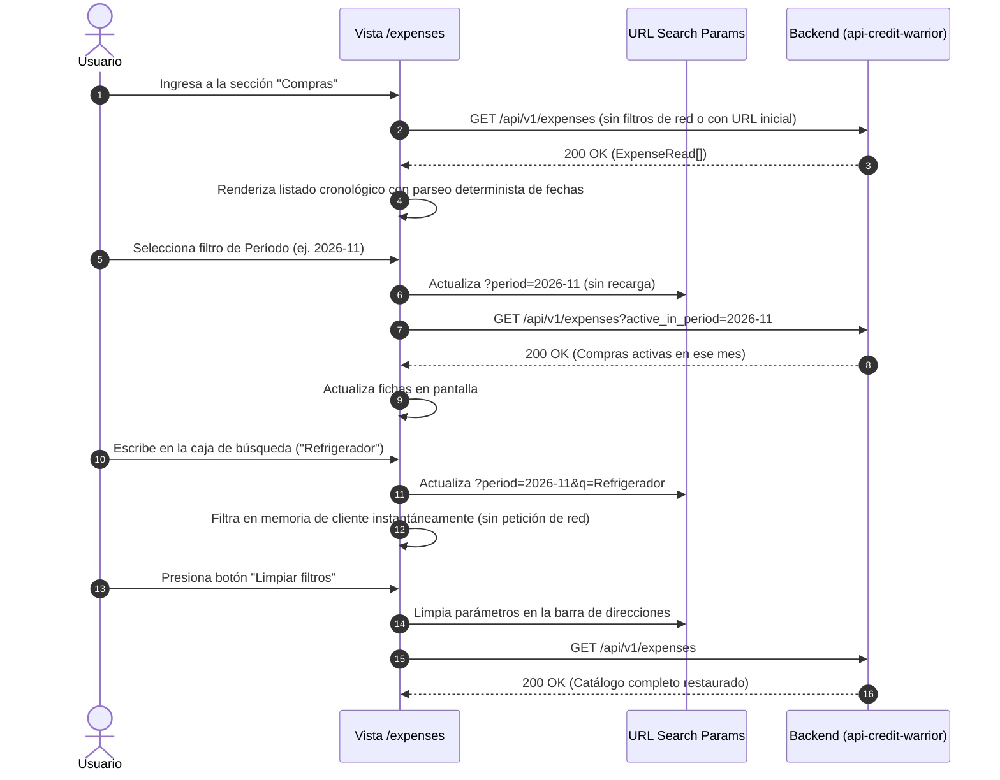

# Especificación 005 — Historial de Compras, Filtros Reactivos y Cronograma de Amortización (`005-expenses-history-and-schedule`)

- **Estado:** aprobado
- **Versión:** 1.1.0
- **Fecha:** 2026-10-20

---

## 1. Propósito y Contexto Funcional (QUÉ y POR QUÉ)

### 1.1 Qué se construye
Esta especificación define la experiencia funcional completa de **auditoría, exploración, consulta cronológica y gestión de compras compartidas** en **Credit Warrior Web**, accesible a través de la sección principal de Compras (`/expenses`).

El alcance funcional abarca:
1. **Historial Centralizado de Gastos**:
   - Listado continuo de compras maestras ordenadas de forma cronológica descendente (desde la compra más reciente a la más antigua).
   - Fichas visuales semánticas (`<article>`) que sintetizan de un vistazo los datos clave del gasto: concepto del comercio, tarjeta de crédito enmascarada (`•••• 1234`), divisa de cobro (`CLP` o `USD`), fecha de compra en formato legible determinista, número de cuotas, monto total en cifras monoespaciadas tabulares y etiquetas con los participantes involucrados (`PersonChip`).
   - Botón accesible independiente *"Ver cronograma"* y menú contextual con detención de propagación de eventos para evitar anidamiento inválido de controles interactivos.
   - Indicadores visuales de opciones especiales: distintivo de diferimiento de cobro inicial (`first_billing_override`) y presencia de notas adicionales.
2. **Barra Reactiva de Filtros y Búsqueda en Memoria**:
   - Filtrado multidimensional combinable por:
     - **Tarjeta de crédito**: Filtrar compras asociadas a una tarjeta específica o todas (`card_id`).
     - **Participante**: Filtrar compras en las que participa una persona determinada o todas (`person_id`).
     - **Período de facturación activo**: Filtrar compras con cuota activa en un mes determinado expuesto en URL como `period=YYYY-MM` y mapeado al parámetro de red `active_in_period`.
   - Búsqueda por texto en tiempo real (`q`) ejecutada estrictamente en memoria del cliente sin peticiones de red redundantes.
   - Sincronización bidireccional inmediata de filtros en los parámetros de la URL (`?card_id=&person_id=&period=&q=`), permitiendo guardar enlaces en marcadores, refrescar la página sin perder el estado y compartir vistas filtradas.
   - Acción directa *"Limpiar filtros"* para restablecer el historial completo en un toque.
3. **Cronograma de Amortización al Vuelo (*ExpenseScheduleDrawer*)**:
   - Panel adaptativo (deslizable táctil en móvil y modal amplio en escritorio) que expone la tabla completa de amortización mes a mes de una compra en cuotas.
   - Desglose fiel cuota a cuota retornado por el servidor: número de cuota (ej. `1/3`), fecha de corte, fecha de vencimiento, monto total de la cuota y desglose individual por participante.
   - Resaltado contextual de la cuota vigente o próxima a pagar evaluado exclusivamente mediante coincidencia exacta de strings de período (`payment_period === active_in_period` o período de sesión), preservando la regla de cero cálculo financiero en cliente.
4. **Acciones de Ciclo de Vida sobre el Gasto**:
   - **Edición de Parámetros**: Modificación de la descripción, notas y período forzado de inicio de cobro (`first_billing_override`) mediante formulario adaptativo, con protección contra cierre accidental si el formulario está modificado (`dismissible={!isDirty}`), sanitización estricta de la lista de repartos a `ExpenseSplitInput` descartando metadatos para cumplir con el contrato `PUT /api/v1/expenses/{id}` (`ExpenseUpdate`) y normalización rigurosa de cadenas vacías a nulo.
   - **Eliminación Definitiva**: Eliminación atómica del gasto y sus asignaciones de participantes mediante diálogo de confirmación destructivo accesible (`AlertDialog`), con actualización reactiva del listado y de los totales del panel financiero.
5. **Resiliencia de Interfaz, Manejo de Concurrencia y Fechas Seguras**:
   - Estados de carga mediante esqueletos visuales estructurados (*skeletons*).
   - Parseo determinista de fechas (`purchase_date`, `closing_date`, `due_date`) inmune a desfases horarios por zonas horarias occidentales (UTC-3 / UTC-4).
   - Estados vacíos accionables diferenciados: ausencia total de compras (invitación directa a registrar un gasto) versus ausencia de coincidencias por filtros aplicados (botón para limpiar filtros).
   - Tolerancia a concurrencia ante compras eliminadas simultáneamente (`404 Not Found`) y retroalimentación inline ante errores de validación (`422 Unprocessable Entity`).

### 1.2 Por qué es necesario
Una vez que el usuario y sus acompañantes registran compras en tarjeta de crédito, surge la necesidad primordial de **auditar, consultar y planificar los pagos futuros**:
- Sin un historial ordenado y filtrable, los usuarios pierden trazabilidad de qué compras siguen generando cobros y qué tarjetas concentran el mayor volumen de gastos.
- Las compras en cuotas generan incertidumbre si las personas no pueden comprobar en qué mes termina de pagarse un producto o cuánto le corresponde transferir a cada uno en una cuota particular.
- El cálculo de las fechas de corte bancarias y la absorción de los residuos de centavos varían entre tarjetas y calendarios; centralizar la visualización de la tabla de amortización oficial del servidor brinda transparencia y erradica disputas entre participantes.
- Si la edición de una compra enviara metadatos de lectura o no manejara el reemplazo atómico `PUT` requerido por el backend, se producirían fallos `422` bloqueantes.
- En zonas horarias occidentales (como Chile/Latinoamérica UTC-3 o UTC-4), un parseo descuidado de fechas con `new Date("YYYY-MM-DD")` resta un día al renderizado visual (mostrando el 15 en lugar del 16), induciendo a errores graves en la planificación bancaria.

---

## 2. Reglas Innegociables del Dominio

1. **Capa de Presentación Pura (Zero Financial Math on Client)**:
   - El frontend **jamás calcula ni recalcula** el cronograma de amortización, las fechas de corte efectivas, las fechas límite de pago ni la absorción de diferencias por redondeo de centavos.
   - La tabla de amortización que se visualiza en el cronograma proviene 100% de la consulta oficial al servidor (`GET /api/v1/expenses/{id}/schedule`).
   - El resaltado de la cuota vigente en el cronograma se efectúa exclusivamente por comparación literal de strings de período (`payment_period === active_in_period`), sin cálculos de días bancarios en cliente.
2. **Inmutabilidad y Precisión Monetaria Basada en `string`**:
   - Todos los montos monetarios (`total_amount`, `installment_amount`, montos individuales de participación) viajan, se almacenan y se manipulan estrictamente como **cadenas de texto numéricas** (`string`).
   - El formateo visual con símbolos de divisa (`$` para `CLP`, `US$` para `USD`) y separadores de miles se aplica exclusivamente en el instante final de renderizado utilizando números tabulares (`tabular-nums`) para asegurar alineación vertical matemática.
3. **Parseo Determinista de Fechas Inmune a Zonas Horarias**:
   - Las fechas provistas por la API en formato `YYYY-MM-DD` (`purchase_date`, `closing_date`, `due_date`) deben formatearse extrayendo sus componentes de año, mes y día de forma determinista, evitando el constructor estándar `new Date("YYYY-MM-DD")` en UTC para erradicar desplazamientos al día anterior en husos horarios occidentales.
4. **Contrato de Reemplazo Completo en Edición (`PUT /api/v1/expenses/{id}`)**:
   - El backend requiere una sustitución completa mediante el esquema `ExpenseUpdate` en método `PUT`.
   - Para evitar rechazos `422 Unprocessable Entity` por la regla Pydantic `extra="forbid"`, los splits existentes en `ExpenseRead` deben mapearse a `ExpenseSplitInput` descartando estrictamente sus atributos de solo lectura (`id`, `created_at`, `updated_at`), mientras se preservan fielmente `card_id`, `total_amount`, `purchase_date` e `installments_count`.
5. **Sincronización Bidireccional en URL y Aislamiento de Búsqueda de Red**:
   - Los filtros aplicados en la vista de compras (`card_id`, `person_id`, `period`, `q`) se sincronizan en la URL del navegador.
   - El parámetro de URL `period` se mapea hacia el parámetro de red `active_in_period` de la API.
   - El parámetro de búsqueda `q` vive en la URL y se filtra en memoria de cliente: **jamás** se transmite como query param al servidor ni a las claves de caché de TanStack Query.
6. **Normalización de Campos Opcionales a Nulo en Edición**:
   - Si durante la edición de una compra el usuario vacía los campos de período de inicio de facturación (`first_billing_override`) o notas adicionales (`notes`), dichos valores deben normalizarse a `null` (o suprimirse), impidiendo que se envíen cadenas vacías `""` que provocarían rechazo del servidor por error de validación `422`.
7. **Ergonomía Táctil y Accesibilidad DOM sin Controles Anidados**:
   - Queda estrictamente prohibido el uso de diálogos nativos (`alert()`, `confirm()`, `prompt()`) y el anidamiento inválido de elementos interactivos (`<button>` dentro de `<button>`).
   - Toda confirmación de eliminación se gestiona mediante un diálogo modal accesible integrado en el tema oscuro (`#090A0F`, `#12141C`, `#1A1D28`), garantizando áreas de pulsación táctil mínimas de `44x44px`.
8. **Sincronización en Cascada hacia el Panel Financiero**:
   - Toda mutación exitosa sobre una compra (edición o eliminación) debe invalidar en cascada tanto el catálogo de gastos (`expenses.all`) como las proyecciones y resúmenes del dashboard mensual (`dashboard.all`).
9. **Sin Autenticación en el MVP**:
   - La visualización y gestión del historial opera de manera directa en el entorno local del usuario sin pantallas de login ni tokens de sesión.

---

## 3. Requisitos Funcionales (Formato EARS) y Criterios de Aceptación

### RF-01: Vista Principal del Historial de Compras, Fichas de Gasto y Accesibilidad
**MIENTRAS** el usuario se encuentre en la sección de compras (`/expenses`), **EL SISTEMA DEBERÁ** presentar el listado completo de compras maestras registradas:
1. **Ordenamiento Cronológico**:
   - Las compras se presentan ordenadas cronológicamente de forma descendente según su fecha de compra (`purchase_date`).
2. **Anatomía Semántica de la Ficha de Gasto (`<article>`)**:
   - Cada compra se muestra dentro de un contenedor estructurado (`<article>`) con superficie `#12141C` y borde sutil de `1px` en `#232736`, conteniendo:
     - **Concepto o Descripción**: Nombre del comercio o compra (ej. *"Supermercado Líder"*), con tipografía destacada.
     - **Tarjeta de Crédito Asociada**: Nombre de la tarjeta y sus últimos 4 dígitos enmascarados (`•••• 1234`).
     - **Distintivo de Moneda (`CurrencyBadge`)**: Identificación cromática clara de la divisa (`CLP` en `#10B981` o `USD` en `#38BDF8`).
     - **Fecha de Compra Determinista**: Fecha de la transacción formateada mediante parseo determinista inmune a husos horarios (ej. *"16 oct 2026"*).
     - **Cantidad de Cuotas**: Etiqueta que indica el plazo acordado (ej. *"1 cuota"* o *"3 cuotas"*).
     - **Monto Total de la Compra**: Cifra completa formateada según la divisa (`$150.000` o `US$45.50`) en tipografía monoespaciada con alineación tabular (`tabular-nums`).
     - **Participantes del Reparto**: Lista de distintivos visuales (`PersonChip`) que identifican a cada persona involucrada con su respectivo punto de color o avatar.
     - **Distintivos de Opciones Especiales**:
       - Si registra un mes de cobro forzado (`first_billing_override`), muestra una etiqueta sutil indicando el período diferido (ej. *"Factura desde 2026-12"*).
       - Si contiene notas adicionales, muestra un icono discreto de nota o texto de vista previa truncada.
3. **Estructura Accesible y Prevención de Controles Anidados**:
   - Para cumplir estrictamente con los estándares de accesibilidad HTML (sin `<button>` anidado dentro de `<button>`):
     - La apertura del cronograma se activa mediante un botón explícito y accesible rotulado *"Ver cronograma"* (o botón de acción principal de la tarjeta).
     - El menú contextual de acciones adicionales (*"Editar compra"* y *"Eliminar compra"*) opera como un componente `DropdownMenu` hermano e independiente, con detención de propagación de eventos (`event.stopPropagation()`) para que desplegar el menú no abra accidentalmente el cronograma.
     - Todos los botones interactivos mantienen un área táctil mínima de `44x44px` y foco accesible para navegación por teclado.

**Criterios de Aceptación:**
- [ ] La lista de compras carga y renderiza todos los gastos existentes ordenados desde la fecha más reciente a la más antigua.
- [ ] La fecha de compra `"2026-10-16"` se visualiza como "16 oct 2026" en cualquier zona horaria occidental sin desfase al día 15.
- [ ] Los montos monetarios se alinean y muestran con la divisa y formato correctos en números tabulares.
- [ ] La ficha no anida elementos `<button>` dentro de otros `<button>` y pasar por teclado permite activar el menú o el cronograma independientemente.
- [ ] Si la compra no tiene últimos 4 dígitos registrados, se omite limpiamente la máscara sin mostrar textos nulos.

---

### RF-02: Barra Reactiva de Filtros y Búsqueda en Texto
**MIENTRAS** el usuario explore el historial de compras, **EL SISTEMA DEBERÁ** proporcionar controles de filtrado reactivos y sincronizados:
1. **Filtro por Tarjeta de Crédito (`card_id`)**:
   - Selector desplegable o barra de opciones que permite filtrar las compras por tarjeta específica o ver *"Todas las tarjetas"*.
   - Muestra el nombre y últimos 4 dígitos de cada tarjeta activa o archivada que registre compras.
2. **Filtro por Participante (`person_id`)**:
   - Selector que permite filtrar las compras en las que participa una persona determinada o ver *"Todos los participantes"*.
3. **Filtro por Período de Facturación Activo y Mapeo de Parámetros**:
   - Selector de período en formato mes-año (`YYYY-MM`) que permite identificar compras con cuota activa a pagar en ese mes.
   - **Mapeo URL vs Red**: En la barra de direcciones del navegador, el parámetro se expone de forma amigable como `period=YYYY-MM`. Al despachar la consulta de red a la API, el sistema lo mapea directamente como `GET /api/v1/expenses?active_in_period=YYYY-MM`, así como en la query key de TanStack Query `queryKeys.expenses.list({ active_in_period: period })`.
4. **Campo de Búsqueda por Texto (`q`) Estrictamente en Cliente**:
   - Caja de texto accesible con icono de lupa para buscar por coincidencia parcial en la descripción o concepto del gasto.
   - **Aislamiento de Red**: El término de búsqueda se sincroniza en la URL del navegador (`?q=texto`) para permitir enlaces compartibles y persistencia, pero se evalúa **estrictamente en memoria del cliente** sobre la lista retornada por el servidor. **Jamás** se envía como parámetro de consulta a la API de gastos ni a la clave de caché de TanStack Query.
   - El comparador en memoria normaliza mayúsculas, minúsculas y diacríticos (ej. *"cafe"* encuentra *"Café"*).
5. **Sincronización Bidireccional en URL**:
   - La selección de cualquier filtro o la escritura en la búsqueda actualiza reactivamente la URL sin recargar la página (ej. `?card_id=...&period=2026-11&q=supermercado`).
   - Al cargar la página con parámetros en la URL, el sistema inicializa los selectores con dichos valores y filtra el catálogo automáticamente.
6. **Acción de Restablecimiento ("Limpiar filtros")**:
   - **SI** existe al menos un filtro activo (`card_id`, `person_id`, `period`) o término de búsqueda ingresado (`q`), **ENTONCES EL SISTEMA DEBERÁ** mostrar un botón accesible *"Limpiar filtros"* que restablece todos los criterios a su estado predeterminado y limpia los parámetros de la URL.

**Criterios de Aceptación:**
- [ ] Filtrar por una tarjeta reduce instantáneamente la lista a las compras pertenecientes a esa tarjeta.
- [ ] Filtrar por una persona muestra únicamente las compras donde esa persona figura en la lista de repartos.
- [ ] El parámetro de URL `period=2026-11` genera la petición HTTP con `active_in_period=2026-11`.
- [ ] Escribir en la caja de búsqueda filtra la lista en tiempo real sin disparar peticiones de red adicionales por cada letra.
- [ ] Recargar la página con parámetros en la URL conserva exactamente los filtros seleccionados.
- [ ] Pulsar *"Limpiar filtros"* restablece la vista completa y remueve los parámetros de la URL.

---

### RF-03: Visualización del Cronograma de Amortización al Vuelo (*ExpenseScheduleDrawer*)
**CUANDO** el usuario seleccione una compra o presione la acción *"Ver cronograma"*, **EL SISTEMA DEBERÁ** consultar el cronograma oficial del servidor y desplegarlo en un panel adaptativo:
1. **Modal Adaptativo**:
   - En pantallas móviles (`< 768px`): Se abre un panel inferior deslizable (*Drawer*) con manija de arrastre y ajuste de altura.
   - En pantallas de escritorio (`>= 768px`): Se abre un diálogo modal centrado o panel lateral amplio con desenfoque de fondo.
2. **Cabecera Informativa del Gasto**:
   - Muestra el concepto de la compra, tarjeta asociada, divisa, monto total y cantidad de cuotas.
3. **Tabla Desglosada Cuota a Cuota**:
   - Se despliega cada una de las $N$ cuotas que componen el cronograma:
     - **Número de Cuota (`installment_label`)**: Etiqueta clara del progreso (ej. `1/3`, `2/3`, `3/3`).
     - **Período de Facturación (`statement_period`)**: Mes correspondiente al corte de la tarjeta (ej. `2026-10`).
     - **Fecha de Corte (`closing_date`)**: Fecha límite en que se cierra la cuenta del ciclo, parseada de forma determinista.
     - **Período de Pago (`payment_period`)**: Mes calendario en que se debe pagar la cuota (ej. `2026-11`).
     - **Fecha de Vencimiento (`due_date`)**: Fecha límite exacta para el pago, parseada de forma determinista.
     - **Monto de la Cuota (`installment_amount`)**: Importe total de la cuota mensual.
     - **Desglose Individual por Participante (`person_shares`)**: Sub-lista con el nombre de cada persona participante y el monto exacto asignado para esa cuota en particular.
4. **Identificación de Cuota Vigente mediante Comparación Literal**:
   - La cuota vigente o próxima a vencer se resalta visualmente (con distintivo *"Próximo vencimiento"* y borde de acento en `#10B981`) **exclusivamente mediante coincidencia exacta de strings de período** (`payment_period === active_in_period` de la URL o el período activo del dashboard).
   - Queda prohibido calcular fechas bancarias en cliente; si no hay período coincidente, la lista se renderiza neutralmente.
5. **Aclaración de Precisión Financiera**:
   - Se incluye un pie informativo sutil que aclara que el cronograma y la absorción de centavos residuales provienen del motor oficial del servidor.

**Criterios de Aceptación:**
- [ ] Tocar *"Ver cronograma"* abre el panel y despacha la petición `GET /api/v1/expenses/{id}/schedule` sin errores.
- [ ] Cada fila del cronograma despliega el número de cuota, fecha de vencimiento sin desfase de zona horaria y monto total.
- [ ] El desglose por persona dentro de cada cuota suma exactamente el monto de la cuota.
- [ ] El resaltado de la cuota vigente coincide con el período de pago seleccionado mediante comparación de strings.
- [ ] Cerrar el panel devuelve al usuario a la lista de compras en la misma posición de scroll.

---

### RF-04: Edición de Parámetros de Compra, Reemplazo Completo (`PUT`) y Resiliencia
**CUANDO** el usuario seleccione la acción *"Editar"* en una compra existente:
1. **Apertura de Formulario de Edición y Protección Anti-Cierre**:
   - Se despliega un formulario adaptativo precargado con los datos actuales de la compra:
     - **Descripción (`description`)**: Campo de texto editable (1 a 255 caracteres).
     - **Primer Mes de Facturación (`first_billing_override`)**: Selector de período `YYYY-MM` para diferir o forzar el inicio del cobro de cuotas.
     - **Notas (`notes`)**: Campo de texto multilínea para aclaraciones adicionales (hasta 2000 caracteres).
   - Los datos estructurales de la compra (tarjeta, monto total, fecha de compra, cuotas y participantes) se muestran en modo informativo.
   - **Protección Anti-Cierre Accidental**: Si el formulario ha sido modificado respecto a los valores iniciales (`isDirty`), el modal **deshabilita el cierre accidental por clic o toque en el fondo** (`dismissible={!isDirty}`). Para salir sin guardar, el usuario debe presionar explícitamente el botón *"Cancelar"*.
2. **Contrato de Reemplazo Completo (`PUT /api/v1/expenses/{id}`) y Sanitización de Splits**:
   - El backend exige el esquema `ExpenseUpdate` mediante método `PUT`.
   - **Regla de Sanitización Estricta**: Al despachar la petición, los splits del gasto (obtenidos de `ExpenseRead`) deben mapearse a `ExpenseSplitInput` **descartando obligatoriamente los atributos de solo lectura (`id`, `created_at`, `updated_at`)**, manteniendo únicamente `{ person_id, split_type, percentage, fixed_amount }`, previniendo así el error `422 Unprocessable Entity` por la restricción `extra="forbid"` de Pydantic V2.
   - Se conservan y transmiten íntegros los valores originales de `card_id`, `total_amount`, `purchase_date` e `installments_count`.
3. **Normalización Estricta de Campos Opcionales a Nulo**:
   - **SI** el usuario limpia o deja vacío el campo `first_billing_override` (cadena vacía `""`), **ENTONCES EL SISTEMA DEBERÁ** normalizar el valor a `null` antes de despachar el `PUT`, evitando el rechazo por formato de período inválido (`422 Unprocessable Entity`).
   - **SI** el usuario limpia o deja vacío el campo `notes`, **ENTONCES EL SISTEMA DEBERÁ** normalizar el valor a `null` antes del envío.
4. **Procesamiento de Respuesta Exitosa**:
   - Al confirmarse la actualización en el servidor:
     - Cierra el formulario de edición.
     - Despliega una notificación de éxito visual (*toast*: *"Compra actualizada exitosamente"*).
     - Invalida automáticamente en cascada las consultas de compras (`expenses.all`) y las consultas del panel financiero (`dashboard.all`).
5. **Mapeo de Errores de Validación (`422`)**:
   - Si el servidor rechaza la edición por validación semántica, el modal permanece abierto y los mensajes de error se proyectan directamente debajo del campo correspondiente.

**Criterios de Aceptación:**
- [ ] Al abrir el formulario de edición, los campos se encuentran precargados con la información actual de la compra.
- [ ] Modificar un campo y pulsar fuera del modal no cierra el formulario accidentalmente.
- [ ] La petición despachada es un `PUT` que envía los splits limpios sin campos `id`, `created_at` ni `updated_at`.
- [ ] Si se vacía el campo de diferimiento de período, la petición envía valor nulo sin provocar error 422.
- [ ] Guardar los cambios actualiza de inmediato la ficha del gasto y el cronograma sin recargar la página.

---

### RF-05: Eliminación de Gastos y Confirmación Destructiva
**CUANDO** el usuario seleccione la acción *"Eliminar"* en una compra existente:
1. **Diálogo de Confirmación Destructiva**:
   - **EL SISTEMA DEBERÁ** presentar un diálogo de confirmación accesible (`AlertDialog`) con botón de acción destructiva en tono de peligro (`#F43F5E`):
     - **Título**: *"¿Eliminar esta compra?"*.
     - **Mensaje**: *"Esta acción eliminará de forma permanente el registro del gasto y todo su cronograma de cuotas asociado. Esta operación no se puede deshacer."*.
     - **Botón Primario**: *"Eliminar definitivamente"*.
     - **Botón Secundario**: *"Cancelar"*.
2. **Despacho de la Eliminación**:
   - Al confirmar, el botón pasa a estado de carga bloqueando interacciones sucesivas.
   - Se despacha la petición de eliminación definitiva al servidor (`DELETE /api/v1/expenses/{id}`).
3. **Procesamiento de Respuesta Exitosa (`204 No Content`)**:
   - **EL SISTEMA DEBERÁ**:
     - Cerrar el diálogo de confirmación.
     - Remover la compra inmediatamente del listado en pantalla.
     - Desplegar una notificación de éxito visual (*toast*: *"Compra eliminada exitosamente"*).
     - Disparar la invalidación en cascada de compras (`expenses.all`) y de los paneles de resumen y proyección financiera (`dashboard.all`).
4. **Tolerancia a Concurrencia (`404 Not Found`)**:
   - **SI** la compra ya fue eliminada en otra sesión concurrente y el servidor responde `404`, el diálogo se cierra, se notifica que el gasto ya no existe y se refresca el catálogo.

**Criterios de Aceptación:**
- [ ] La acción de eliminar requiere confirmación explícita antes de ejecutar cualquier petición de red.
- [ ] Tras confirmar, la compra desaparece de la vista y se invalidan las consultas de compras y dashboard.
- [ ] Si la compra fue eliminada previamente en otra pestaña, la interfaz informa amigablemente y actualiza la lista.

---

### RF-06: Estados de Carga, Estados Vacíos y Resiliencia de Red
**MIENTRAS** la aplicación gestione la presentación del historial:
1. **Estados de Carga Estructurada (*Skeletons*)**:
   - Mientras se consultan las compras o el cronograma de amortización, la interfaz despliega siluetas animadas que reproducen el diseño de las tarjetas de gasto y filas de cuotas, previniendo saltos visuales de contenido (*layout shifts*).
2. **Estado Vacío Global (Sin Compras en el Sistema)**:
   - **SI** el catálogo no registra compras creadas (`expenses.length === 0`), **ENTONCES EL SISTEMA DEBERÁ** mostrar un estado visual empático:
     - Título: *"Aún no tienes compras registradas"*.
     - Mensaje: *"Registra tu primera compra con tarjeta de crédito para visualizar aquí el historial y el desglose de cuotas."*.
     - Botón de Acción Principal (*CTA*): *"Registrar gasto"* (abre directamente el formulario global de registro rápido de compras).
3. **Estado Vacío por Filtros (Sin Coincidencias)**:
   - **SI** existen compras en el sistema pero ninguna coincide con la combinación de filtros o el texto de búsqueda, **ENTONCES EL SISTEMA DEBERÁ** mostrar:
     - Título: *"No se encontraron compras"*.
     - Mensaje: *"No hay gastos que coincidan con los filtros seleccionados o el término de búsqueda."*.
     - Botón de Acción: *"Limpiar filtros"* (restablece los criterios y muestra nuevamente el historial completo).
4. **Resiliencia ante Fallos de Conexión o Servidor**:
   - Si la consulta de compras o del cronograma no puede completarse por corte de red o error de servidor (`500`), el sistema presenta una tarjeta de advertencia no bloqueante con un botón para *"Reintentar"*.

**Criterios de Aceptación:**
- [ ] Cuando la base de datos está vacía, se despliega el estado vacío global con botón para registrar gasto.
- [ ] Cuando los filtros no arrojan resultados, se muestra el estado vacío de búsqueda con botón para limpiar filtros.
- [ ] Durante las peticiones de red se muestran skeletons que imitan las tarjetas de gasto.

---

## 4. Flujos de Usuario y Diagramas de Interacción (UX)

### 4.1 Flujo Principal: Exploración, Búsqueda en Memoria y Filtrado Reactivo



---

### 4.2 Flujo: Consulta del Cronograma de Amortización Cuota a Cuota

```mermaid
sequenceDiagram
    autonumber
    actor U as Usuario (Móvil / Desktop)
    participant V as Vista /expenses
    participant D as ExpenseScheduleDrawer
    participant API as Backend (api-credit-warrior)

    U->>V: Presiona botón "Ver cronograma" en la ficha
    V->>D: Abre panel adaptativo (Drawer en móvil / Dialog en desktop)
    D->>D: Despliega esqueleto de carga de tabla
    D->>API: GET /api/v1/expenses/{expense_id}/schedule
    API-->>D: 200 OK (ExpenseScheduleResponse)
    D->>D: Renderiza datos maestros (Comercio, Tarjeta, Divisa, Monto)
    D->>D: Renderiza filas 1 a N de cuotas con fechas deterministas y desglose por persona
    D->>D: Destaca cuota vigente si payment_period coincide con período de consulta (comparación de strings)
    U->>D: Desliza hacia abajo o presiona botón "Cerrar"
    D->>V: Cierra panel; usuario conserva su posición de scroll en la lista
```

---

### 4.3 Flujo: Edición y Eliminación con Sanitización e Invalidación en Cascada

```mermaid
sequenceDiagram
    autonumber
    actor U as Usuario
    participant V as Vista /expenses
    participant M as Modal Edición / Confirmación
    participant API as Backend (api-credit-warrior)
    participant Q as TanStack Query Cache

    alt Edición de Compra (Reemplazo Completo PUT)
        U->>V: Selecciona opción "Editar" en menú contextual
        V->>M: Abre formulario con descripción, notas y período forzado
        U->>M: Modifica descripción y vacía el campo de diferimiento
        U->>M: Presiona "Guardar cambios"
        M->>M: Normaliza diferimiento a null
        M->>M: Sanitiza splits de ExpenseRead descartando id, created_at, updated_at
        M->>API: PUT /api/v1/expenses/{id} (ExpenseUpdate con card_id, total, fecha, cuotas, splits limpios)
        API-->>M: 200 OK (ExpenseRead)
        M->>Q: Invalida expenses.all y dashboard.all
        M->>V: Cierra modal; toast "Compra actualizada exitosamente"
    else Eliminación de Compra
        U->>V: Selecciona opción "Eliminar" en menú contextual
        V->>M: Abre AlertDialog de confirmación destructiva
        U->>M: Presiona "Eliminar definitivamente"
        M->>API: DELETE /api/v1/expenses/{id}
        API-->>M: 204 No Content
        M->>Q: Invalida expenses.all y dashboard.all
        M->>V: Cierra diálogo; remueve tarjeta; toast "Compra eliminada exitosamente"
    end
```

---

## 5. Estados de la Interfaz de Usuario

| Estado de UI | Condiciones Disparadoras | Comportamiento Visual y Controles | Acciones del Usuario |
| :--- | :--- | :--- | :--- |
| **1. Carga Inicial** | Consulta inicial de compras en tránsito. | Esqueletos animados (*skeletons*) con la forma de las fichas de compra. Filtros bloqueados temporalmente. | Esperar medio segundo la llegada de datos. |
| **2. Sin Compras Registradas** | Petición exitosa pero catálogo global vacío (`expenses.length === 0`). | Estado vacío centrado con ilustración sutil, título explicativo y botón primario *"Registrar gasto"* que abre el formulario rápido. | Pulsar *"Registrar gasto"* para crear su primera compra. |
| **3. Sin Coincidencias por Filtros** | Filtros aplicados o término de búsqueda no arrojan resultados. | Estado vacío que notifica la ausencia de coincidencias y muestra el botón destacado *"Limpiar filtros"*. | Pulsar *"Limpiar filtros"* o modificar los criterios de búsqueda. |
| **4. Listado Poblado Activo** | Compras disponibles que coinciden con los filtros. | Fichas de gasto ordenadas cronológicamente con montos tabulares, distintivos de moneda y participantes. | Explorar compras, abrir cronograma, filtrar o buscar. |
| **5. Carga de Cronograma** | Apertura del panel de amortización mientras se consulta el endpoint de cronograma. | Drawer o modal desplegado mostrando cabecera y siluetas de carga de las filas de cuotas. | Esperar respuesta del servidor o cerrar panel. |
| **6. Cronograma Poblado** | Respuesta exitosa del cronograma de amortización. | Tabla cuota a cuota con fechas deterministas de vencimiento, montos e importes individuales por participante. Cuota vigente destacada por comparación de strings. | Consultar cuotas futuras, revisar desgloses y cerrar panel. |
| **7. Modal de Edición** | El usuario acciona *"Editar compra"*. | Formulario adaptativo precargado con descripción, notas y período forzado. Protección `dismissible={!isDirty}`. | Editar los campos permitidos y pulsar guardar. |
| **8. Confirmación de Eliminación** | El usuario acciona *"Eliminar compra"*. | Diálogo modal de alerta destructiva con mensaje explícito sobre la pérdida permanente del gasto y cronograma. | Confirmar la eliminación o pulsar cancelar. |
| **9. Procesamiento de Acción** | Envío de edición (`PUT`) o confirmación de eliminación en curso. | Botón de acción con spinner y controles deshabilitados (*anti double-click*). | Esperar respuesta de la API. |
| **10. Error de Validación (`422`)** | Servidor rechaza la edición por formato inválido o campos indebidos. | Modal permanece abierto. Campo afectado resaltado en rojo con el mensaje de error inyectado debajo. | Corregir el campo observado y volver a presionar guardar. |
| **11. Error Concurrencia (`404`)** | El gasto fue eliminado concurrentemente en otra sesión. | Cierre del modal/diálogo, toast informativo (*"La compra seleccionada ya no existe"*) y refresco del listado. | Continuar navegación con la lista actualizada. |
| **12. Error de Red o Servidor (`500`)** | Fallo de conexión o caída momentánea del servicio. | Banner de advertencia en el listado o modal con mensaje amigable y botón *"Reintentar"*. | Pulsar *"Reintentar"* cuando se restablezca la señal. |

---

## 6. Matriz de Casos Límite y Reglas de Validación

| Escenario / Caso Límite | Condición de Borde | Comportamiento Esperado de la Interfaz |
| :--- | :--- | :--- |
| **Parseo de fecha en zona horaria occidental (ej. UTC-3 / UTC-4)** | `purchase_date`, `closing_date` o `due_date` provistas en `YYYY-MM-DD`. | Se formatean extrayendo año, mes y día deterministamente, garantizando que `"2026-10-16"` se muestre siempre como "16 oct 2026" sin retroceso al día anterior. |
| **Sanitización de splits en edición `PUT`** | Splits recibidos de `ExpenseRead` contienen `id`, `created_at`, `updated_at`. | Se descartan esos 3 atributos al preparar el payload `ExpenseUpdate`, enviando únicamente `{ person_id, split_type, percentage, fixed_amount }` para no disparar `422 Unprocessable Entity`. |
| **Mapeo de parámetro período entre URL y Red** | Usuario selecciona período en filtro o carga URL con `period=2026-11`. | La URL mantiene `period=2026-11` y la llamada HTTP transmite `active_in_period=2026-11`. |
| **Búsqueda por texto con caracteres especiales** | Texto de búsqueda contiene mayúsculas, minúsculas o tildes. | Filtrado en memoria normaliza caracteres para que coincidan sin distinción de mayúsculas ni acentos. La búsqueda no viaja al servidor. |
| **Compra de 1 sola cuota (al contado)** | `installments_count === 1`. | El cronograma muestra una única fila `1/1` con su fecha de vencimiento y el monto completo asignado. |
| **Compra con diferimiento de facturación** | `first_billing_override` presente (ej. `2026-12`). | La ficha muestra un distintivo especial (*"Factura desde 2026-12"*) y el cronograma refleja que la cuota 1 inicia en ese período. |
| **Limpieza de diferimiento en edición** | El usuario borra el campo `first_billing_override`. | La interfaz normaliza el valor a `null` (no envía `""`), evitando error de validación `422` del servidor. |
| **Notas adicionales con solo espacios en blanco** | El usuario ingresa espacios o borra las notas en edición. | El texto se normaliza automáticamente a `null`. |
| **Edición con formulario sucio y clic exterior** | Formulario de edición modificado (`isDirty`). | El backdrop desactiva el cierre accidental (`dismissible={false}`), exigiendo presionar explícitamente *"Cancelar"*. |
| **Tarjeta asociada fue archivada posteriormente** | La tarjeta tiene `is_active: false`. | El gasto se muestra normalmente en el historial con su tarjeta y datos históricos preservados, indicando el estado archivado solo si es relevante. |
| **Participante del gasto fue archivado posteriormente** | La persona tiene `is_active: false`. | El chip de la persona se visualiza con su nombre y color histórico sin alteraciones, preservando la trazabilidad. |
| **Eliminación concurrente de una compra abierta en cronograma** | La compra se elimina en otra pestaña mientras el usuario consulta su cronograma. | Si el usuario intenta editarla o eliminarla, la respuesta `404` cierra el panel y notifica que el registro fue removido. |
| **Filtro por período sin compras activas** | Período seleccionado no tiene cuotas que pagar. | Se presenta el estado vacío por filtros con el botón *"Limpiar filtros"*. |

---

## 7. Requisitos No Funcionales, Accesibilidad y Ergonomía

1. **Cumplimiento WCAG 2.1 Nivel AA**:
   - Contraste visual mínimo de `4.5:1` en todos los textos descriptivos y cifras sobre fondos oscuros (`#090A0F`, `#12141C`, `#1A1D28`).
   - Los números tabulares en montos garantizan alineación visual perfecta y legibilidad para lectores de pantalla.
   - Navegación integral por teclado mediante tabulador lógico y tecla Escape para cerrar el cronograma o modales.
   - **Cero controles interactivos anidados**: Fichas estructuradas sin anidación inválida de `<button>` dentro de `<button>`.
2. **Ergonomía Táctil y Mobile-First**:
   - Fichas de compra y botones de acción con áreas táctiles mínimas de **`44x44px`**.
   - El panel de cronograma en móvil respeta las zonas seguras (*safe areas*) y permite scroll vertical fluido para compras de hasta 120 cuotas sin perder la cabecera del comercio.
3. **Eficiencia y Tiempos de Respuesta**:
   - El filtrado por texto en cliente responde en menos de `50ms`.
   - Las peticiones de detalle y cronograma utilizan almacenamiento en caché de TanStack Query para evitar re-solicitudes redundantes al volver a abrir una compra consultada recientemente.
4. **Seguridad y Privacidad de Datos**:
   - Todos los datos provenientes de la API se proyectan de forma segura sin inyección directa de HTML.
   - Las tarjetas de crédito jamás exponen numeración completa; se preserva la regla de exhibir únicamente los últimos 4 dígitos enmascarados (`•••• 1234`).
