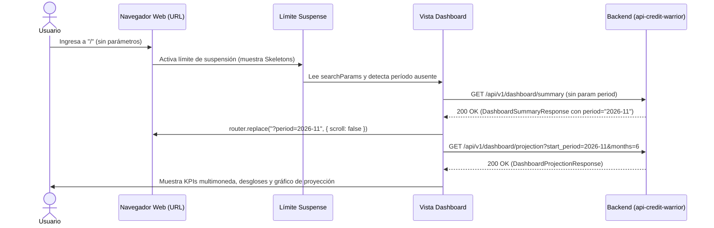
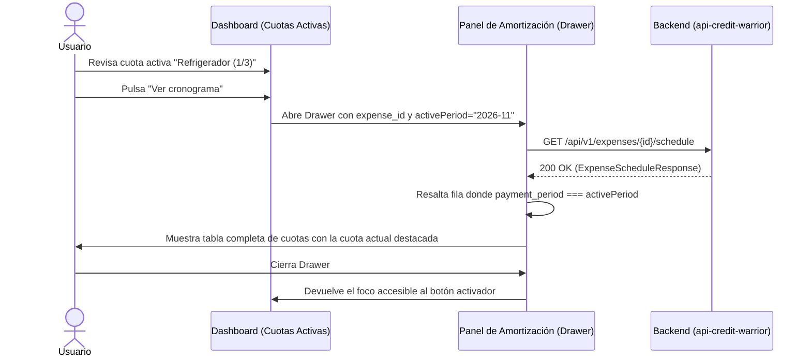

# Especificación 006 — Panel Financiero Principal, Resumen Mensual y Proyecciones (`006-dashboard-and-projections`)

- **Estado:** borrador
- **Versión:** 1.1.0
- **Fecha:** 2026-10-21

---

## 1. Propósito y Contexto Funcional (QUÉ y POR QUÉ)

### 1.1 Qué se construye
Esta especificación define la experiencia funcional completa del **Panel de Control Financiero Principal (Dashboard)** y el **Módulo de Proyección Multimoneda a Futuro** en **Credit Warrior Web**, accesible directamente en la ruta raíz de la aplicación (`/`).

El alcance funcional abarca:
1. **Selector de Período Mensual con Navegación Temporal Continua**:
   - Selector interactivo del mes de facturación/pago que permite avanzar o retroceder mes a mes de forma continua mediante cálculo aritmético determinista.
   - Identificación explícita del período activo en formato legible (ej. *"Noviembre 2026"*).
   - Atajo directo para regresar en un solo toque al *"Próximo vencimiento"* (mes inmediato de cobro determinado por el servidor).
   - Sincronización bidireccional inmediata en la URL del navegador mediante el parámetro de consulta `?period=YYYY-MM`, permitiendo guardar vistas específicas en marcadores, refrescar la pantalla sin perder el contexto y compartir enlaces de períodos específicos.
   - Validación previa en cliente contra el formato estricto `^\d{4}-(0[1-9]|1[0-2])$`. Si el parámetro está ausente o es inválido, se solicita el período por defecto al servidor y se sincroniza la URL con reemplazo sin recarga ni desplazamiento.
   - Aislamiento mediante límite de suspensión (`Suspense boundary`) con fallback estructurado de esqueletos visuales para garantizar compatibilidad con el enrutador de Next.js al leer parámetros de búsqueda.
2. **Tarjetas de Resumen Financiero Clave (KPIs Multimoneda)**:
   - Tarjetas destacadas de alto contraste visual diferenciadas por divisa (`CLP` y `USD`).
   - Visualización instantánea del monto total adeudado en cada moneda para el período seleccionado, expresado en números monoespaciados tabulares.
   - Indicador del volumen de compromisos o cuotas activas que componen la deuda mensual en cada divisa, derivado del recuento de cuotas activas de dicha divisa.
   - Estado informativo neutral cuando en una divisa no se registran compromisos en el período.
3. **Desglose de Compromisos por Persona (*Cuánto Paga Cada Uno*)**:
   - Listado consolidado de los participantes involucrados en compras del mes (`by_person`).
   - Fichas individuales que presentan el nombre del participante, su identificador cromático único (`color_hex` resuelto contra el catálogo de personas, con contingencia neutra ante ausencias) y el monto exacto consolidado que le corresponde transferir o cubrir en cada moneda (`CLP` y `USD`).
   - Alineación vertical estricta para permitir una conciliación inmediata y transparente de las transferencias requeridas entre las personas.
4. **Desglose de Compromisos por Tarjeta de Crédito (*Estado por Tarjeta*)**:
   - Vista desglosada de las tarjetas de crédito que registran pagos en el período (`by_card`).
   - Identificación de cada tarjeta con su nombre comercial, divisa, sus últimos cuatro dígitos enmascarados de forma segura (`•••• 1234`) y estado de actividad (`is_active` resuelto contra el catálogo de tarjetas, mostrando distintivo de *"Archivada"* si está inactiva).
   - Fechas clave del ciclo bancario en formato legible determinista: **Fecha de Corte / Facturación** y **Fecha Límite de Pago / Vencimiento**.
   - Monto total exigible en el estado de cuenta de la tarjeta para el período (`total_due`).
   - Sub-desglose por persona que detalla cuánto aporta cada participante al total de esa tarjeta específica.
5. **Listado de Cuotas Activas del Período e Integración de Cronograma**:
   - Tabla o lista de tarjetas de las compras puntuales y en cuotas que impactan el mes seleccionado (`active_installments`).
   - Detalle de cada compromiso: concepto de la compra, tarjeta asociada con máscara de 4 dígitos resuelta contra el catálogo de tarjetas, fecha original de la transacción, número de cuota en curso sobre el total (ej. `1/3`), monto mensual de la cuota y reparto entre los participantes.
   - Botón accesible independiente *"Ver cronograma"* en cada compromiso que reutiliza el panel adaptativo de amortización (*ExpenseScheduleDrawer*), consultando la tabla completa de amortización mes a mes de dicha compra y resaltando contextualmente la cuota vigente que coincide con el período activo del Dashboard.
6. **Gráfico Interactivo de Proyección Financiera a 6 Meses**:
   - Gráfico de barras apiladas responsivo que visualiza el horizonte de endeudamiento y pago futuro mes a mes para los próximos 6 períodos.
   - Selector de divisa para alternar entre la proyección en pesos chilenos (`CLP`) y dólares (`USD`).
   - Segmentación cromática de las barras apiladas según el color distintivo de cada participante (`color_hex` resuelto contra el catálogo de personas), permitiendo visualizar de inmediato el peso relativo del gasto de cada persona en los meses venideros.
   - Uso estrictamente delimitado de valores numéricos (`Number(amount)`) exclusivo para el cálculo de coordenadas SVG de las barras apiladas, preservando el formateo textual en cadenas de texto (`string`) para ejes, leyendas y tooltips.
   - Ventana flotante de detalle (tooltip) accesible con el desglose numérico exacto por persona y total del mes al interactuar con cualquier barra.
   - Interactividad bidireccional: al hacer clic o pulsar en una barra de un mes proyectado, el Dashboard sincroniza automáticamente su período activo y actualiza todos sus desgloses a ese mes.
7. **Resiliencia de Interfaz, Estados de Carga y Ergonomía Móvil (PWA)**:
   - Esqueletos visuales estructurados (*skeletons*) que respetan la geometría del panel durante las cargas para erradicar saltos acumulativos de diseño (CLS).
   - Estados vacíos explicativos diferenciados: ausencia de cuotas en el mes con botón CTA directo que activa el flujo global de captura rápida de gastos (*QuickExpenseDrawer*).
   - Soporte táctil optimizado para dispositivos móviles en modo pantalla completa (*standalone PWA*) con áreas de pulsación cómodas y ergonomía en zona de pulgar.

### 1.2 Por qué es necesario
El Dashboard es el **centro neurálgico de Credit Warrior**: es la primera pantalla que el usuario consulta al abrir la aplicación para gestionar su vida financiera cotidiana:
- **Respuesta inmediata a las preguntas esenciales**: Sin un panel consolidado, el usuario tendría que abrir cada compra, revisar calendarios de corte y sumar manualmente en una calculadora cuánto le debe cada participante o cuánto llegará en la cuenta de cada tarjeta.
- **Claridad de cobro y conciliación**: En gastos compartidos de pareja, familia o amigos, el principal punto de fricción es no saber con exactitud cuánto debe transferir cada persona antes del día de pago. El desglose por persona elimina confusiones y disputas.
- **Resolución cruzada de metadatos del dominio**: Dado que los esquemas de resumen mensual del servidor (`DashboardSummaryResponse`) están optimizados para agregaciones numéricas y no duplican metadatos como el color de las personas (`color_hex`), los últimos 4 dígitos de tarjeta (`last_four_digits`) o su estado de vigencia (`is_active`), el frontend debe enlazar transparentemente estos datos con los catálogos en caché sin emitir llamadas de red redundantes.
- **Previsibilidad y tranquilidad financiera**: El gráfico de proyección a 6 meses permite anticipar caídas de cuotas (por ejemplo, saber que en marzo finaliza el pago de un electrodoméstico grande y la carga financiera bajará sustancialmente), permitiendo planificar nuevos gastos de manera responsable.
- **Control de ciclos bancarios**: Conocer con certeza la fecha de corte y la fecha de vencimiento de cada tarjeta evita pagos fuera de plazo e intereses por mora.
- **Acceso rápido al detalle y registro**: Poder abrir el cronograma de amortización de una compra directamente desde la cuota activa del mes sin perder la vista principal, o registrar una nueva compra desde el estado vacío, ofrece una experiencia fluida y sin fricción.

---

## 2. Reglas Innegociables del Dominio

1. **Capa de Presentación Pura (Zero Financial Math on Client)**:
   - El frontend **jamás calcula ni recalcula** totales adeudados por período, totales por tarjeta, totales por persona, fechas de corte, fechas de vencimiento, ni proyecciones futuras.
   - Toda la información cuantitativa y de fechas proviene exclusivamente de las respuestas del servidor para el resumen del período y la proyección multimoneda.
   - El cliente se limita a solicitar los datos del período, enlazar metadatos de presentación, formatear cadenas monetarias y renderizar la interfaz.
2. **Inmutabilidad y Precisión Monetaria Basada en `string` (con Excepción Delimitada para SVG)**:
   - Todos los montos monetarios de resumen, totales de tarjeta, aportes de personas, cuotas activas y montos de proyección se reciben, procesan y manipulan estrictamente como **cadenas de texto numéricas** (`string`).
   - El formateo visual con símbolos de divisa (`$` para `CLP`, `US$` para `USD`) y separadores de miles se aplica exclusivamente en el instante final de pintado en pantalla, utilizando tipografía monoespaciada con alineación tabular (`tabular-nums`) para garantizar perfecta alineación vertical.
   - **Excepción técnica delimitada**: Se autoriza la conversión a `number` (`Number(amount)`) de forma estrictamente acotada a las propiedades internas de coordenadas y dimensionamiento SVG del gráfico de barras de Recharts (`<Bar dataKey="..." />`). Todos los textos presentados en pantalla (ejes, leyendas, tooltips flotantes) preservan la precisión monetaria de las cadenas de texto (`string`) formateadas con el formateador monetario.
3. **Parseo Determinista de Fechas y Navegación Aritmética de Períodos**:
   - Todas las fechas provistas por el servidor en formato `YYYY-MM-DD` (`closing_date`, `due_date`, `purchase_date`) deben formatearse extrayendo sus componentes de año, mes y día de forma determinista, erradicando desfases hacia el día anterior en husos horarios occidentales (UTC-3 / UTC-4).
   - El cálculo de meses anterior y siguiente (`<` y `>`) sobre períodos `YYYY-MM` se realiza mediante aritmética entera determinista sobre componentes numéricos de año y mes:
     - Mes siguiente: si `mes === 12`, el nuevo período es `(año + 1)-01`; de lo contrario, `año-(mes + 1)`.
     - Mes anterior: si `mes === 1`, el nuevo período es `(año - 1)-12`; de lo contrario, `año-(mes - 1)`.
     - Se prohibe el uso de `new Date("YYYY-MM")` o `new Date("YYYY-MM-01")` con `setMonth()`, evitando desfases temporales provocados por zonas horarias con UTC negativo.
4. **Sincronización Bidireccional en URL y Validación Previa**:
   - El período seleccionado se mantiene sincronizado en la dirección del navegador mediante el parámetro de consulta `?period=YYYY-MM`.
   - Antes de realizar cualquier petición a la red, el cliente valida el parámetro de la URL contra la expresión regular estricta `^\d{4}-(0[1-9]|1[0-2])$`.
   - Si el parámetro de URL no está presente o no supera la validación (cadena malformada, mes fuera de rango `01`–`12`), el frontend omite el parámetro al consultar al servidor (`period=undefined`), adopta el período devuelto por el servidor y actualiza la URL mediante `router.replace('?period=' + backendPeriod, { scroll: false })`.
5. **Aislamiento de Navegación con Límite de Suspensión (`Suspense Boundary`)**:
   - Para cumplir estrictamente con los estándares de Next.js 15 App Router respecto al consumo de `useSearchParams()`, la vista del Dashboard en la página raíz (`/`) debe encapsularse dentro de un límite `<Suspense>` con un componente de fallback que renderice esqueletos estructurados, previniendo advertencias de hidratación o desoptimizaciones en tiempo de compilación.
6. **Resolución Cruzada de Metadatos de Presentación**:
   - **Color de Personas (`color_hex`)**: El contrato `PersonMonthlySummary` no incluye `color_hex`. La UI cruza el identificador `person_id` con el catálogo local en caché de personas (`PersonRead[]`). Si la persona no se encuentra en el catálogo o no posee color configurado, se aplica un color de contingencia (`#10B981` o `#8A93A6`).
   - **Enmascaramiento y Estado de Tarjetas (`last_four_digits` e `is_active`)**: Los esquemas `CardMonthlySummary` y `ActiveInstallmentItem` no incluyen `last_four_digits` ni `is_active`. La UI cruza `card_id` con el catálogo en caché de tarjetas (`CardRead[]`). Si `last_four_digits` existe, se muestra enmascarado (`•••• 1234`); si no existe, se omite limpiamente. Si `is_active === false`, se muestra el distintivo de tarjeta *"Archivada"*.
7. **Derivación de Contadores de Compromisos por Divisa**:
   - El esquema `totals_by_currency` entrega únicamente montos consolidados en formato `string`. El número de compromisos activos por divisa se deriva del conteo de elementos de la lista `active_installments` cuya divisa coincida con la tarjeta KPI correspondiente (`currency === 'CLP'` o `currency === 'USD'`).
8. **Reutilización de Componentes de Dominio y Acciones**:
   - La inspección de cuotas activas reutiliza el panel adaptativo de amortización (*ExpenseScheduleDrawer*), inyectándole el `activePeriod` del Dashboard para resaltar contextualmente la fila correspondiente a la cuota en curso.
   - El estado vacío del Dashboard cuando no existen deudas activas conecta su botón de llamada a la acción (*"Registrar compra"*) directamente con la apertura del flujo global de captura rápida de gastos (*QuickExpenseDrawer*).
9. **Independencia de Interacción y Prevención de Controles Anidados**:
   - Queda estrictamente prohibido anidar elementos interactivos (como botones de acción dentro de tarjetas cliqueables). La apertura del cronograma de amortización desde una cuota activa o el clic en una barra del gráfico de proyección deben operar con límites de eventos delimitados.
10. **Diseño Dark Mode First de Alto Contraste**:
   - La paleta visual se fundamenta en superficies de obsidiana profunda (`#090A0F`, `#12141C`, `#1A1D28`), líneas divisorias de 1px (`#232736`), texto de alta legibilidad (`#F3F5F8`), metadatos atenuados (`#8A93A6`) y acentos semánticos por divisa (`#10B981` para `CLP`, `#38BDF8` para `USD`).
11. **Soporte PWA y Experiencia Táctil**:
   - La interfaz debe operar de manera óptima en modo pantalla completa (*standalone*) en teléfonos móviles, con áreas de pulsación mínimas de `44x44px`, soporte para gestos táctiles y layouts fluidos sin desbordamiento horizontal.
12. **Sin Autenticación en el MVP**:
   - La visualización y consulta del panel opera de manera directa en el entorno local del usuario sin pantallas de login ni tokens de sesión.

---

## 3. Requisitos Funcionales (Formato EARS) y Criterios de Aceptación

### RF-01: Selector de Período Mensual, Navegación Determinista y Sincronización en URL
- **CUANDO** el usuario ingrese a la vista principal sin especificar un parámetro de período en la dirección web o con un valor que no coincida con el patrón estricto `^\d{4}-(0[1-9]|1[0-2])$`, **EL SISTEMA DEBERÁ** solicitar el resumen financiero sin parámetro al servidor, adoptar el período de cobro devuelto y actualizar la dirección web con el parámetro correspondiente (`?period=YYYY-MM`) mediante reemplazo sin recargar la página ni desplazar el scroll.
- **MIENTRAS** el componente se monte y lea los parámetros de consulta de la URL, **EL SISTEMA DEBERÁ** ejecutarse dentro de un límite de suspensión (`Suspense boundary`) con un fallback estructurado de esqueletos visuales para asegurar la compatibilidad con el enrutador de Next.js 15.
- **MIENTRAS** el usuario se encuentre en el panel financiero, **EL SISTEMA DEBERÁ** presentar un control de navegación de período compuesto por:
  1. Botón de navegación al mes cronológico anterior (`<`).
  2. Etiqueta central destacada con el nombre del mes y año en formato legible en español (ej. *"Noviembre 2026"*).
  3. Botón de navegación al mes cronológico siguiente (`>`).
  4. Botón de acceso rápido *"Próximo vencimiento"* (o *"Mes actual"*), visible o habilitado cuando el período visualizado no sea el período por defecto retornado por el servidor.
- **CUANDO** el usuario accione los botones de mes anterior o siguiente, **EL SISTEMA DEBERÁ** calcular el nuevo período mediante aritmética entera determinista sobre componentes numéricos (incrementando año al pasar de mes 12 a 01, y decrementando año al pasar de mes 01 a 12), actualizar el parámetro `period` en la dirección web y solicitar de forma inmediata los datos del nuevo mes sin usar constructores `Date` vulnerables a husos horarios.
- **CUANDO** el usuario accione el botón de acceso rápido *"Próximo vencimiento"*, **EL SISTEMA DEBERÁ** restablecer la navegación al período predeterminado del servidor.

**Criterios de Aceptación:**
- [ ] La carga inicial sin parámetros en la URL muestra el período sugerido por la API y sincroniza la dirección a `?period=YYYY-MM`.
- [ ] La navegación de períodos entre `2026-12` y `2027-01` o entre `2027-01` y `2026-12` transiciona correctamente sin desfases temporales.
- [ ] Al pulsar `<` o `>`, la URL cambia al mes adyacente correcto y se refrescan las cifras del Dashboard.
- [ ] El botón *"Próximo vencimiento"* aparece o se resalta cuando el usuario navega a un mes diferente del período por defecto y, al pulsarlo, regresa al período predeterminado.
- [ ] Ingresar manualmente una URL con parámetro corrupto (ej. `?period=2026-99`, `?period=abc` o `?period=2026-00`) descarta el parámetro y adopta el período sugerido del backend.
- [ ] La página raíz envuelve el contenido en un `<Suspense>` boundary visible durante la carga de parámetros.

---

### RF-02: Tarjetas de Resumen Financiero Clave (KPIs Multimoneda)
- **MIENTRAS** se visualice el Dashboard para un período seleccionado, **EL SISTEMA DEBERÁ** presentar tarjetas de métricas financieras clave organizadas por divisa:
  1. **Tarjeta de Resumen CLP**:
     - Borde o indicador visual con el color semántico de Pesos Chilenos (`#10B981`).
     - Etiqueta clara de divisa y concepto (*"Total a pagar CLP"*).
     - Monto total exigible en el mes para dicha moneda, formateado en tipografía monoespaciada tabular (ej. `"$150.000"`).
     - Contador de cuotas o compromisos activos en pesos chilenos que componen dicha cifra, derivado de contar las cuotas activas donde `currency === 'CLP'`.
  2. **Tarjeta de Resumen USD**:
     - Borde o indicador visual con el color semántico de Dólares (`#38BDF8`).
     - Etiqueta clara de divisa y concepto (*"Total a pagar USD"*).
     - Monto total exigible en el mes para dicha moneda, formateado en tipografía monoespaciada tabular con dos decimales (ej. `"US$45.50"`).
     - Contador de cuotas o compromisos activos en dólares que componen dicha cifra, derivado de contar las cuotas activas donde `currency === 'USD'`.
- **SI** para alguna de las divisas el servidor devuelve un total de cero (`"0"` o `"0.00"`) o no existen registros en dicha moneda, **EL SISTEMA DEBERÁ** presentar la tarjeta en estado neutral con monto cero formateado y contador en 0 cuotas, indicando que no hay compromisos pendientes para esa divisa en el período.

**Criterios de Aceptación:**
- [ ] Se muestran tarjetas de resumen diferenciadas para CLP y USD con sus respectivos colores semánticos.
- [ ] Los montos se presentan formateados con sus divisas correspondientes en cifras monoespaciadas tabulares sin truncamiento.
- [ ] El contador de compromisos refleja con precisión el número de cuotas activas de esa moneda reportadas en `active_installments`.
- [ ] Si una moneda tiene total cero, se refleja con claridad sin ocultar la tarjeta ni romper el layout.

---

### RF-03: Desglose de Compromisos por Persona ("Cuánto Paga Cada Uno")
- **MIENTRAS** existan compromisos en el período seleccionado, **EL SISTEMA DEBERÁ** renderizar una sección estructurada que detalle el importe consolidado que le corresponde asumir a cada participante (`by_person`):
  1. Identificación del participante con su avatar cromático o punto de color configurado (`color_hex`), resuelto cruzando su `person_id` con el catálogo general de personas. Si la persona no se encuentra o no tiene color configurado, se aplica un color de respaldo neutro (`#8A93A6`).
  2. Nombre completo del participante.
  3. Monto total adeudado por la persona en Pesos Chilenos (`CLP`), si registra compromisos en dicha divisa.
  4. Monto total adeudado por la persona en Dólares (`USD`), si registra compromisos en dicha divisa.
  5. Alineación vertical en números tabulares para permitir comparar con facilidad los totales entre participantes.
- **SI** un participante no registra cobros en una de las divisas para el mes consultado, **EL SISTEMA DEBERÁ** indicar visualmente un guion o prescindir de dicha cifra secundaria para no saturar la lectura visual.
- **SI** ninguna persona tiene deuda en el período, **EL SISTEMA DEBERÁ** mostrar un estado de tranquilidad informando que no hay cobros a participantes para el mes.

**Criterios de Aceptación:**
- [ ] Cada participante con deuda en el mes aparece listado con su nombre y color característico resuelto desde el catálogo de personas.
- [ ] Si el participante no posee color en el catálogo, se visualiza con el color de respaldo sin errores de renderizado.
- [ ] Se visualiza con exactitud cuánto corresponde pagar a cada persona en CLP y en USD según lo reportado por la API.
- [ ] Las cifras monetarias utilizan números tabulares alineados a la derecha.

---

### RF-04: Desglose de Compromisos por Tarjeta de Crédito ("Estado por Tarjeta")
- **MIENTRAS** existan tarjetas con cobros en el período seleccionado, **EL SISTEMA DEBERÁ** renderizar un bloque organizado de tarjetas de crédito (`by_card`):
  1. Cabecera de la tarjeta con su nombre comercial, distintivo de divisa (`CLP` o `USD`), sus últimos 4 dígitos enmascarados (`•••• 1234`) y su estado de vigencia, resueltos cruzando su `card_id` con el catálogo general de tarjetas.
  2. Si la tarjeta está archivada en el catálogo general (`is_active === false`), muestra un distintivo visible de *"Archivada"*.
  3. Si la tarjeta no posee últimos 4 dígitos registrados, se omite limpiamente la máscara.
  4. Bloque de fechas bancarias en formato determinista legible:
     - **Fecha de Corte**: Día en que la entidad financiera cierra la facturación del período (`closing_date`).
     - **Fecha de Vencimiento**: Día límite en que debe efectuarse el pago del estado de cuenta (`due_date`).
  5. Monto total adeudado en la tarjeta para el período (`total_due`), destacado en cifras tabulares monoespaciadas.
  6. Lista de sub-desglose por persona (`by_person` de la tarjeta): muestra el nombre de cada persona y el importe específico que le corresponde abonar a dicha tarjeta para saldar la cuenta.
- **SI** una tarjeta de crédito no registra cobros ni cuotas activas para el período consultado, **EL SISTEMA DEBERÁ** omitir la tarjeta de la lista activa del mes para mantener el foco en las cuentas exigibles.

**Criterios de Aceptación:**
- [ ] Todas las tarjetas con saldo a pagar en el mes se visualizan con su nombre, moneda y dígitos enmascarados resueltos del catálogo de tarjetas.
- [ ] Si una tarjeta con cuotas está archivada (`is_active === false`), se visualiza el distintivo *"Archivada"*.
- [ ] Las fechas de corte y vencimiento se renderizan de forma determinista sin desplazamientos por zona horaria.
- [ ] El total de la tarjeta coincide con la suma de los aportes de las personas listadas bajo dicha tarjeta.

---

### RF-05: Listado de Cuotas Activas del Período e Integración de Cronograma
- **MIENTRAS** el período contenga cuotas o compras activas (`active_installments`), **EL SISTEMA DEBERÁ** presentar el listado detallado de compromisos del mes:
  1. Cada elemento expone:
     - Descripción o concepto comercial del gasto (ej. *"Refrigerador"*).
     - Nombre de la tarjeta asociada y sus últimos 4 dígitos enmascarados resueltos contra el catálogo de tarjetas.
     - Indicador del avance de la cuota (ej. `1/3` o `4/12`).
     - Distintivo de divisa (`CLP` o `USD`).
     - Monto de la cuota mensual a pagar en cifras tabulares monoespaciadas.
     - Fecha original de la compra en formato determinista legible.
     - Desglose de participantes y el monto asignado a cada uno en la cuota activa.
  2. Botón interactivo independiente *"Ver cronograma"* accesible mediante teclado y puntero táctil.
- **CUANDO** el usuario presione el botón *"Ver cronograma"* en una cuota activa, **EL SISTEMA DEBERÁ** desplegar el panel adaptativo de amortización (*ExpenseScheduleDrawer*) reutilizando el componente de cronograma, enviando el identificador del gasto y el período activo del Dashboard (`activePeriod`) para que la tabla de amortización resalte contextualmente la fila de la cuota en curso.
- **CUANDO** el usuario cierre el panel de amortización, **EL SISTEMA DEBERÁ** devolver el foco de navegación al botón que abrió el panel y mantener inalterada la posición del usuario en el Dashboard.

**Criterios de Aceptación:**
- [ ] Se listan todas las cuotas activas del mes con concepto, tarjeta, cuota actual sobre total y montos por persona.
- [ ] Los últimos 4 dígitos de la tarjeta se resuelven contra el catálogo de tarjetas en caché.
- [ ] Pulsar *"Ver cronograma"* abre el Drawer de amortización reutilizado y resalta la cuota del período consultado.
- [ ] El botón *"Ver cronograma"* no interfiere con otros elementos interactivos ni genera anidamiento indebido de botones en el DOM.

---

### RF-06: Gráfico Interactivo de Proyección Financiera a 6 Meses
- **MIENTRAS** el usuario explore el Dashboard, **EL SISTEMA DEBERÁ** presentar un módulo de proyección gráfica a 6 meses basado en los datos devueltos por el servidor (`DashboardProjectionResponse`):
  1. **Control de Alternancia de Divisa**: Selector accesible para alternar la visualización del gráfico entre Pesos Chilenos (`CLP`) y Dólares (`USD`).
  2. **Estructura del Gráfico de Barras Apiladas**:
     - El eje horizontal expone los 6 períodos proyectados en orden cronológico (desde el mes de inicio del período consultado hasta 5 meses hacia adelante).
     - Cada barra vertical representa el monto total proyectado para ese período.
     - La barra se divide en segmentos apilados correspondientes a cada participante, pintados con el color distintivo de cada persona (`color_hex` resuelto contra el catálogo de personas, con contingencia neutra).
     - **Manejo de Precisión Numérica**: Para los requerimientos de cálculo geométrico y posicionamiento vectorial SVG de Recharts (`<Bar dataKey="..." />`), se autoriza estrictamente la conversión a número (`Number(amount)`).
  3. **Preservación de Strings en Textos y Tooltip Interactivo**:
     - Todos los textos visibles en ejes y leyendas se renderizan mediante cadenas formateadas con `formatCurrency` y números tabulares.
     - Al situar el cursor o pulsar una barra en pantallas táctiles, se despliega una ventana flotante de alto contraste con:
       - Nombre del mes y año del período.
       - Monto total a pagar en ese mes en formato monetario (`string`).
       - Lista de personas con su color, nombre y monto individual correspondiente en formato monetario (`string`).
  4. **Navegación Temporal al Tocar una Barra**:
     - Al presionar o hacer clic en una barra del gráfico, **EL SISTEMA DEBERÁ** cambiar el período activo del Dashboard al mes seleccionado en la barra, actualizando la dirección web (`?period=YYYY-MM`) y recargando el resumen financiero para dicho período.
- **SI** durante los 6 meses proyectados no existen cuotas ni compromisos en la divisa seleccionada (todos los totales en cero), **EL SISTEMA DEBERÁ** mostrar un estado visual de tranquilidad que informe que no existen compromisos futuros registrados en esa divisa.

**Criterios de Aceptación:**
- [ ] El gráfico muestra 6 barras consecutivas en el tiempo comenzando por el período seleccionado.
- [ ] El selector de divisa permite alternar fluidamente entre la proyección en CLP y en USD.
- [ ] Los segmentos de cada barra utilizan los colores distintivos de las personas participantes resueltos del catálogo.
- [ ] La conversión a `Number(amount)` está estrictamente limitada a las barras SVG de Recharts; tooltips y leyendas mantienen formato `string`.
- [ ] Al posarse sobre una barra se despliega el desglose por persona con números tabulares.
- [ ] Hacer clic en una barra del gráfico navega al Dashboard de ese mes y actualiza la URL.

---

### RF-07: Resiliencia de Red, Manejo de Errores y Estados Vacíos Accionables
- **CUANDO** el panel esté cargando los datos del período o de la proyección, **EL SISTEMA DEBERÁ** mostrar esqueletos visuales estructurados (*skeletons*) que preserven exactamente las proporciones de las tarjetas KPI, listas de desgloses y gráfico, evitando saltos de contenido (CLS).
- **SI** la consulta del resumen o de la proyección falla debido a un error de red o indisponibilidad del servidor (`500`, caída de conexión o tiempo de espera agotado), **EL SISTEMA DEBERÁ** presentar un bloque de error accesible con mensaje explicativo directo y un botón prominente de *"Reintentar"* que vuelva a solicitar los datos sin recargar la página completa.
- **SI** para el período consultado no existe ninguna compra registrada ni cuotas activas (total de deuda cero en todas las divisas), **EL SISTEMA DEBERÁ** presentar un estado vacío informativo que felicite al usuario por no tener compromisos pendientes para ese mes, ofreciendo dos acciones claras:
  1. Explorar otros meses mediante el selector de período o botón *"Próximo vencimiento"*.
  2. Registrar una nueva compra mediante el botón de *"Registrar compra"* (`+`), conectado directamente con la apertura del flujo global de captura rápida de gastos (*QuickExpenseDrawer*).

**Criterios de Aceptación:**
- [ ] Durante la carga de red, se renderizan esqueletos visuales armónicos sin parpadeos.
- [ ] Ante fallas del servidor, se muestra un mensaje de error claro con botón funcional de *"Reintentar"*.
- [ ] En meses con deuda cero, se visualiza un estado vacío que no se percibe como un error.
- [ ] El botón de registro del estado vacío invoca la apertura del modal de captura rápida de gastos sin recargar la página.

---

## 4. Flujos de Usuario Principales

### 4.1 Flujo 1: Acceso Inicial al Dashboard, Límite de Suspensión y Adopción de Período



### 4.2 Flujo 2: Navegación de Períodos y Retorno al Próximo Vencimiento

```mermaid
flowchart TD
    Inicio([Usuario visualiza Período Activo ej. Nov 2026]) --> Accion{Acción del Usuario}

    Accion -->|Pulsa botón '>' o '<'| AritmeticaMes[Cálculo aritmético determinista de mes:\n12 -> 01 con año+1 | 01 -> 12 con año-1]
    Accion -->|Pulsa barra en Gráfico Proyección| SeleccionarBarra[Toma período de la barra ej. 2027-01]
    Accion -->|Pulsa 'Próximo vencimiento'| ResetDefault[Restaura período sugerido por API]

    AritmeticaMes --> ActualizarURL[Actualiza URL ?period=YYYY-MM]
    SeleccionarBarra --> ActualizarURL
    ResetDefault --> ActualizarURL

    ActualizarURL --> FetchData[Lanza consultas en paralelo:\n1. GET /dashboard/summary?period=YYYY-MM\n2. GET /dashboard/projection?start_period=YYYY-MM]
    FetchData --> CruzarCatalogos[Cruza IDs con catálogos:\n- person_id -> color_hex\n- card_id -> last_four_digits, is_active]
    CruzarCatalogos --> RenderDashboard[Renderiza KPIs, Desgloses, Cuotas y Gráfico]
```

### 4.3 Flujo 3: Inspección de Cuota Activa y Apertura de Cronograma



---

## 5. Matriz de Estados de la Interfaz de Usuario

| Estado de UI | Desencadenante | Representación Visual | Acciones Disponibles |
| :--- | :--- | :--- | :--- |
| **Cargando (Loading / Suspense)** | Consulta inicial de resumen, lectura de `searchParams` o cambio de período en curso. | Esqueletos visuales estructurados (*skeletons*) dentro del límite `<Suspense>` preservando las tarjetas KPI, bloques de desgloses y gráfico. | El usuario puede seguir interactuando con la navegación global. |
| **Éxito Completo** | `200 OK` en resumen y proyección con compromisos activos. | Panel completo: KPIs CLP/USD, desgloses por persona y tarjeta con metadatos cruzados, lista de cuotas activas y gráfico de proyección apilado. | Navegación de meses, alternar divisa de proyección, pulsar cuotas para ver cronograma, registrar nuevo gasto. |
| **Período Vacío (Sin Deuda)** | `200 OK` pero `totals_by_currency` en `$0` y cuotas vacías. | Tarjetas KPI en `$0` / `US$0.00`, estado visual informativo de tranquilidad (sin deudas este mes). | Botón para ir al próximo vencimiento, navegar a otros meses o botón *"Registrar compra"* que abre `QuickExpenseDrawer`. |
| **Error de Red o Servidor** | Falla de conexión, timeout o respuesta `500`. | Tarjeta de alerta en tono ámbar/carmesí con mensaje claro del error y estado offline si corresponde. | Botón prominente de *"Reintentar"* que reejecuta las consultas del período actual. |
| **Error de Validación `422` o URL Inválida** | Parámetro `period` en URL malformado o no coincidente con `^\d{4}-(0[1-9]|1[0-2])$`. | Descarte en cliente del parámetro inválido, consulta sin parámetro a la API y normalización a `?period=YYYY-MM` sin errores en pantalla. | Navegación estándar restablecida. |

---

## 6. Casos Límite y Reglas de Negocio Específicas

1. **Mes con Deuda Exclusiva en una Divisa**:
   - Si un período registra cuotas únicamente en `CLP` y cero en `USD` (o viceversa), la tarjeta KPI de la moneda con saldo se destaca en su color característico, mientras que la tarjeta de la divisa en cero muestra `$0` con tipografía atenuada y contador de 0 cuotas, evitando desarmar la cuadrícula del panel.
   - En el gráfico de proyección, si se selecciona la divisa que no registra gastos en los 6 meses, se expone un mensaje claro indicando que no hay proyección de cobros para dicha moneda.
2. **Tarjeta de Crédito Archivada con Cuotas Futuras**:
   - Si una tarjeta de crédito fue archivada previamente (`is_active: false`) pero mantiene compras en cuotas con cobros pendientes en el período, el backend la incluirá en `by_card`. La UI cruza su `card_id` con el catálogo de tarjetas y muestra un distintivo visible de *"Archivada"* junto a sus últimos 4 dígitos enmascarados, garantizando total transparencia financiera.
3. **Participante no Registrado en el Catálogo o sin Color**:
   - Si por alguna inconsistencia histórica el participante devuelto en `by_person` no tiene coincidencia en el catálogo de personas o su `color_hex` es nulo, la UI asigna un color de respaldo neutral (`#8A93A6`) tanto en la ficha como en el gráfico de proyección.
4. **Fechas de Corte y Vencimiento en Días No Hábiles**:
   - El cálculo de corrimiento de fechas bancarias fue realizado al 100% por el servidor. El cliente muestra exactamente las cadenas devueltas (`closing_date` y `due_date`) formateadas con el formateador determinista sin intentar deducir si el día es sábado o domingo.
5. **Alineación de Cifras con Tipografía Tabular**:
   - Todas las cantidades monetarias, porcentajes, números de cuota y fechas se pintan con la clase monoespaciada tabular para evitar saltos o desalineaciones visuales cuando cambian los dígitos de un mes a otro.
6. **Manejo de Transición Rápida de Meses**:
   - Si el usuario pulsa repetidamente los botones de navegación de mes (`>` o `<`), TanStack Query gestiona la deduplicación de peticiones y cancela peticiones obsoletas, asegurando que la pantalla solo pinte el estado final del período seleccionado.

---

## 7. Requisitos No Funcionales, Accesibilidad y Ergonomía PWA

1. **Accesibilidad WCAG 2.1 AA**:
   - Todos los textos cumplen con una relación de contraste mínima de `4.5:1` sobre sus fondos respectivos (`#090A0F`, `#12141C`, `#1A1D28`).
   - Todos los controles interactivos (botones de navegación de período, alternador de moneda, botones de cronograma) poseen un área táctil mínima de `44x44px` y estados de foco visibles para teclado (`focus-visible:ring-2`).
   - El gráfico de proyección cuenta con equivalentes textuales legibles y tooltips contrastados para usuarios de tecnologías de asistencia.
2. **Ergonomía Mobile-First & PWA**:
   - El diseño del Dashboard prioriza visualización vertical en una sola columna en pantallas móviles (`< 768px`), apilando ordenadamente los KPIs, desgloses y gráfico.
   - En pantallas de escritorio (`>= 768px`), los KPIs y desgloses se organizan en una cuadrícula armónica de dos columnas para maximizar el aprovechamiento del espacio sin dispersar la atención.
   - No se producen barras de desplazamiento horizontal involuntarias en ninguna resolución de pantalla.
3. **Rendimiento Visual y Estabilidad (CLS < 0.05)**:
   - Los contenedores del gráfico y de los desgloses tienen dimensiones mínimas predeterminadas (`min-h-[...]`) y operan dentro del límite `<Suspense>` para garantizar que la transición entre el esqueleto de carga y los datos definitivos no mueva los elementos de la interfaz.
