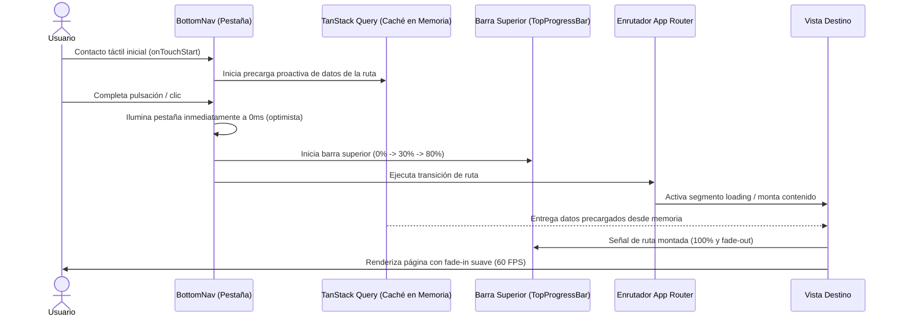
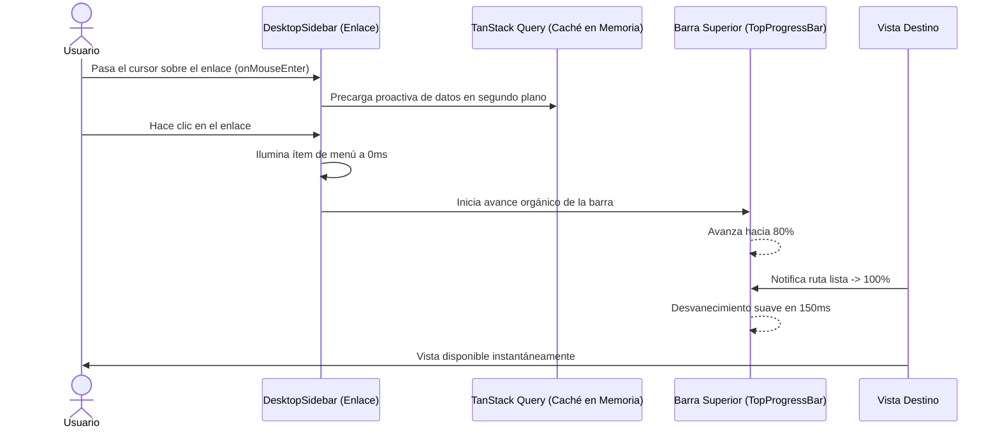
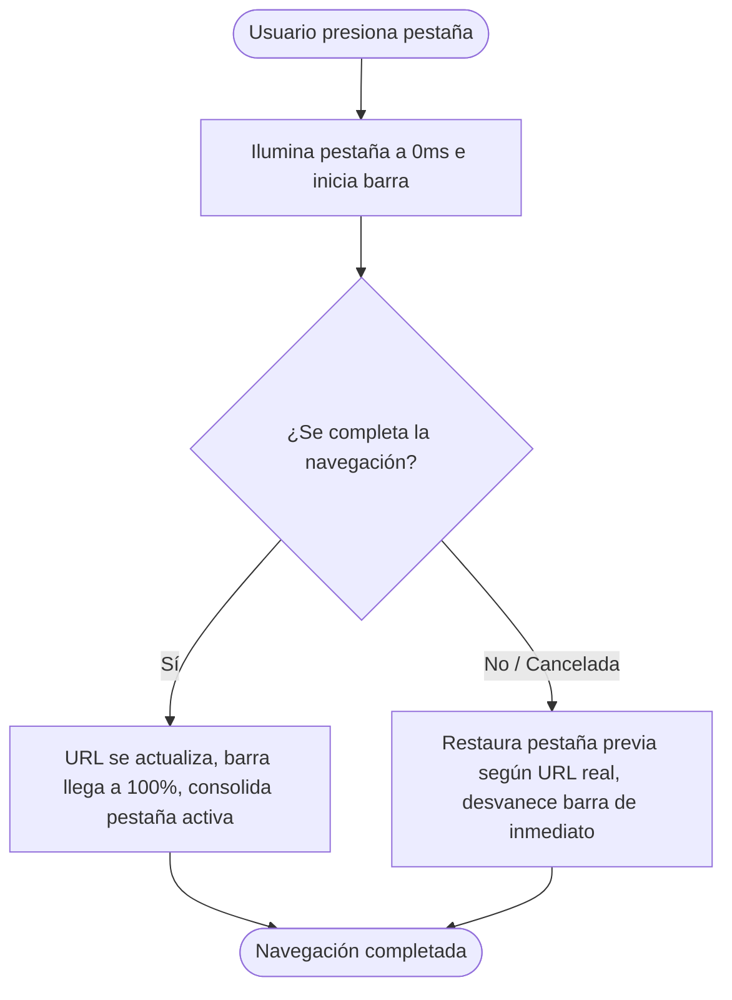

# Especificación 007 — Navegación Instantánea, Barra de Progreso Superior y Transiciones de Página de Alta Fluidez (`007-instant-navigation-and-page-transitions`)

- **Estado:** borrador
- **Versión:** 1.0.0
- **Fecha:** 2026-10-21

---

## 1. Propósito y Contexto Funcional (QUÉ y POR QUÉ)

### 1.1 Qué se construye
Esta especificación define la experiencia funcional completa de **navegación instantánea de latencia cero percibida (*Zero Perceived Latency Navigation*)**, retroalimentación visual inmediata y transiciones fluidas de página en **Credit Warrior Web**.

El alcance funcional abarca:
1. **Barra de Progreso Superior Instantánea de Navegación**:
   - Línea indicadora ultrafina fijada en el borde superior absoluto de la ventana visible (`z-50`, altura de 2.5px), con gradiente continuo Esmeralda a Cian (`#10B981` a `#38BDF8`) y resplandor luminoso suave en el extremo frontal.
   - Activación inmediata (0ms) ante cualquier clic o pulsación sobre enlaces de navegación interna o cambios de ruta en la aplicación.
   - Animación orgánica de avance: se despliega velozmente hacia un 20%-30%, avanza fluidamente hacia un ~70%-80% mientras el nuevo segmento de página se procesa, y salta instantáneamente al 100% con un desvanecimiento suave (*fade-out*) en cuanto la ruta de destino se encuentra lista y visible.
   - Ocultamiento automático no intrusivo ante errores de red o interrupciones de navegación.
2. **Segmentos de Carga Nativos y Supresión de Pantalla Congelada**:
   - Sustitución inmediata de la pantalla anterior por esqueletos visuales estructurados (*loading skeletons*) de la sección correspondiente al iniciar la transición, erradicando cualquier sensación de interfaz congelada o estática mientras se procesa la nueva vista.
   - Preservación permanente del marco de navegación exterior (cabecera superior, barra lateral de escritorio y barra de navegación inferior móvil), manteniéndolo completamente interactivo y responsivo durante las transiciones de contenido.
3. **Anticipación y Precarga Proactiva de Datos en Memoria**:
   - Detección de la intención de navegación del usuario en el instante del primer contacto táctil (`touch`) en dispositivos móviles o en la proximidad del puntero (`hover`) en ordenadores de escritorio.
   - Precarga anticipada en segundo plano de las consultas de datos clave asociadas a la sección de destino (compras, tarjetas, personas o resumen financiero) en la caché en memoria del cliente, reduciendo o eliminando la latencia de red al momento de liberar el clic o toque.
   - Precarga prioritaria de los paquetes de código y componentes de las rutas principales mediante enlaces proactivos.
4. **Activación Optimista Inmediata de Pestañas en Navegación**:
   - Iluminación inmediata (0ms) del indicador activo de la pestaña presionada en la barra de navegación móvil o en el menú lateral de escritorio en cuanto se produce la pulsación física, otorgando confirmación táctil inmediata antes de que la URL finalice su transición.
   - Reconciliación automática y tolerante a fallos: si la navegación es abortada o no se concreta, el estado visual del menú se reconcilia fielmente con la ruta activa real en el navegador.
5. **Transición Suave de Página a 60 FPS y Respeto a Preferencias de Movimiento**:
   - Efecto de entrada visual suave (*fade-in*) con una duración de 150ms a 200ms al presentarse el contenido de cada pantalla, eliminando parpadeos bruscos o saltos de pintado.
   - Adaptación estricta a las preferencias de accesibilidad del usuario (`prefers-reduced-motion`), deshabilitando las transiciones animadas para personas que prefieren interfaces estáticas sin efectos de aceleración.

### 1.2 Por qué es necesario
En aplicaciones web progresivas (PWA) de gestión financiera y uso cotidiano en el punto de venta, la diferencia fundamental entre una página web común y una aplicación nativa de alta gama radica en la **velocidad de respuesta táctil y la continuidad visual de la navegación**:
- **Eliminación del retardo perceptivo**: Si un usuario toca "Compras" o "Tarjetas" desde su teléfono y la pantalla permanece estática durante 300ms a 500ms mientras viaja la petición de red, el usuario experimenta incertidumbre, duda si su toque fue registrado y tiende a presionar repetidamente la pantalla, provocando fricción y frustración.
- **Confirmación táctil a 0ms**: Al iluminar la pestaña de forma optimista e iniciar la barra de progreso superior de inmediato (0ms), el sistema entrega certeza instantánea de que la orden fue comprendida y está ejecutándose.
- **Navegación instantánea en la palma de la mano**: Precargar los datos en el instante del roce táctil (`onTouchStart` o `onMouseEnter`) aprovecha los 100ms a 200ms que transcurren entre el toque físico y el levantamiento del dedo para iniciar la carga de red, logrando que al completarse el clic los datos ya se encuentren en memoria, alcanzando una experiencia percibida de navegación instantánea.
- **Identidad visual consistente**: La barra de progreso superior con los colores emblemáticos de las divisas (`CLP` esmeralda y `USD` cian) refuerza la estética de terminal financiera de precisión sin recargar la interfaz con elementos ruidosos.

---

## 2. Reglas Innegociables del Dominio

1. **Capa de Presentación Pura (Zero Financial Math on Client)**:
   - Las optimizaciones de navegación, precarga en memoria y transiciones de pantalla pertenecen estrictamente a la experiencia de usuario y arquitectura de renderizado.
   - En ningún caso alteran, recalculan ni intervienen en la lógica financiera, amortizaciones, montos o fechas del servidor.
2. **Inmutabilidad y Precisión Monetaria Basada en `string`**:
   - Toda consulta precargada de datos remotos preserva de forma estricta los contratos de datos y la regla de precisión basada en cadenas numéricas (`string`).
   - Los datos en caché precargados son idénticos a los consultados por la vía regular.
3. **Rendimiento Acelerado por Hardware (60 FPS Performance Floor)**:
   - Todas las animaciones visuales (avance de barra de progreso y desvanecimiento de entrada de páginas) deben ejecutarse en la capa de composición acelerada por hardware de la GPU (utilizando exclusivamente transformaciones de escala horizontal `transform: scaleX(...)` y opacidad `opacity`).
   - Queda estrictamente prohibido animar propiedades que provoquen recálculos de layout o reflows continuos (`width`, `left`, `margin`).
4. **Ergonomía Táctil y Mobile-First PWA**:
   - Los controles de navegación en la barra inferior móvil y el menú de escritorio mantienen áreas de contacto táctil mínimas de `44x44px`.
   - Se asegura compatibilidad táctil nativa sin retrasos de interacción de 300ms en pantallas móviles.
5. **Accesibilidad y Respeto a Movimiento Reducido (`prefers-reduced-motion`)**:
   - Si el sistema operativo del usuario tiene habilitada la preferencia de movimiento reducido, el sistema suprime los efectos de desplazamiento y aceleración, mostrando los cambios de estado y contenido de forma directa o con atenuación instantánea de opacidad sin movimiento físico.
6. **Reconciliación y Resiliencia ante Navegación Interrumpida**:
   - Si una transición de ruta no culmina (por ejemplo, por pérdida abrupta de conectividad o cancelación del usuario), la barra de progreso finaliza su ciclo de forma limpia, la pestaña activa se restaura a la ruta actual y la pantalla presenta el estado correspondiente sin quedar bloqueada ni congelada.
7. **Sin Autenticación en el MVP**:
   - La navegación entre las vistas es directa y libre en el entorno local del usuario sin pantallas de login ni redirecciones por tokens de sesión.

---

## 3. Requisitos Funcionales (Formato EARS) y Criterios de Aceptación

### RF-01: Barra de Progreso Superior Instantánea de Navegación
- **CUANDO** el usuario accione un enlace de navegación interna o se inicie un cambio de ruta en la aplicación, **EL SISTEMA DEBERÁ** activar de manera inmediata (0ms) una barra de progreso ultrafina en el borde superior absoluto de la ventana (`z-50`, altura `2.5px`).
- **MIENTRAS** la navegación se encuentre en curso y el nuevo segmento de página se esté preparando, **EL SISTEMA DEBERÁ** animar orgánicamente el avance de la barra desde 0% hasta un rango de 70% a 80% mediante transformaciones de escala horizontal (`scaleX`), desplegando un gradiente continuo de Esmeralda (`#10B981`) a Cian (`#38BDF8`) con un sutil resplandor luminoso en su extremo frontal.
- **CUANDO** la navegación culmine y la nueva ruta se active en pantalla, **EL SISTEMA DEBERÁ** completar el recorrido de la barra al 100% en menos de 100ms y desvanecerla suavemente (*fade-out*) en aproximadamente 150ms a 200ms, retirándola de la capa visual sin interferir con la interacción del usuario.
- **SI** la navegación se cancela o se ve interrumpida por un fallo de red, **EL SISTEMA DEBERÁ** concluir el ciclo de la barra y ocultarla limpiamente sin dejar residuos gráficos en el encabezado.

**Criterios de Aceptación:**
- [ ] Al pulsar cualquier enlace de navegación interna, la barra superior aparece de inmediato en 0ms.
- [ ] La barra avanza fluidamente hacia ~80% mientras la ruta se prepara y salta a 100% con desvanecimiento al activarse el nuevo contenido.
- [ ] La animación se realiza exclusivamente mediante transformaciones `scaleX` y `opacity` sin provocar recálculos de layout.
- [ ] El gradiente cromático refleja la paleta del sistema (`#10B981` a `#38BDF8`).
- [ ] La barra de progreso no intercepta clics ni eventos del puntero (`pointer-events-none`).

---

### RF-02: Segmentos de Carga Nativos y Supresión de Pantalla Congelada
- **CUANDO** el usuario navegue entre las secciones principales de la aplicación (`/`, `/expenses`, `/cards`, `/persons`), **EL SISTEMA DEBERÁ** desmontar la vista anterior y mostrar de inmediato el segmento visual de carga estructurado (*loading skeleton*) correspondiente a la ruta destino.
- **MIENTRAS** el nuevo segmento esté cargando sus datos iniciales, **EL SISTEMA DEBERÁ** mantener el marco exterior de la aplicación (cabecera superior, barra lateral de escritorio y barra de navegación inferior móvil) completamente visible, interactivo y accesible.
- **MIENTRAS** los esqueletos de carga permanezcan visibles, **EL SISTEMA DEBERÁ** preservar la geometría y proporciones espaciales de la vista destino para garantizar que no existan saltos acumulativos de diseño (CLS < 0.05).

**Criterios de Aceptación:**
- [ ] Cambiar de ruta muestra de inmediato los esqueletos de carga estructurados de la sección destino en lugar de congelar la pantalla anterior.
- [ ] El marco de navegación (BottomNav y DesktopSidebar) se mantiene interactivo durante la transición.
- [ ] Los esqueletos de carga respetan la paleta Dark Mode (`bg-elevated/60`) y poseen los atributos accesibles `role="status"` y `aria-busy="true"`.

---

### RF-03: Precarga Proactiva de Datos e Intención de Navegación
- **CUANDO** el usuario en dispositivo móvil inicie un contacto táctil (`touch`) sobre una pestaña de navegación en la barra inferior, **EL SISTEMA DEBERÁ** activar la precarga inmediata en memoria de las consultas de datos clave correspondientes a la ruta asociada (ej. compras, tarjetas, personas o resumen financiero).
- **CUANDO** el usuario en ordenador de escritorio sitúe el cursor (`hover`) sobre un elemento de navegación de la barra lateral o cabecera, **EL SISTEMA DEBERÁ** activar la precarga en segundo plano de las consultas de datos correspondientes a esa sección.
- **MIENTRAS** el usuario navegue por la aplicación, **EL SISTEMA DEBERÁ** precargar proactivamente los paquetes de código de las rutas principales asociadas a los enlaces visibles para asegurar transiciones inmediatas.
- **SI** los datos de la ruta destino ya se encuentran en la memoria caché en estado fresco (*fresh*), **EL SISTEMA DEBERÁ** abstenerse de emitir peticiones redundantes a la red y reutilizar de inmediato los datos en caché.

**Criterios de Aceptación:**
- [ ] El evento táctil inicial en móvil (`onTouchStart`) o el cursor posado en escritorio (`onMouseEnter`) sobre un enlace de navegación dispara la precarga proactiva en caché.
- [ ] Si la vista ya fue consultada recientemente y sus datos están frescos, no se generan peticiones de red innecesarias.
- [ ] Al completarse el clic, la vista destino renderiza sus datos de forma instantánea aprovechando la precarga.

---

### RF-04: Activación Optimista Inmediata de Pestañas en Navegación
- **CUANDO** el usuario presione una pestaña en la barra de navegación móvil o en el menú lateral de escritorio, **EL SISTEMA DEBERÁ** iluminar y activar de forma inmediata (0ms) el indicador visual de pestaña seleccionada, brindando retroalimentación táctil instantánea antes de que la URL finalice su actualización.
- **SI** la navegación culmina con éxito, **EL SISTEMA DEBERÁ** consolidar el estado de la pestaña seleccionada en concordancia con la nueva ruta activa.
- **SI** la navegación es cancelada o no se completa, **EL SISTEMA DEBERÁ** revertir el indicador optimista al ítem que coincide con la ruta que efectivamente permanece activa en el navegador.

**Criterios de Aceptación:**
- [ ] La pulsación física sobre una pestaña del menú ilumina su icono y etiqueta en 0ms.
- [ ] Si el usuario navega a otra sección, la pestaña seleccionada refleja inmediatamente la nueva intención.
- [ ] Si la navegación no se concreta, la selección se reconcilia fielmente con la URL real.

---

### RF-05: Transición Suave de Página a 60 FPS y Accesibilidad
- **CUANDO** el contenido de una nueva página o segmento se monte y se presente en pantalla, **EL SISTEMA DEBERÁ** realizar una animación de entrada suave (*fade-in*) con una duración de entre 150ms y 200ms, proporcionando una sensación de continuidad visual fluida.
- **SI** el usuario tiene habilitada la preferencia del sistema operativo para reducción de movimiento (`prefers-reduced-motion`), **EL SISTEMA DEBERÁ** omitir las transiciones de movimiento y aceleración, mostrando el nuevo contenido de forma directa e inmediata.

**Criterios de Aceptación:**
- [ ] El contenido de las páginas entra con un desvanecimiento suave de opacidad a 60 FPS sin saltos bruscos.
- [ ] Con la opción de movimiento reducido activada en el sistema, la transición se presenta sin animación de desplazamiento ni desvanecimiento retardado.
- [ ] Las transiciones no causan parpadeos (*flashes*) de fondo blanco en ningún momento.

---

## 4. Flujos de Usuario Principales

### 4.1 Flujo 1: Navegación Táctil Móvil Instantánea (Touch -> Preload -> Optimistic Tab -> Render)

### 4.2 Flujo 2: Navegación con Cursor en Escritorio (Hover -> Preload -> Clic)

### 4.3 Flujo 3: Cancelación o Navegación Interrumpida y Reconciliación

---

## 5. Matriz de Estados de la Interfaz de Usuario

| Estado de UI | Desencadenante | Representación Visual | Comportamiento del Sistema |
| :--- | :--- | :--- | :--- |
| **Reposo (Idle)** | Usuario interactuando dentro de una pantalla cargada. | Barra de progreso superior oculta (`opacity: 0`). Pestañas del menú sincronizadas con la ruta actual. | Sin consumo de recursos de animación en segundo plano. |
| **Intención Detectada (Preload)** | `onTouchStart` en móvil o `onMouseEnter` en escritorio sobre un enlace. | Sin cambio visual en la barra superior. Puntero táctil o cursor sobre el elemento interactivo. | Precarga silenciosa en segundo plano de consultas y código de la ruta destino. |
| **Navegación en Curso (Navigating)** | Clic o liberación del toque en el enlace de navegación. | Pestaña presionada iluminada inmediatamente a 0ms. Barra superior visible avanzando de 0% hacia ~80%. Esqueleto de carga en el área de contenido. | Petición de transición en App Router en curso. Marco exterior interactivo. |
| **Completado Exitoso (Completed)** | Nuevo segmento de ruta montado y listo. | Barra salta velozmente al 100% y se desvanece suavemente. Nuevo contenido entra con animación *fade-in*. Pestaña confirmada. | La barra se desmonta de la capa de interacción (`pointer-events-none`). |
| **Interrupción o Error** | Fallo de conexión o cancelación del usuario. | Barra de progreso se oculta de inmediato. Pestaña activa se reconcilia con la URL real. Mensaje de error no invasivo si corresponde. | El marco exterior permanece operativo y disponible para reintentar. |

---

## 6. Casos Límite y Reglas de Negocio Específicas

1. **Pulsaciones Ultra-Rápidas Consecutivas en Múltiples Pestañas**:
   - Si el usuario pulsa rápidamente varias pestañas seguidas (ej. "Compras" y de inmediato "Tarjetas"), la activación optimista se traslada inmediatamente a la última pestaña presionada, la barra de progreso reinicia o acelera su ciclo de avance y el enrutador resuelve la última intención sin retener estados intermedios inconsistentes.
2. **Pulsación sobre la Misma Pestaña Activa**:
   - Si el usuario presiona la pestaña que ya se encuentra activa, el sistema no reinicia la barra de progreso ni recarga innecesariamente la pantalla, evitando parpadeos visuales redundantes.
3. **Navegación mediante el Historial del Navegador (Atrás / Adelante)**:
   - Al utilizar los botones de retroceso o avance del navegador o gestos táctiles de deslizamiento del sistema operativo, la barra de progreso superior detecta el cambio de ruta, se activa y se desvanece suavemente, manteniendo la pestaña del menú sincronizada con la nueva ubicación.
4. **Apertura de Enlaces en Nueva Pestaña (Clic Derecho / Comando + Clic)**:
   - Si el usuario abre un enlace en una pestaña secundaria o mediante combinación de teclas (`Ctrl+Clic` / `Cmd+Clic`), la vista actual no activa la barra de progreso ni la pestaña optimista, permitiendo la apertura nativa del navegador.
5. **Conexiones Lentas o Modo Fuera de Línea (PWA Offline)**:
   - Si la red se encuentra degradada, la barra de progreso avanza hasta el 80% y permanece en espera de forma orgánica. Si la petición falla, la barra se desvanece de inmediato y se expone el estado de error estructurado con botón de reintento.
6. **Manejo Estricto de Movimiento Reducido (`prefers-reduced-motion: reduce`)**:
   - En sistemas con reducción de movimiento activada, la barra de progreso se muestra directamente estática o se desactiva, y el contenido de las páginas se monta sin transición de desvanecimiento para respetar las necesidades de salud visual del usuario.

---

## 7. Requisitos No Funcionales, Accesibilidad y Ergonomía PWA

1. **Accesibilidad WCAG 2.1 AA**:
   - La barra de progreso superior posee atributos `aria-hidden="true"` y `pointer-events-none` para no alterar la lectura de lectores de pantalla ni interferir con elementos cliqueables subyacentes.
   - Las pestañas de navegación mantienen sus atributos semánticos `aria-current="page"` debidamente sincronizados.
   - Las áreas de pulsación táctil cumplen con el estándar mínimo de `44x44px`.
2. **Rendimiento Visual y Estabilidad (CLS < 0.05 y 60 FPS)**:
   - Todas las animaciones se ejecutan en la GPU mediante propiedades aceleradas (`transform`, `opacity`), manteniendo una tasa de cuadros estable de 60 cuadros por segundo en dispositivos móviles.
   - El uso de esqueletos estructurados idénticos en proporciones a las vistas finales garantiza un valor de cambio acumulativo de diseño (CLS) inferior a 0.05.
3. **Ergonomía PWA y Experiencia Móvil de Grado Nativo**:
   - La respuesta táctil a 0ms proporciona la misma sensación de fluidez y solidez que una aplicación nativa instalada en iOS o Android, funcionando con total naturalidad en modo pantalla completa (*standalone*).
