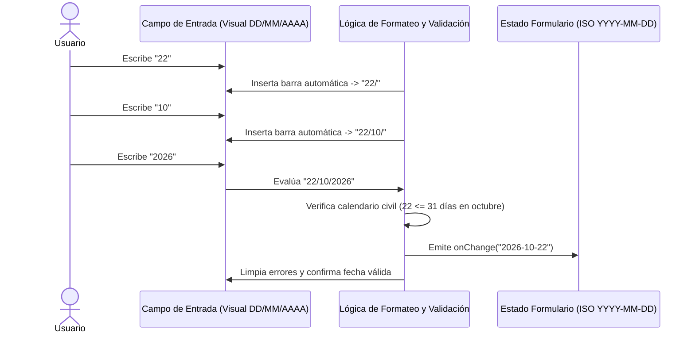
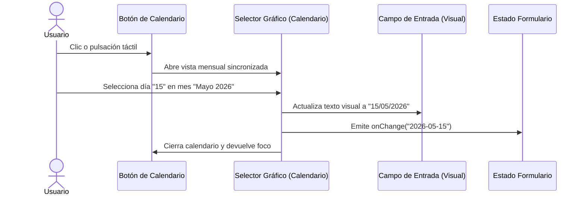
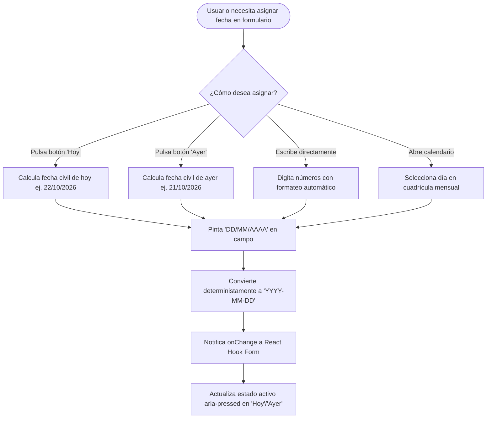

# Especificación 008 — Selector de Fecha Localizado en Formato DD/MM/AAAA (`008-localized-date-format-picker`)

- **Estado:** aprobado
- **Versión:** 1.0.0
- **Fecha:** 2026-10-22

---

## 1. Propósito y Contexto Funcional (QUÉ y POR QUÉ)

### 1.1 Qué se construye
Esta especificación define el comportamiento funcional y de experiencia de usuario para el **Selector de Fecha Localizado**, garantizando que en todos los formularios y vistas de la aplicación (captura de compras, edición de gastos y consultas temporales) la fecha se presente y se ingrese de manera estricta y predecible en formato **día/mes/año (`DD/MM/AAAA`)**, independientemente de la configuración regional, idioma o sistema operativo del dispositivo del usuario.

El alcance funcional abarca:
1. **Visualización y Máscara Estricta en Formato Local (`DD/MM/AAAA`)**:
   - El campo de fecha visualiza, solicita y formatea siempre la fecha en orden cronológico civil hispanoamericano: dos dígitos para el día, dos dígitos para el mes y cuatro dígitos para el año (ej. `"22/10/2026"`).
   - Eliminación total del formato anglosajón (`MM/DD/AAAA` o `AAAA-MM-DD`) en la capa visual expuesta al usuario.
   - Texto de sugerencia (*placeholder*) claro y explícito: `"DD/MM/AAAA"`.
2. **Entrada Manual Asistida por Teclado con Delimitación Automática**:
   - Capacidad de ingresar la fecha directamente escribiendo números desde el teclado físico o teclado numérico en pantalla en dispositivos móviles.
   - Inserción automática de las barras separadoras `/` conforme el usuario tipea (ej. al escribir `22102026` se formatea dinámicamente como `22/10/2026`), evitando la necesidad de teclear manualmente los caracteres especiales.
   - Manejo fluido y natural de la tecla de retroceso (*Backspace*), permitiendo corregir dígitos y separadores sin bloqueos ni saltos de cursor inesperados.
3. **Validación Estricta de Calendario Civil en Tiempo Real**:
   - Control estricto de días válidos según el mes (ej. meses de 30 versus 31 días; rechazo de combinaciones imposibles como `"31/04/2026"` o `"31/11/2026"`).
   - Soporte y cálculo determinista de años bisiestos para febrero (admitiendo `"29/02/2024"` pero rechazando `"29/02/2026"`).
   - Validación de rango de años razonables para transacciones financieras (años entre 1900 y 2100).
4. **Selector Gráfico de Calendario Integrado y Accesible**:
   - Icono o botón interactivo de calendario adyacente o integrado al campo de texto que despliega un selector visual interactivo de fecha con cuadrícula mensual.
   - Al seleccionar un día en el calendario gráfico, el campo de texto se actualiza de inmediato al formato visual `DD/MM/AAAA` y se propaga el valor confirmado.
   - El selector gráfico se sincroniza bidireccionalmente: si el usuario escribe una fecha por teclado, al abrir el calendario gráfico este se posiciona en el mes y día escritos.
5. **Atajos Táctiles Rápidos de Fecha ("Hoy" y "Ayer")**:
   - Botones táctiles de un solo toque para asignar la fecha del día actual (*"Hoy"*) o del día anterior (*"Ayer"*).
   - Al pulsar un atajo, el campo refleja de inmediato la fecha en formato `DD/MM/AAAA` y se marca visualmente el botón seleccionado (`aria-pressed="true"`).
6. **Contrato de Integración y Sincronización Transparente**:
   - Hacia los modelos de datos, validaciones de esquema y servicios de la aplicación, el selector emite y recibe siempre la fecha normalizada en estándar internacional ISO **`YYYY-MM-DD`** (ej. `"2026-10-22"`), asegurando compatibilidad absoluta con la API del servidor y las reglas de negocio sin cálculos financieros en cliente.

### 1.2 Por qué es necesario
En la versión inicial de la aplicación, el selector de fecha utilizaba el control nativo del navegador, el cual delega el formato visual a la configuración regional interna del sistema operativo del cliente:
- **Confusión y errores en la captura de compras**: En navegadores configurados por omisión en inglés (`en-US`), el control nativo despliega `MM/DD/AAAA` (mes antes que día). En países de habla hispana como Chile y Latinoamérica, donde el estándar cultural y comercial indiscutido es `DD/MM/AAAA`, esto provoca que un gasto efectuado el 10 de mayo (`10/05`) se interprete o registre accidentalmente como el 5 de octubre (`05/10`).
- **Falta de control del desarrollador sobre el control nativo**: Los estándares web de navegadores impiden explícitamente forzar mediante estilos o atributos HTML el formato visual de un campo de fecha nativo.
- **Inconsistencia entre dispositivos**: El mismo formulario mostraba formatos diferentes según si el usuario accedía desde un teléfono Android, un iPhone o una computadora con navegador en inglés.
- **Necesidad de agilidad en terreno**: Al registrar una compra compartida en el punto de venta, el usuario necesita comprobar de un solo vistazo que el día y el mes son correctos y poder tippear rápidamente los números o pulsar "Hoy" sin luchar contra máscaras ambiguas.

---

## 2. Reglas Innegociables del Dominio

1. **Localización Visual Estricta en Formato Civil Hispanoamericano (`DD/MM/AAAA`)**:
   - Todo texto, etiqueta, campo editable o vista previa de la fecha de compra en la interfaz debe mostrar el día primero, luego el mes y finalmente el año de 4 dígitos, separados por barras diagonales (`/`).
   - Queda estrictamente prohibida la exposición visual del formato `MM/DD/AAAA`.
2. **Inmutabilidad del Contrato de Datos Internacional ISO (`YYYY-MM-DD`)**:
   - El formato visual `DD/MM/AAAA` pertenece exclusivamente a la capa de presentación humana.
   - En el estado del formulario, la validación de esquemas y las peticiones enviadas al servidor, la fecha viaja y se almacena estrictamente como cadena de texto en formato ISO `YYYY-MM-DD` (ej. `"2026-10-22"`).
   - La conversión bidireccional entre `DD/MM/AAAA` y `YYYY-MM-DD` es determinista y no sufre redondeos ni desfases de husos horarios.
3. **Parseo Determinista Inmune a Desfases Horarios UTC**:
   - Todas las conversiones de fecha operan sobre componentes numéricos enteros (día, mes, año civil local), prohibiendo el uso de constructores de fecha que interpreten medianoches en UTC provocando desplazamientos al día anterior en zonas horarias occidentales (como Chile UTC-3 / UTC-4).
4. **Capa de Presentación Pura (Zero Financial Math on Client)**:
   - La asignación de la fecha de compra es un dato descriptivo de la transacción. El cliente no deduce ni recalcula a partir de esta fecha los cortes de facturación ni fechas de vencimiento de las tarjetas, las cuales son calculadas de forma soberana por el servidor.
5. **Ergonomía Táctil y Accesibilidad Universal (WCAG 2.1 AA)**:
   - Los botones de atajo ("Hoy", "Ayer") y el activador del calendario gráfico mantienen áreas de contacto táctil mínimas de `44x44px`.
   - El campo de entrada cuenta con teclado numérico optimizado en pantallas móviles (`inputMode="numeric"`), etiquetas legibles, indicadores de error (`aria-invalid`) y navegación completa por teclado.

---

## 3. Requisitos Funcionales (Formato EARS) y Criterios de Aceptación

### RF-01: Visualización Forzada y Enmascarada en Formato DD/MM/AAAA
- **MIENTRAS** el usuario visualice o interactúe con el selector de fecha, **EL SISTEMA DEBERÁ** mostrar el valor de la fecha en orden estricto `DD/MM/AAAA` (ej. `"22/10/2026"`), con dos dígitos para el día, dos dígitos para el mes y cuatro dígitos para el año, separados por barras diagonales.
- **CUANDO** el campo no tenga una fecha asignada o se encuentre vacío, **EL SISTEMA DEBERÁ** presentar el texto de sugerencia (*placeholder*) con el patrón `"DD/MM/AAAA"` en tipografía atenuada.
- **SI** la configuración regional o idioma del navegador del usuario es inglés (`en-US`) o cualquier otra distinta al español, **EL SISTEMA DEBERÁ** mantener de forma inalterable el formato visual `DD/MM/AAAA`.

**Criterios de Aceptación:**
- [ ] La fecha actual (ej. 22 de octubre de 2026) se visualiza como `"22/10/2026"` en navegadores con locale `en-US`, `es-CL`, `es-ES` o cualquier otro.
- [ ] El texto de sugerencia cuando el campo está vacío es exactamente `"DD/MM/AAAA"`.
- [ ] En ningún caso se muestra el mes antes del día en la interfaz visual.

---

### RF-02: Entrada Manual Asistida por Teclado y Validación de Calendario Civil
- **CUANDO** el usuario ingrese dígitos numéricos en el campo de fecha, **EL SISTEMA DEBERÁ** insertar automáticamente las barras separadoras `/` tras el ingreso del segundo dígito (día) y del cuarto dígito (mes), permitiendo ingresar una fecha completa digitando únicamente los 8 números correspondientes.
- **CUANDO** el usuario presione la tecla de retroceso (*Backspace*) sobre o inmediatamente después de una barra separadora `/`, **EL SISTEMA DEBERÁ** permitir el borrado natural del dígito anterior sin bloquear el cursor ni requerir pulsar dos veces la tecla.
- **MIENTRAS** el usuario escriba, **EL SISTEMA DEBERÁ** validar que los componentes de la fecha cumplan con las reglas del calendario gregoriano civil:
  1. El mes debe encontrarse en el rango `01` a `12`.
  2. El día debe encontrarse en el rango `01` al número máximo de días que posee dicho mes específico:
     - Meses de 31 días (enero, marzo, mayo, julio, agosto, octubre, diciembre): máximo `31`.
     - Meses de 30 días (abril, junio, septiembre, noviembre): máximo `30`.
     - Febrero en años bisiestos: máximo `29`.
     - Febrero en años no bisiestos: máximo `28`.
  3. El año debe poseer 4 dígitos válidos dentro del rango de operación financiera (`1900` a `2100`).
- **CUANDO** el usuario complete una fecha válida en formato `DD/MM/AAAA`, **EL SISTEMA DEBERÁ** transformar y emitir inmediatamente el valor en formato estándar ISO `YYYY-MM-DD` hacia el estado del formulario.
- **SI** el usuario introduce una fecha que no existe en el calendario (ej. `"31/04/2026"` o `"29/02/2025"`), **EL SISTEMA DEBERÁ** marcar el campo como inválido (`aria-invalid="true"`), presentar un mensaje descriptivo de error y abstenerse de emitir una fecha corrupta.

**Criterios de Aceptación:**
- [ ] Escribir los números `2` `2` `1` `0` `2` `0` `2` `6` produce automáticamente el texto `"22/10/2026"`.
- [ ] Ingresar `"31/04/2026"` (abril tiene 30 días) es detectado como inválido y muestra retroalimentación de error.
- [ ] Ingresar `"29/02/2024"` (año bisiesto) es aceptado como válido, mientras que `"29/02/2026"` es rechazado.
- [ ] La tecla de retroceso borra caracteres de forma intuitiva sin dejar caracteres huérfanos.

---

### RF-03: Selector Gráfico de Calendario Accesible Integrado
- **MIENTRAS** se presente el campo de fecha, **EL SISTEMA DEBERÁ** proveer un botón interactivo accesible con icono de calendario integrado en el extremo del campo.
- **CUANDO** el usuario accione el botón de calendario o presione la combinación de teclas correspondiente, **EL SISTEMA DEBERÁ** abrir un selector visual interactivo de fecha que exponga el mes actual con cuadrícula navegable de días.
- **CUANDO** el usuario seleccione un día en el calendario gráfico, **EL SISTEMA DEBERÁ**:
  1. Formatear y exhibir la fecha seleccionada en el campo de texto en formato `DD/MM/AAAA`.
  2. Emitir el valor correspondiente en formato ISO `YYYY-MM-DD` hacia el formulario.
  3. Cerrar el selector gráfico y devolver el foco de forma accesible al campo de texto o botón activador.
- **MIENTRAS** el campo de texto ya contenga una fecha válida, **EL SISTEMA DEBERÁ** abrir el selector gráfico posicionado directamente en el año, mes y día especificados en dicha fecha.

**Criterios de Aceptación:**
- [ ] El botón de calendario es visible, accesible por teclado y posee un área de contacto mínima de `44x44px`.
- [ ] Seleccionar un día en el calendario gráfico actualiza el campo visible al formato `DD/MM/AAAA` y envía `YYYY-MM-DD` al formulario.
- [ ] Si el campo contiene `"15/03/2026"`, abrir el calendario visual muestra el mes de marzo de 2026 con el día 15 resaltado.

---

### RF-04: Atajos Táctiles Rápidos de Fecha ("Hoy" y "Ayer")
- **MIENTRAS** se muestre el selector de fecha, **EL SISTEMA DEBERÁ** presentar en la cabecera del campo los botones de acceso rápido de un solo toque: *"Hoy"* y *"Ayer"*.
- **CUANDO** el usuario pulse el botón *"Hoy"*, **EL SISTEMA DEBERÁ** asignar inmediatamente la fecha civil local actual, formateándola como `DD/MM/AAAA` en el campo visual y emitiendo `YYYY-MM-DD` al estado del formulario.
- **CUANDO** el usuario pulse el botón *"Ayer"*, **EL SISTEMA DEBERÁ** asignar inmediatamente la fecha civil local del día inmediatamente anterior, formateándola como `DD/MM/AAAA` en el campo visual y emitiendo `YYYY-MM-DD` al estado del formulario.
- **MIENTRAS** la fecha seleccionada coincida con la fecha de hoy o de ayer, **EL SISTEMA DEBERÁ** resaltar visualmente el botón correspondiente con estado activo (`aria-pressed="true"`).

**Criterios de Aceptación:**
- [ ] Pulsar *"Hoy"* asigna la fecha actual en `DD/MM/AAAA` y activa el botón *"Hoy"*.
- [ ] Pulsar *"Ayer"* asigna el día anterior en `DD/MM/AAAA` y activa el botón *"Ayer"*.
- [ ] Si la fecha se cambia manualmente a otro día diferente, ambos botones quedan en estado no presionado (`aria-pressed="false"`).
- [ ] La determinación de "Hoy" y "Ayer" se basa estrictamente en la fecha civil local, sin desvíos provocados por UTC.

---

### RF-05: Sincronización Bidireccional y Contrato ISO YYYY-MM-DD
- **CUANDO** el componente reciba una fecha externa en formato ISO `YYYY-MM-DD` (ej. `"2026-10-22"`), **EL SISTEMA DEBERÁ** descomponer deterministamente el año, mes y día, y renderizar en el campo visual el texto `"22/10/2026"`.
- **CUANDO** el valor externo cambie programáticamente (ej. por restablecimiento de formulario o carga de datos preexistentes), **EL SISTEMA DEBERÁ** sincronizar de inmediato el texto mostrado en pantalla.
- **MIENTRAS** el usuario edite o complete la fecha en formato `DD/MM/AAAA`, **EL SISTEMA DEBERÁ** emitir hacia el evento de cambio (`onChange`) el string normalizado en formato ISO `YYYY-MM-DD`.
- **SI** el campo es vaciado o se encuentra incompleto durante la edición, **EL SISTEMA DEBERÁ** gestionar el estado provisional sin romper la validación del formulario receptor.

**Criterios de Aceptación:**
- [ ] Recibir `value="2026-10-22"` renderiza en pantalla `"22/10/2026"`.
- [ ] Modificar el texto visible a `"05/11/2026"` emite `"2026-11-05"` al manejador `onChange`.
- [ ] La integración con React Hook Form es limpia y transparente, recibiendo siempre cadenas `YYYY-MM-DD`.

---

### RF-06: Retroalimentación de Validación, Errores y Accesibilidad
- **CUANDO** la fecha ingresada sea incompleta o inválida y el campo pierda el foco de interacción (*blur*), **EL SISTEMA DEBERÁ** exhibir un mensaje de error accesible bajo el campo (ej. *"Ingrese una fecha válida en formato DD/MM/AAAA"*).
- **MIENTRAS** el campo se encuentre en estado de error, **EL SISTEMA DEBERÁ** resaltar visualmente el borde en color carmesí de alerta (`#F43F5E`), asociar el mensaje de error mediante `aria-describedby` y asignar `aria-invalid="true"`.
- **SI** el campo recibe la propiedad de deshabilitado (`disabled`), **EL SISTEMA DEBERÁ** atenuar visualmente el campo, los botones de atajo y el icono de calendario, impidiendo cualquier edición o apertura del selector gráfico.

**Criterios de Aceptación:**
- [ ] Perder el foco con una fecha como `"31/02/2026"` activa el borde de error y mensaje accesible en `#F43F5E`.
- [ ] El lector de pantallas anuncia el error asociado gracias al atributo `role="alert"`.
- [ ] En estado `disabled`, ningún elemento interactivo responde a pulsaciones ni recibe foco por teclado.

---

## 4. Flujos de Usuario Principales

### 4.1 Flujo 1: Entrada Directa por Teclado con Máscara Dinámica

### 4.2 Flujo 2: Selección Mediante Selector Gráfico de Calendario

### 4.3 Flujo 3: Activación de Atajo Rápido ("Hoy" / "Ayer")

---

## 5. Matriz de Estados de la Interfaz de Usuario

| Estado de UI | Desencadenante | Representación Visual | Comportamiento del Sistema |
| :--- | :--- | :--- | :--- |
| **Vacío / Inicial** | Sin fecha seleccionada o formulario nuevo. | Texto de sugerencia `"DD/MM/AAAA"` en `#8A93A6`. Botones "Hoy" y "Ayer" en estado neutro. | Listo para recibir foco o pulsación de atajo. |
| **Fecha Asignada Válida** | Carga de fecha existente o selección confirmada. | Texto en cifras tabulares `"22/10/2026"`. Si coincide con hoy/ayer, botón de atajo resaltado en `#10B981`. | Estado del formulario sincronizado con `"YYYY-MM-DD"`. |
| **En Edición (Tipeando)** | Usuario escribiendo números por teclado. | Inserción fluida de separadores `/`. Borde activo con anillo esmeralda (`#10B981`). | Mantiene borrador local; emite a `onChange` cuando los 8 dígitos conforman una fecha válida. |
| **Selector Gráfico Abierto** | Pulsación en botón de calendario. | Panel de calendario superpuesto o nativo con mes sincronizado y día resaltado. | Foco atrapado en el calendario; cierre con tecla Escape o clic externo. |
| **Error de Validación** | Fecha imposible (ej. `"31/02/2026"`, `"31/04/2026"`) o incompleta tras desenfocar. | Borde del campo en `#F43F5E`. Mensaje de alerta visible debajo. `aria-invalid="true"`. | Bloquea el envío del formulario mediante validación de esquema. |
| **Deshabilitado (Disabled)** | Propiedad `disabled={true}` activa. | Opacidad al 50%, cursor no permitido, controles inactivos. | No emite eventos ni permite foco. |

---

## 6. Casos Límite y Reglas de Negocio Específicas

1. **Años Bisiestos en Febrero**:
   - Para el mes `02`, el sistema evalúa si el año es divisible por 4 y (no divisible por 100 o divisible por 400).
   - `"29/02/2024"` y `"29/02/2028"` se validan como fechas correctas.
   - `"29/02/2025"`, `"29/02/2026"` o `"29/02/2100"` se identifican inmediatamente como fechas inválidas.
2. **Meses con 30 Días**:
   - En abril (`04`), junio (`06`), septiembre (`09`) y noviembre (`11`), los días permitidos van de `01` a `30`.
   - Cualquier valor `31` en dichos meses es rechazado con error descriptivo.
3. **Manejo del Retroceso (*Backspace*) sobre Separadores**:
   - Si el usuario tiene el cursor posicionado tras una barra diagonal (ej. `"22/"` o `"22/10/"`) y presiona retroceso, el sistema borra tanto el separador como el último dígito ingresado, permitiendo una corrección natural sin bloqueos.
4. **Pegado de Texto desde el Portapapeles (*Paste*)**:
   - Si el usuario copia y pega una fecha en formato `DD/MM/AAAA` (ej. `"22/10/2026"`), `DD-MM-AAAA` (ej. `"22-10-2026"`) o ISO `YYYY-MM-DD` (ej. `"2026-10-22"`), el sistema normaliza limpiamente los caracteres, verifica su validez y actualiza el campo visible a `DD/MM/AAAA`.
5. **Pérdida de Foco (*Blur*) con Entrada Incompleta**:
   - Si el usuario escribe solo 3 o 4 dígitos (ej. `"22/1"`) y desenfoca el campo, se activa la retroalimentación de fecha incompleta y se preserva el borrador o se restaura al valor previo válido si el formulario lo requiere.
6. **Manejo de Transición de Medianoche Local**:
   - Los botones "Hoy" y "Ayer" evalúan la fecha con base en el reloj del sistema local del usuario en el instante de la pulsación, evitando cualquier corrimiento por horas UTC.

---

## 7. Requisitos No Funcionales, Accesibilidad y Ergonomía PWA

1. **Accesibilidad WCAG 2.1 AA**:
   - Contraste superior a `4.5:1` en textos normales y `3.0:1` en bordes interactivos sobre las superficies oscuras (`#090A0F`, `#12141C`, `#1A1D28`).
   - El campo posee una etiqueta semántica asociada (`<label htmlFor="...">`) con icono descriptivo.
   - Los estados de error vinculan el mensaje mediante `aria-describedby` y el contenedor expone `role="alert"`.
2. **Ergonomía Táctil y Mobile-First**:
   - En dispositivos táctiles, el campo activa el teclado numérico (`inputMode="numeric"`), permitiendo una digitación inmediata sin requerir cambiar manualmente al teclado de números.
   - El botón de apertura de calendario y los atajos "Hoy" y "Ayer" tienen áreas táctiles que cumplen con el mínimo de `44x44px`.
3. **Estabilidad Visual y Coherencia de Tema**:
   - El componente se integra de manera homogénea en la estética Dark Mode First del proyecto, utilizando bordes sutiles en `#232736`, superficies `#12141C` y foco accesible en `#10B981`.
