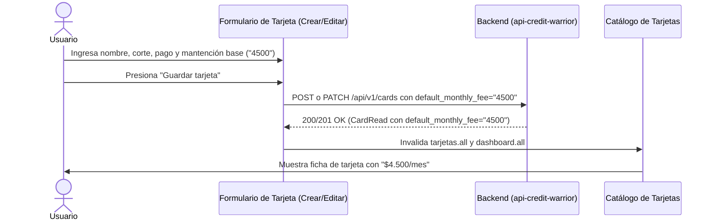
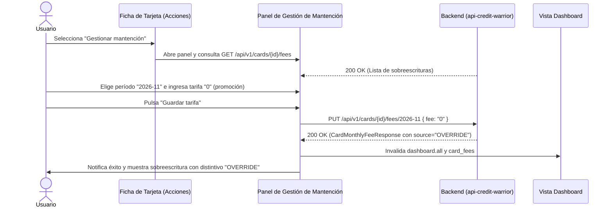
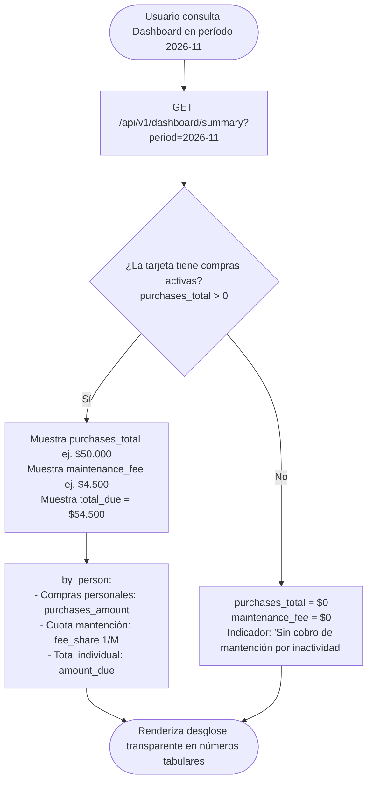

# Especificación 009 — Gestión de Mantención de Tarjetas: Configuración Base, Sobreescrituras Mensuales y Transparencia en Dashboard (`009-card-maintenance-fees`)

- **Estado:** aprobado
- **Versión:** 1.0.0
- **Fecha:** 2026-10-23

---

## 1. Propósito y Contexto Funcional (QUÉ y POR QUÉ)

### 1.1 Qué se construye
Esta especificación define la experiencia funcional completa de **administración, sobreescritura periódica y transparencia analítica de los costos de mantención de tarjetas de crédito** en **Credit Warrior Web**, integrando la configuración base por tarjeta, la gestión mensual de tarifas por período y su desglose equitativo en el panel financiero del Dashboard.

El alcance funcional abarca:
1. **Configuración de Mantención Mensual Base por Tarjeta**:
   - En los formularios de creación y edición de tarjetas (así como en el paso de creación de tarjeta del asistente de bienvenida inicial), se incorpora el campo opcional *"Mantención mensual por defecto"*, con valor inicial predeterminado de cero (`"0"`).
   - Validación adaptativa según la divisa de la tarjeta: para pesos chilenos (`CLP`), enteros no negativos sin decimales; para dólares (`USD`), montos no negativos con hasta 2 decimales.
   - Visualización explícita del costo de mantención base en las tarjetas de crédito del catálogo (ej. `"$4.500/mes"` o `"US$5.00/mes"`), informando con claridad si la tarjeta no tiene costo mensual asociado (`"$0/mes"` o *"Sin mantención"*).
2. **Centro de Gestión de Sobreescrituras Mensuales de Mantención**:
   - Panel adaptativo accesible desde las opciones contextuales de cada tarjeta (modal centrado en escritorio o deslizable inferior en dispositivos móviles) para consultar y administrar las tarifas mensuales históricas y futuras de esa tarjeta.
   - Listado cronológico de las sobreescrituras registradas para la tarjeta, indicando el período (`YYYY-MM`), el monto de la tarifa y la fuente activa del cobro: sobreescritura explícita (`OVERRIDE`) versus tarifa base predeterminada (`CARD_DEFAULT`).
   - Capacidad de ingresar o modificar la tarifa de mantención para un mes específico mediante una acción directa (*"Ajustar mantención del mes"*), permitiendo reflejar promociones bancarias temporales (ej. meses con mantención rebajada o costo cero) o alzas puntuales informadas por el banco.
   - Capacidad de eliminar una sobreescritura mensual específica, restaurando de inmediato el cobro de la tarifa base por defecto de la tarjeta para ese período.
3. **Transparencia Financiera en el Dashboard**:
   - En la sección de desglose por tarjeta (*"Estado por Tarjeta"*), se visibiliza la descomposición exacta del saldo exigible del mes:
     - Monto total de compras y cuotas del período (`purchases_total`).
     - Costo de mantención mensual aplicado (`maintenance_fee`).
     - Total consolidado a pagar por la tarjeta (`total_due`).
   - **Visualización de la Regla de Inactividad Bancaria**: Si en el período la tarjeta no registra cuotas ni compras activas (`purchases_total == "0"`), la mantención se expone en `$0` con una indicación visual sutil de que no se generó cobro por ausencia de movimientos en el ciclo, reflejando fielmente la regla de negocio del dominio.
   - En el desglose individual por participante dentro de la tarjeta: exposición transparente de cuánto corresponde a compras personales (`purchases_amount`), cuánto a la cuota parte de mantención compartida (`fee_share`), y el total adeudado por la persona a esa tarjeta (`amount_due`).

### 1.2 Por qué es necesario
En la operativa bancaria real con tarjetas de crédito compartidas:
- **Las entidades bancarias cobran comisiones fijas de mantención mensual o administración de cuenta**: Si el titular de la tarjeta asume solo este cobro o no lo transparenta, se producen asimetrías injustas donde quien presta la tarjeta asume gastos operativos que benefician a todos los que compraron en ella.
- **Las tarifas varían en el tiempo**: Es frecuente que los bancos ofrezcan promociones de mantención costo cero durante ciertos meses (ej. por metas de uso o campañas de fidelización) o apliquen reajustes tarifarios en períodos determinados. Sin la posibilidad de sobreescribir la mantención mes a mes, el usuario se vería obligado a modificar constantemente la configuración permanente de la tarjeta o a cuadrar los cobros con cálculos manuales fuera de la plataforma.
- **La regla de inactividad previene cobros fantasmas**: Los usuarios no deben pagar mantención en una tarjeta si nadie la utilizó en ese ciclo de facturación. Transparentar que la mantención es `$0` ante cero compras brinda total tranquilidad y confianza matemática.
- **Erradicación de disputas en gastos compartidos**: Mostrar con claridad en el Dashboard cuánto le corresponde pagar a cada persona por sus compras propias versus su parte equitativa de la mantención elimina discusiones y transparenta el desglose final antes de realizar transferencias bancarias.

---

## 2. Reglas Innegociables del Dominio

1. **Capa de Presentación Pura (Zero Financial Math on Client)**:
   - El frontend **jamás calcula ni recalcula** la división equitativa de la mantención entre participantes ($1/M$), la absorción de residuos de redondeo (en pesos o centavos), ni la aplicación condicional de la regla de inactividad.
   - Todas las cifras (`purchases_total`, `maintenance_fee`, `total_due`, `purchases_amount`, `fee_share`, `amount_due`) provienen exclusivamente del backend y se renderizan sin alteraciones aritméticas en el cliente.
2. **Inmutabilidad y Precisión Monetaria Basada en `string`**:
   - Los campos de mantención (`default_monthly_fee`, `fee`, `maintenance_fee`, `fee_share`) se validan, transmiten y almacenan estrictamente como **cadenas de texto numéricas** (`string`).
   - El formateo con símbolos de divisa (`$` para `CLP`, `US$` para `USD`) y separadores de miles se aplica exclusivamente en el instante final de pintado en pantalla, utilizando tipografía monoespaciada con alineación tabular (`tabular-nums`).
3. **Regla de Inactividad Soberana del Servidor**:
   - Si una tarjeta tiene compras cero en el mes (`purchases_total == "0"`), la API devuelve `maintenance_fee: "0"` y `fee_share: "0"`.
   - La interfaz muestra este estado informativo de forma neutral y transparente sin intentar forzar cobros en el cliente.
4. **Reparto Equitativo y Absorción de Residuos**:
   - Cuando $M$ personas distintas participan en compras de una tarjeta en el mes, la API divide la mantención en partes iguales ($1/M$) y absorbe cualquier diferencia de centavos o pesos en el último participante ordenado por identificador. El frontend refleja fielmente los montos individuales retornados en `by_person[i].fee_share`.
5. **Esquemas Estrictos de Entrada (`extra="forbid"`)**:
   - Toda petición a los endpoints de tarjetas y tarifas (`CardCreate`, `CardUpdate`, `CardMonthlyFeeCreateOrUpdate`) debe cumplir con la prohibición estricta de propiedades desconocidas para erradicar rechazos `422 Unprocessable Entity`.
6. **Sincronización en Cascada de Caché**:
   - Cualquier creación o modificación de la mantención base de una tarjeta o sobreescritura de período debe invalidar en cascada tanto las consultas de tarjetas (`cards.all`) como los resúmenes y proyecciones del panel financiero (`dashboard.all`), garantizando coherencia inmediata en todas las vistas.
7. **Sin Autenticación en el MVP**:
   - La gestión de mantenciones y tarifas opera de forma directa en el entorno local del usuario sin cabeceras de autorización ni pantallas de login.

---

## 3. Requisitos Funcionales (Formato EARS) y Criterios de Aceptación

### RF-01: Configuración de Mantención Mensual Base en Tarjetas
- **MIENTRAS** el usuario cree una nueva tarjeta de crédito (en la vista de tarjetas o en el paso correspondiente del asistente de bienvenida inicial), **EL SISTEMA DEBERÁ** presentar un campo opcional rotulado *"Mantención mensual base"*, con valor inicial `"0"`.
- **MIENTRAS** el usuario edite los parámetros de una tarjeta existente, **EL SISTEMA DEBERÁ** permitir modificar el valor de la mantención mensual base.
- **MIENTRAS** el usuario ingrese la mantención base, **EL SISTEMA DEBERÁ** validar el formato numérico según la divisa seleccionada:
  1. Para moneda `CLP`: número entero mayor o igual a cero, sin decimales ni separadores especiales (ej. `"4500"` o `"0"`).
  2. Para moneda `USD`: número decimal mayor o igual a cero, con hasta 2 cifras decimales (ej. `"5.00"` o `"0"`).
- **CUANDO** el campo de mantención se deje en blanco o contenga solo espacios, **EL SISTEMA DEBERÁ** normalizar el valor a `"0"` antes de transmitir el payload a la API.

**Criterios de Aceptación:**
- [ ] El formulario de creación de tarjetas incluye el campo *"Mantención mensual base"* inicializado en `"0"`.
- [ ] En moneda `CLP`, ingresar decimales (ej. `"4500.50"`) es rechazado con mensaje de validación claro.
- [ ] En moneda `USD`, se admiten montos con dos decimales (ej. `"3.50"`).
- [ ] Dejar el campo vacío envía `"0"` al servidor, cumpliendo el contrato de tipo y evitando errores `422`.
- [ ] El formulario de edición de tarjetas carga y permite actualizar el valor existente de `default_monthly_fee`.

---

### RF-02: Visualización de Mantención Base en Catálogo de Tarjetas
- **MIENTRAS** el usuario explore la sección de gestión de tarjetas (`/cards`), **EL SISTEMA DEBERÁ** exhibir en cada ficha de tarjeta el costo de mantención mensual base configurado:
  1. Si `default_monthly_fee > 0`: muestra el monto formateado seguido del sufijo de periodicidad (ej. `"$4.500/mes"` o `"US$5.00/mes"`).
  2. Si `default_monthly_fee == "0"` o equivalente: muestra un distintivo neutral indicando `"$0/mes"` o *"Sin costo de mantención"*.
- **MIENTRAS** se despliegue la ficha de tarjeta, **EL SISTEMA DEBERÁ** proveer una acción accesible rotulada *"Gestionar mantención"* o *"Tarifas mensuales"* en el menú de opciones o directamente en la tarjeta.

**Criterios de Aceptación:**
- [ ] Cada tarjeta en el catálogo muestra con claridad su costo mensual base formateado según su divisa.
- [ ] Tarjetas con mantención en cero exponen el indicador sin costo sin romper el layout.
- [ ] La acción para gestionar tarifas mensuales está disponible y accesible por teclado y puntero táctil.

---

### RF-03: Panel de Gestión de Tarifas Mensuales por Período
- **CUANDO** el usuario accione *"Gestionar mantención"* en una tarjeta, **EL SISTEMA DEBERÁ** desplegar un panel adaptativo (modal centrado en escritorio o deslizable inferior en pantallas móviles) que exponga el historial y configuración de tarifas de esa tarjeta.
- **MIENTRAS** el panel esté abierto, **EL SISTEMA DEBERÁ** listar las sobreescrituras mensuales registradas para la tarjeta ordenadas cronológicamente, exponiendo para cada una:
  1. El período de facturación/pago en formato legible en español (ej. *"Noviembre 2026"*).
  2. El monto de mantención fijado para ese mes en cifras monoespaciadas tabulares.
  3. Un distintivo visual que identifique que corresponde a una sobreescritura manual (`OVERRIDE`).
  4. Botón accesible para eliminar la sobreescritura de ese mes.
- **MIENTRAS** el panel esté visible, **EL SISTEMA DEBERÁ** ofrecer un formulario compacto para registrar o actualizar la tarifa de un período específico:
  1. Selector del período a sobreescribir (`YYYY-MM`).
  2. Campo de monto de mantención para dicho período.
  3. Botón de confirmación *"Guardar tarifa"*.
- **CUANDO** el usuario confirme el registro de la tarifa para el período, **EL SISTEMA DEBERÁ** invocar el endpoint `PUT /api/v1/cards/{card_id}/fees/{period}`, actualizar la lista de tarifas en pantalla, emitir una notificación toast de éxito e invalidar en cascada las consultas del Dashboard.

**Criterios de Aceptación:**
- [ ] Pulsar *"Gestionar mantención"* abre el panel adaptativo mostrando el nombre de la tarjeta y su tarifa base por defecto.
- [ ] Se listan las sobreescrituras existentes con su período, monto y distintivo de sobreescritura.
- [ ] El formulario permite seleccionar un mes e ingresar una tarifa específica, guardando exitosamente con `PUT`.
- [ ] Tras guardar, se refrescan los datos sin recargar la página completa y se notifica con un toast.

---

### RF-04: Eliminación de Sobreescrituras y Restauración de Tarifa Base
- **CUANDO** el usuario presione el botón de eliminar en una tarifa mensual sobreescrita, **EL SISTEMA DEBERÁ** solicitar confirmación o ejecutar la remoción de la sobreescritura mediante `DELETE /api/v1/cards/{card_id}/fees/{period}`.
- **CUANDO** la remoción sea exitosa (`204 No Content`), **EL SISTEMA DEBERÁ**:
  1. Remover la sobreescritura del listado del panel.
  2. Informar al usuario que el período ha vuelto a regirse por la tarifa base por defecto de la tarjeta.
  3. Invalidar las consultas de tarifas de la tarjeta y del Dashboard para recalcular los totales del mes.

**Criterios de Aceptación:**
- [ ] La acción de eliminar remueve la sobreescritura del mes seleccionado mediante `DELETE`.
- [ ] El período vuelve a adoptar el valor de `CARD_DEFAULT`.
- [ ] Se muestra un toast confirmando la restauración de la tarifa base.

---

### RF-05: Transparencia de Mantención y Compras en el Resumen por Tarjeta del Dashboard
- **MIENTRAS** el usuario consulte el Dashboard para un período seleccionado, **EL SISTEMA DEBERÁ** reflejar en cada tarjeta de crédito con saldo del bloque *"Estado por Tarjeta"* el desglose fiel reportado por la API:
  1. **Compras del mes (`purchases_total`)**: Monto correspondiente exclusivamente a cuotas y compras del ciclo.
  2. **Mantención mensual (`maintenance_fee`)**: Costo de mantención aplicado en ese período.
  3. **Total a pagar de la tarjeta (`total_due`)**: Suma total exigible devuelta por el servidor.
- **SI** en el período consultado la tarjeta no tiene cuotas activas (`purchases_total == "0"`), **EL SISTEMA DEBERÁ** mostrar `maintenance_fee: "$0"` acompañado de una nota o distintivo discreto informando que no aplica cobro de mantención por inactividad de compras.

**Criterios de Aceptación:**
- [ ] La tarjeta en el Dashboard exhibe con claridad el desglose: compras, mantención y total a pagar.
- [ ] Si la mantención es cero por la regla de inactividad, se indica con claridad que no hubo cobro.
- [ ] Los montos se alinean en números tabulares monoespaciados para facilitar la lectura contable.

---

### RF-06: Transparencia de Mantención en el Desglose por Persona dentro de la Tarjeta
- **MIENTRAS** se visualice el sub-desglose por persona (`by_person`) dentro de una tarjeta en el Dashboard, **EL SISTEMA DEBERÁ** detallar para cada participante:
  1. Nombre del participante e indicador cromático.
  2. Monto correspondiente a sus compras propias (`purchases_amount`).
  3. Su cuota parte asignada de la mantención de la tarjeta (`fee_share`).
  4. El total adeudado por la persona para saldar su parte en esa tarjeta (`amount_due`).
- **SI** la cuota parte de mantención de una persona es cero (`fee_share == "0"`), **EL SISTEMA DEBERÁ** indicar que no tiene cobro de mantención asociado o exhibir `"$0"` de forma atenuada.

**Criterios de Aceptación:**
- [ ] Cada persona bajo la tarjeta muestra su aporte en compras, su parte de mantención y su total a pagar.
- [ ] La suma de los aportes individuales de mantención (`fee_share`) equivale al total de mantención de la tarjeta (`maintenance_fee`).
- [ ] La suma de `amount_due` de las personas coincide exactamente con el `total_due` de la tarjeta.

---

### RF-07: Resiliencia de Interfaz, Estados de Carga y Manejo de Errores de Tarifas
- **CUANDO** el panel de gestión de tarifas esté consultando las sobreescrituras existentes con el servidor, **EL SISTEMA DEBERÁ** desplegar esqueletos visuales estructurados (*skeletons*).
- **SI** la consulta de tarifas o la operación de sobreescritura responde con error de red o de validación (`422`), **EL SISTEMA DEBERÁ** presentar un mensaje explicativo y mantener los controles habilitados para reintentar sin cerrar abruptamente el diálogo.
- **SI** una tarjeta no registra ninguna sobreescritura mensual, **EL SISTEMA DEBERÁ** exhibir un estado informativo que explique que la tarjeta siempre cobra su mantención base por defecto (`default_monthly_fee`), invitando a agregar una excepción si fuera necesario.

**Criterios de Aceptación:**
- [ ] Se muestran skeletons durante la carga del panel de tarifas.
- [ ] La ausencia de sobreescrituras muestra un estado vacío claro que confirma que aplica la mantención base.
- [ ] Los errores de red o validación se informan mediante retroalimentación en el formulario sin perder los datos tipeados.

---

## 4. Flujos de Usuario Principales

### 4.1 Flujo 1: Configuración de Mantención Base al Crear o Editar Tarjeta

### 4.2 Flujo 2: Sobreescritura de Mantención para un Período Específico

### 4.3 Flujo 3: Visualización Transparente en el Dashboard con Regla de Inactividad

---

## 5. Matriz de Estados de la Interfaz de Usuario

| Estado de UI | Desencadenante | Representación Visual | Comportamiento del Sistema |
| :--- | :--- | :--- | :--- |
| **Carga de Tarifas (Loading)** | Apertura del panel de gestión de tarifas de tarjeta. | Esqueletos visuales estructurados (*skeletons*) en la lista de tarifas. | Controles de entrada temporalmente deshabilitados mientras se recuperan datos. |
| **Sin Sobreescrituras (Empty State)** | Tarjeta sin excepciones mensuales registradas (`fees: []`). | Mensaje explicativo informando que la tarjeta aplica su mantención base por defecto (`default_monthly_fee`). | Formulario visible y listo para agregar la primera excepción. |
| **Listado de Tarifas (Success)** | Existen sobreescrituras para uno o más meses. | Tabla o lista de tarjetas con período, monto tabular y distintivo cromático `"OVERRIDE"`. | Botones para eliminar sobreescrituras individuales y formulario para agregar más. |
| **Guardando Tarifa (Submitting)** | Pulsación en *"Guardar tarifa"*. | Indicador de carga giratorio en botón, inputs deshabilitados para evitar doble envío. | Ejecuta `PUT /fees/{period}` y previene mutaciones simultáneas. |
| **Error de Red o Servidor** | Falla de conexión o error `500`/`422`. | Alerta visible en el panel con mensaje descriptivo y opción de reintentar. | No cierra el panel y preserva los valores ingresados por el usuario. |
| **Tarjeta Inactiva en Dashboard** | `purchases_total == "0"` en el mes visualizado. | Mantención en `$0` con texto discreto explicativo de inactividad. | Evita sumar costos de mantención al total del mes. |

---

## 6. Casos Límite y Reglas de Negocio Específicas

1. **Regla de Inactividad Estricta**:
   - Si una tarjeta tiene compras cero en el mes, la mantención es `$0` aunque la tarjeta tenga configurada una mantención base de `$10.000` o exista una sobreescritura para ese mes. El frontend muestra la cifra oficial devuelta por el backend (`maintenance_fee: "0"`).
2. **Eliminación de Sobreescritura en Mes en Curso**:
   - Al eliminar la sobreescritura de un mes mediante `DELETE`, el backend vuelve a evaluar si aplica el cobro base (`CARD_DEFAULT`) o `$0` si no hubo compras. El Dashboard se refresca automáticamente reflejando la nueva cifra oficial.
3. **Tarjeta con Moneda USD y Centavos**:
   - Para tarjetas en dólares, los campos de mantención base y sobreescrituras admiten exactamente dos decimales (ej. `"4.99"`). Las cifras se presentan con el prefijo `"US$"` y decimales tabulares.
4. **Una Sola Persona Participando en Compras**:
   - Si de $N$ participantes de la plataforma solo 1 persona registró compras en esa tarjeta durante el mes, el backend le asigna el 100% de la mantención (`fee_share == maintenance_fee`). El frontend renderiza este desglose con total naturalidad sin advertencias anómalas.
5. **Absorción de Residuos de Redondeo**:
   - Ante divisiones inexactas (ej. mantención de `$10.000` entre 3 personas = `$3.333`, `$3.333` y `$3.334`), el backend absorbe el peso o centavo residual en la última persona. El frontend muestra los importes individuales exactos retornados por el servidor, asegurando que la suma visual cuadre con exactitud de centavo con el total de la tarjeta.
6. **Tarjeta Archivada con Cobros de Mantención**:
   - Si una tarjeta fue archivada pero mantiene cuotas activas de compras pasadas en el mes, el backend incluirá el cobro de mantención correspondiente. El frontend expone la tarjeta con el distintivo de *"Archivada"* y su desglose completo de compras y mantención.

---

## 7. Requisitos No Funcionales, Accesibilidad y Ergonomía PWA

1. **Accesibilidad WCAG 2.1 AA**:
   - Todos los textos de desgloses y etiquetas de mantención cumplen con la relación de contraste mínima de `4.5:1` sobre los fondos oscuros (`#090A0F`, `#12141C`, `#1A1D28`).
   - Los botones de eliminación y apertura de gestión de mantención disponen de áreas de interacción de al menos `44x44px` y foco visible (`focus-visible:ring-2`).
2. **Alineación Vertical con Tipografía Tabular**:
   - Todas las cifras de compras (`purchases_total`), mantención (`maintenance_fee`), aportes personales (`purchases_amount`, `fee_share`) y totales (`total_due`, `amount_due`) se renderizan con `tabular-nums` para asegurar perfecta alineación contable en listas y tablas.
3. **Ergonomía Mobile-First & PWA**:
   - El panel de gestión de tarifas opera como un `Drawer` táctil deslizable en pantallas móviles (`< 768px`) y como un `Dialog` modal centrado en escritorios (`>= 768px`).
   - No se producen desbordamientos horizontales en ninguna resolución de pantalla.
